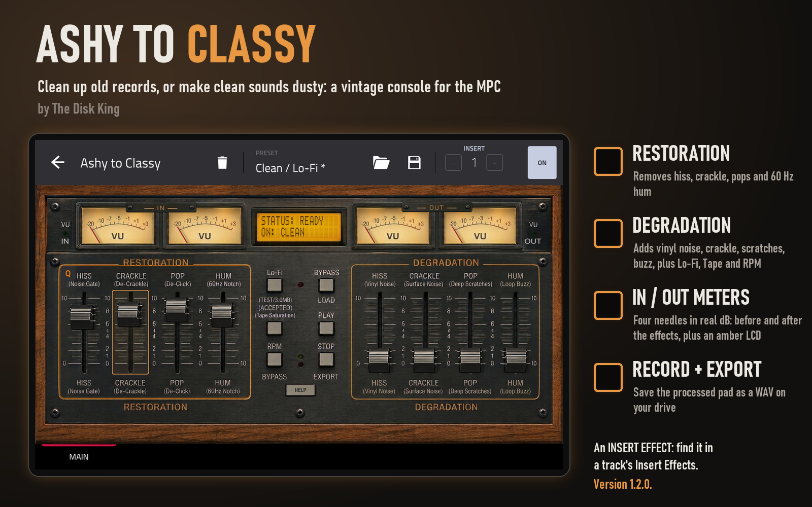
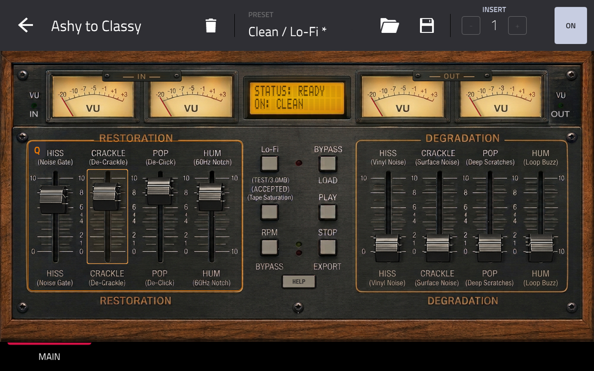
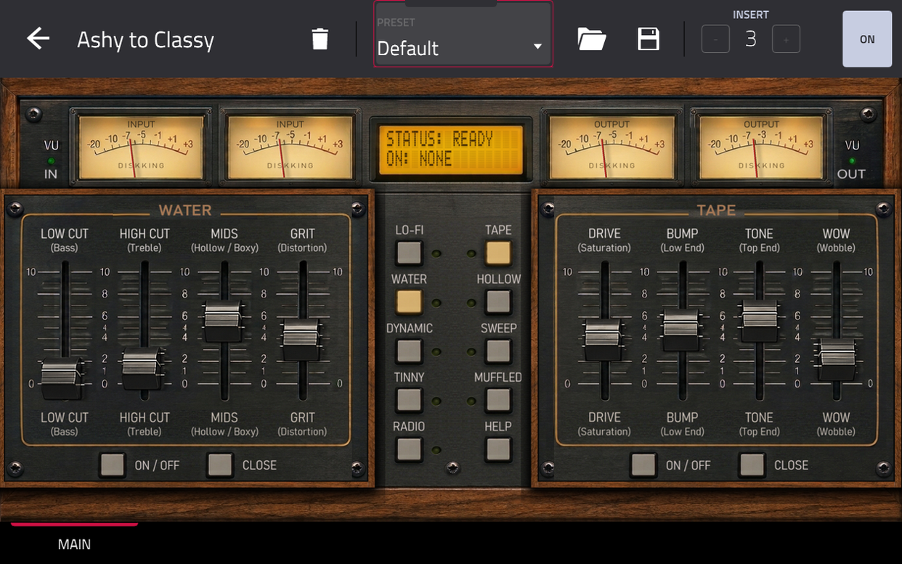
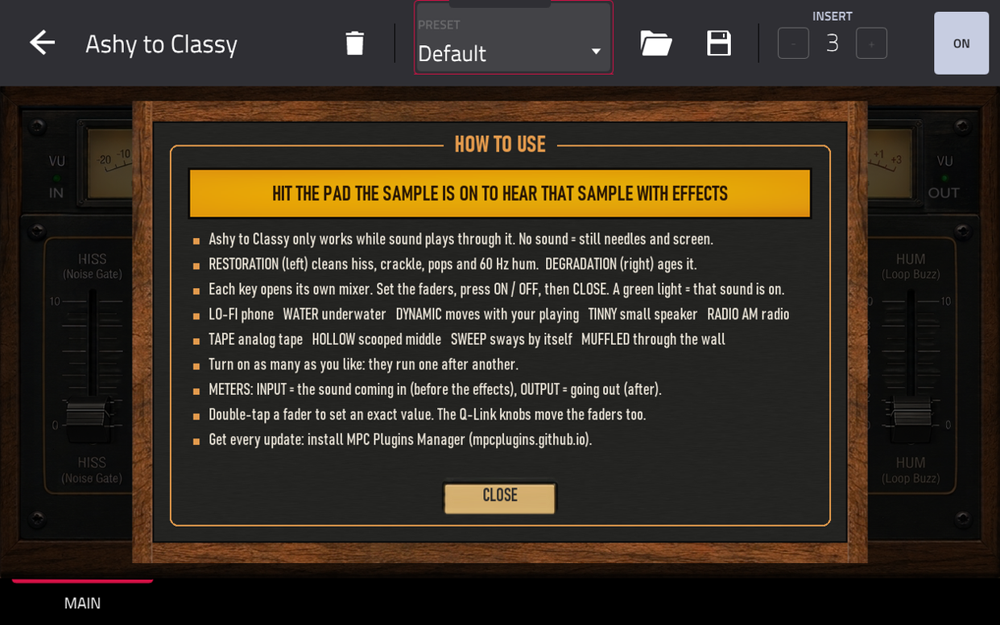

# Ashy to Classy (The Disk King)

A vintage console for Akai MPC standalone hardware. The left side **cleans up old records** (hiss, crackle, pops,
60 Hz hum). The right side **makes clean sounds dusty** (vinyl noise, surface crackle, deep scratches, loop buzz).
In the middle are **ten keys**: eight filters (LO-FI, WATER, DYNAMIC, TINNY, RADIO, HOLLOW, SWEEP, MUFFLED), a real
analog **TAPE**, and HELP. Every key opens its own little mixer with four faders, and you can stack as many as you like.
Four INPUT / OUTPUT meters and an amber 16 x 2 LCD show what is going on.

**Version 2.0.0. Tested on Gen 1 (Akai MPC X SE) and Gen 2 (Akai MPC Live III), MPC OS 3.10.1. Use at your own risk.**

## This is an EFFECT: find it in Insert Effects

Ashy to Classy is an **insert effect**, not an instrument, so it is **not** in the list you get when you add a
Plugin track. To use it:

1. Pick the track (or program) with your sample on it.
2. Open the **Mixer** (or the track's **Insert Effects**) and tap an empty **Insert** slot.
3. Choose **External Plugins → The Disk King → Ashy to Classy**. Tap the slot's edit (pencil) icon to see the console.
4. **Hit the pad the sample is on** to hear that sample with the effects. The plugin only runs while sound plays
   through it: with no sound, the needles and the screen stand still. Tap **HELP** on the console any time.

**Where you put it decides what it hears:** on a pad = that sample only, on a track = the whole track, on the
Master = the whole beat.

## Download

 Gen 1, Gen 2 and works-on-both downloads of every version, added up.

**Gen 1** (32-bit): MPC Live, Live II, One, One+, X, Key 61, Key 37, Force

**Gen 2** (64-bit): MPC Live III, XL

**Get updates automatically:** a zip you download by hand never updates itself. Install **[MPC Plugins Manager](https://mpcplugins.github.io/p/mpc-plugins-manager/)** once on your MPC: it shows when a new version of Ashy to Classy is out and installs it in one tap.

**Easiest:** on your MPC, open **MPC Plugins Manager**, find **Ashy to Classy** and tap **Install**.

**By hand, step by step:**
1. Click the **DOWNLOAD** button above. A file called `Ashy-to-Classy-2.0.0-mpc-sdk.zip` lands in your **Downloads** folder.
2. Unzip it. On Windows: right-click the file, then **Extract All**. On a Mac: double-click it.
3. Connect your MPC to the computer with its USB cable and switch it to **Computer Mode**, so its **internal drive** shows up on the computer.
4. On the MPC's internal drive, open the folder **VST2 Plugins** (make it if it is not there).
5. Copy the folder **The Disk King - VST - Ashy to Classy** from the unzipped files into **VST2 Plugins**.
6. On the MPC: **Preferences → Enhancements (Beta)** → turn on **Enable Enhancements** and **External Plugin Support** (needs MPC OS 3.10.1 or later). Restart the MPC.
7. Put it on a track's **Insert Effects** (see above) and hit the pad.

## Screens

| | |
|---|---|
|  |  |
|  | |

## What is in 2.0.0

- **Restoration faders (0-10):** HISS (spectral noise reduction), CRACKLE (de-crackle), POP (de-click), HUM (60 Hz notch and
  its harmonics).
- **Degradation faders (0-10):** vinyl noise, surface crackle, deep scratches (one per turn at 33 1/3 rpm), loop buzz.
  The added noise only plays **while your music plays**: no sound in, no noise out.
- **Ten keys in the middle.** Tap a key and its **mixer** opens over that side of the console (left keys on the left,
  right keys on the right): four faders, **ON / OFF** and **CLOSE**. A **green light** beside a key = that sound is on.
  Turn on as many as you like: they run one after another.
  - **LO-FI**: telephone sound (the 300 Hz to 3.4 kHz phone band).
  - **WATER**: underwater, muffled and grainy.
  - **DYNAMIC**: a filter that opens and closes with your playing (SENS, RANGE, SPEED, PEAK).
  - **TINNY**: a cheap little speaker, no bass.
  - **RADIO**: an old AM radio.
  - **HOLLOW**: the middle scooped out, ghostly and phasey.
  - **SWEEP**: a filter that sways by itself, smooth or in steps (RATE, DEPTH, CENTER, SHAPE).
  - **MUFFLED**: music through the wall, only the low end.
  - The six still filters share the same four faders: **LOW CUT**, **HIGH CUT**, **MIDS** (down = hollow, up = boxy) and
    **GRIT** (overdrive and digital crunch). Each key keeps its own settings and starts on a sound that already works.
  - **TAPE**: real analog tape: **DRIVE** (saturation that hits the highs first, like tape), **BUMP** (the low-end head
    bump), **TONE** (top roll-off) and **WOW** (wow and flutter).
- **Four level meters in real dB** (0 = full scale, red = over): the **INPUT** pair shows the sound coming in (before the
  effects), the **OUTPUT** pair shows it going out (after).
- **16 x 2 amber LCD:** status, everything that is on, and the value of any fader you move.
- **Presets move the faders and keys** on the panel. 16 presets: Default (everything off), Clean / Lo-Fi, Restore Only,
  Dusty 45, Worn Record, SP Crunch, Tape Warmth, Hot Tape, Old Radio, Long Distance, Water, Dynamic, Tinny, Hollow,
  Sweep, Muffled. Every sound a preset makes, you can make yourself with the faders and keys.
- **HELP** pop-up, Q-Links mapped to all eight console faders.
- **Gone in 2.0.0:** BYPASS (use the MPC's own **ON** key in the plugin header), PLAY / STOP-EXPORT (resample on the
  MPC instead) and RPM (its wobble is now TAPE's **WOW** fader). Your old projects still open.

## Older versions

- [1.2.1](https://github.com/mpcplugins/community-plugins/releases/tag/ashy-to-classy-v1.2.1): cleaner panels, a small look update to 1.2.
- [1.2.0](https://github.com/mpcplugins/community-plugins/releases/tag/ashy-to-classy-v1.2.0): new console art, IN / OUT meters, 16 x 2 LCD.
- [1.0.0](https://github.com/mpcplugins/community-plugins/releases/tag/ashy-to-classy-v1.0.0): first release (two meters, 20 x 2 LCD).

## Known limits

- Crackle and pop removal is gentle: it takes the edge off, but heavy crackle is still audible. A stronger
  de-crackler is planned.
- The plugin only runs while sound plays through it (that is how the MPC runs insert effects).

## Disclaimer

Provided as is, with no warranty of any kind. Use entirely at your own risk; The Disk King is not responsible in any way
for any loss, damage or problem from using it.

More MPC sounds: https://thediskking.com
