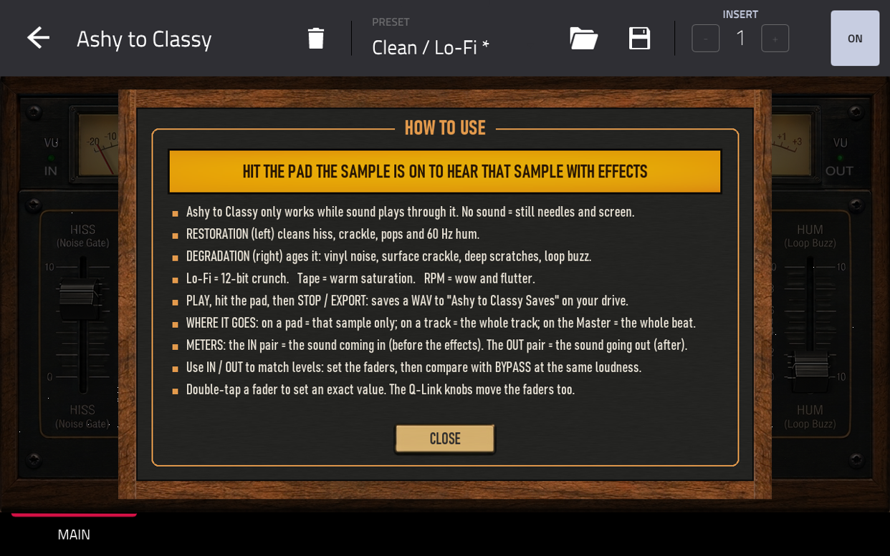

# Ashy to Classy (The Disk King)

A vintage console for Akai MPC standalone hardware. The left side **cleans up old records** (hiss, crackle, pops,
60 Hz hum). The right side **makes clean sounds dusty** (vinyl noise, surface crackle, deep scratches, loop buzz).
It also has Lo-Fi, Tape and RPM switches, four IN / OUT level meters and an amber 16 x 2 LCD.

**Version 1.2.1. Tested on an Akai MPC Live III (MPC OS 3.10.1). Use at your own risk.**

## This is an EFFECT: find it in Insert Effects

Ashy to Classy is an **insert effect**, not an instrument, so it is **not** in the list you get when you add a
Plugin track. To use it:

1. Pick the track (or program) with your sample on it.
2. Open the **Mixer** (or the track's **Insert Effects**) and tap an empty **Insert** slot.
3. Choose **External Plugins → The Disk King → Ashy to Classy**. Tap the slot's edit (pencil) icon to see the console.
4. **Hit the pad the sample is on** to hear that sample with the effects. The plugin only runs while sound plays
   through it: with no sound, the needles and the screen stand still. Tap **HELP** on the console any time.

**Where you put it decides what it hears:** on a pad = that sample only, on a track = the whole track, on the
Master = the whole beat.

## Download

**Easiest:** on your MPC, open **MPC Plugins Manager**, find **Ashy to Classy** and tap **Install**.

**By hand, step by step:**
1. Click the **DOWNLOAD** button above. A file called `Ashy-to-Classy-1.2.1-mpc-sdk.zip` lands in your **Downloads** folder.
2. Unzip it. On Windows: right-click the file, then **Extract All**. On a Mac: double-click it.
3. Connect your MPC to the computer with its USB cable and switch it to **Computer Mode**, so its **internal drive** shows up on the computer.
4. On the MPC's internal drive, open the folder **VST2 Plugins** (make it if it is not there).
5. Copy the folder **The Disk King - VST - Ashy to Classy** from the unzipped files into **VST2 Plugins**.
6. On the MPC: **Preferences → Enhancements (Beta)** → turn on **Enable Enhancements** and **External Plugin Support** (needs MPC OS 3.10.1 or later). Restart the MPC.
7. Put it on a track's **Insert Effects** (see above) and hit the pad.

## Screens

| | |
|---|---|
|  |  |

## What is in 1.2.1

- **Restoration faders (0-10):** HISS (spectral noise reduction), CRACKLE (de-crackle), POP (de-click), HUM (60 Hz notch and
  its harmonics).
- **Degradation faders (0-10):** vinyl noise, surface crackle, deep scratches (one per turn at 33 1/3 rpm), loop buzz.
- **Lo-Fi** (12 kHz / 12-bit crunch), **Tape** (warm saturation), **RPM** (wow and flutter), **Bypass**.
- **Four level meters in real dB** (0 = full scale, red = over): the **IN** pair shows the sound coming in (before the
  effects), the **OUT** pair shows it going out (after). IN / OUT lights, plus a clip light.
- **16 x 2 amber LCD:** status, what is on, and the value of any fader you move.
- **Record and export:** tap PLAY, hit the pad, then STOP / EXPORT. A WAV is saved to `Ashy to Classy Saves` on the drive.
- **HELP** pop-up, Q-Links mapped to all eight faders (no outline drawn over the panels), 7 presets.

## Older versions

- [1.2.0](https://github.com/mpcplugins/community-plugins/releases/tag/ashy-to-classy-v1.2.0): new console art, IN / OUT meters, 16 x 2 LCD.
- [1.0.0](https://github.com/mpcplugins/community-plugins/releases/tag/ashy-to-classy-v1.0.0): first release (two meters, 20 x 2 LCD).

## Known limits

- Crackle and pop removal is gentle: it takes the edge off, but heavy crackle is still audible. A stronger
  de-crackler is planned.
- The plugin only runs while sound plays through it (that is how the MPC runs insert effects).

## Disclaimer

Provided as is, with no warranty of any kind. Use entirely at your own risk; The Disk King is not responsible in any way
for any loss, damage or problem from using it.

More MPC sounds: https://thediskking.com
