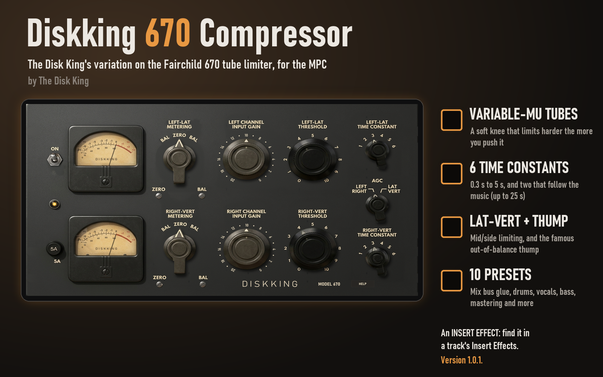
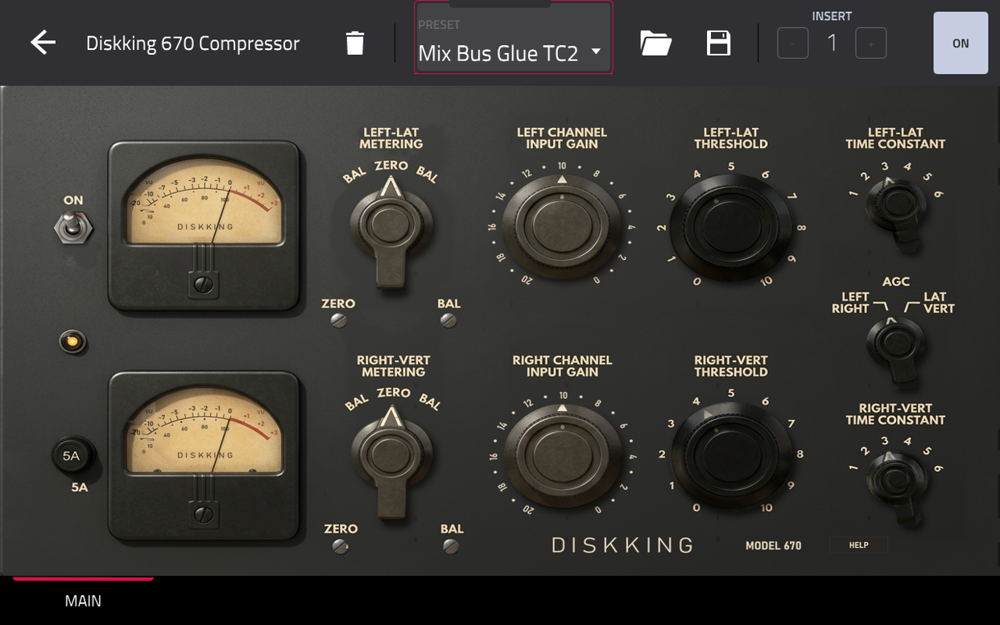
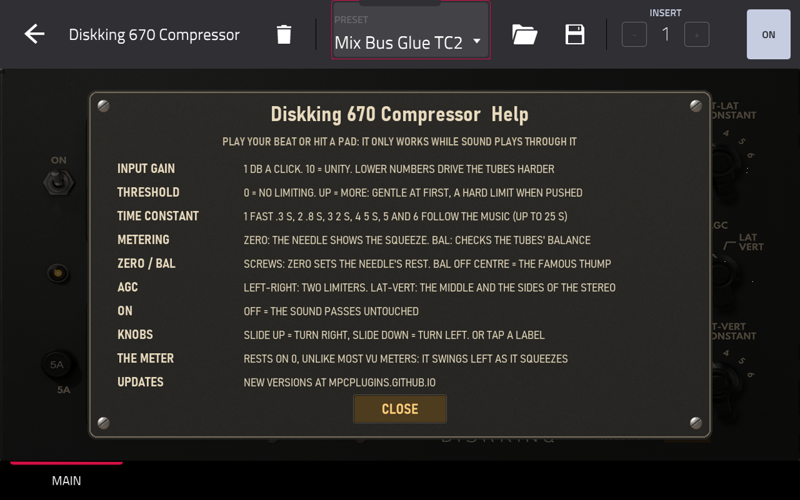

# Diskking 670 Compressor (The Disk King)

**The Disk King's variation on the Fairchild 670**, the classic 1959 two-channel variable-mu tube limiter,
for Akai MPC standalone hardware. Put it on your Master for glue, on drums to squash them, or on a vocal to level it.
It does what the real unit is known for:
- a very soft knee that limits harder the more you push it;
- six TIME CONSTANT settings, two of which follow the music;
- LAT-VERT mid/side limiting;
- the famous "thump" when the tubes are out of balance;
- gain-reduction meters.

**Version 1.0.1. Tested on an Akai MPC Live III (MPC OS 3.10.1). Use at your own risk.**

## This is an EFFECT: find it in Insert Effects

Diskking 670 Compressor is an **insert effect**, not an instrument. To use it:

1. Open the **Mixer** (or a track's / pad's **Insert Effects**) and tap an empty **Insert** slot.
2. Choose **External Plugins → The Disk King → Diskking 670 Compressor**. Tap the slot's edit (pencil) icon to see the panel.
3. Pick a preset from the **preset name at the top of the plugin window** (it starts on **Mix Bus Glue TC2**), then play.
4. Tap **HELP** on the panel any time.

**Where you put it decides what it squeezes:** on a pad = that sample only, on a track = the whole track, on the
**Master** insert = your whole beat.

## Download

 

**Get updates automatically:** a zip you download by hand never updates itself. Install **[MPC Plugins Manager](https://mpcplugins.github.io/p/mpc-plugins-manager/)** once on your MPC: it shows when a new version of Diskking 670 Compressor is out and installs it in one tap.

**Easiest:** on your MPC, open **MPC Plugins Manager**, find **Diskking 670 Compressor** and tap **Install**.
New versions are listed at **[mpcplugins.github.io](https://mpcplugins.github.io/)** and in MPC Plugins Manager.

**By hand, step by step:**
1. Click the **DOWNLOAD** button above. A file called `Diskking-670-Compressor-1.0.1-mpc-sdk.zip` lands in your **Downloads** folder.
2. Unzip it. On Windows: right-click the file, then **Extract All**. On a Mac: double-click it.
3. Connect your MPC to the computer with its USB cable and switch it to **Computer Mode**, so its **internal drive** shows up on the computer.
4. On the MPC's internal drive, open the folder **VST2 Plugins** (make it if it is not there).
5. Copy the folder **The Disk King - VST - Diskking 670 Compressor** from the unzipped files into **VST2 Plugins**.
6. On the MPC: **Preferences → Enhancements (Beta)** → turn on **Enable Enhancements** and **External Plugin Support** (needs MPC OS 3.10.1 or later). Restart the MPC.
7. Put it in an **Insert Effects** slot (see above) and play.

## Screens

| | |
|---|---|
|  |  |

## Turning the knobs

**Slide your finger up to turn a knob right, slide down to turn it left.** On the few-step knobs (METERING,
TIME CONSTANT, AGC) you can also just **tap the label** you want (BAL / ZERO / BAL, 1 to 6, LEFT-RIGHT or LAT-VERT).
The Q-Link knobs work too.

## The meter rests on 0 (unlike most VU meters)

Like the real unit, the meters show **gain reduction**: how much the limiter is turning the sound down. The needle
**rests on 0** and **swings LEFT** as it squeezes: at -3 it is taking 3 dB off. It does not bounce up with the music
the way most VU meters do. No movement means no limiting (THRESHOLD is too low, or the sound is too quiet).

## The controls

Each channel has its own INPUT GAIN, THRESHOLD, TIME CONSTANT and METERING (the top row is the left or lateral
channel, the bottom row the right or vertical one).

| Control | What it does |
|---|---|
| INPUT GAIN (20 .. 0) | A stepped pad, **1 dB a click**. **10 = unity** (as on the real unit). Higher numbers turn the sound down before the tubes; lower numbers drive the tubes harder, so with THRESHOLD up you get more limiting. |
| THRESHOLD (0-10) | **0 = no limiting** (a clean tube line amp). Turn it up for more: gentle (about 2:1) at first, a hard limit (10:1 and more) when pushed. |
| TIME CONSTANT (1-6) | How fast it lets go. **1**: 0.3 s, **2**: 0.8 s, **3**: 2 s, **4**: 5 s. **5**: 2 s after a single peak, 10 s when the peaks keep coming. **6**: 0.3 s after a single peak, 10 s for many, 25 s under a steady loud sound. The attack is always very fast (0.2 to 0.8 ms). |
| METERING (BAL / ZERO / BAL) | **ZERO** = normal use: the needle shows the gain reduction. The two **BAL** positions check the tubes' balance. If the needle moves between them, the BAL screw is off centre. |
| ZERO / BAL screws | **ZERO** sets where the needle rests. **BAL** balances the tubes. Off centre, you get the famous low "thump" on every squeeze. Centred, there is no thump. |
| AGC (LEFT-RIGHT / LAT-VERT) | **LEFT-RIGHT**: two separate limiters, left and right. **LAT-VERT**: the middle (lateral) and the sides (vertical) of the stereo are limited separately. It was made for cutting stereo records, and it is great for gluing a mix without moving the centre. |
| ON | Off = the sound passes untouched (the pilot lamp goes out). |
| OUTPUT | Make-up gain, -12 to +12 dB (on a Q-Link). |

## Presets

The THRESHOLD numbers are where to start: turn it up or down until the needle swings as much as you want.

| Preset | INPUT GAIN | THRESHOLD | TIME CONSTANT | AGC | Use it on |
|---|---|---|---|---|---|
| Mix Bus Glue TC2 | 10 | 4 | 2 | LEFT-RIGHT | The whole beat: glue (loads first) |
| Lat-Vert Bus TC5 | 10 | 4 / 3 | 5 | LAT-VERT | The whole beat: glue that keeps the centre steady |
| Vocal Leveler TC1 | 9 | 6 | 1 | LEFT-RIGHT | Vocals: keeps them even |
| Drum Squash TC1 | 6 | 8 | 1 | LEFT-RIGHT | Drums: hard, fast squash |
| Mastering TC3 | 10 | 3 | 3 | LEFT-RIGHT | The Master, gently |
| Program Auto TC6 | 10 | 5 | 6 | LEFT-RIGHT | Whole songs: the release follows the music |
| Bass Smooth TC4 | 9 | 6 | 4 | LEFT-RIGHT | Bass: smooth and steady |
| Hard Limit TC2 | 8 | 9 | 2 | LEFT-RIGHT | Peaks: a hard limit |
| Thump (Out of Bal) | 9 | 7 | 1 | LEFT-RIGHT | The out-of-balance "thump" as an effect (BAL screws off centre) |
| Clean Line Amp | 10 | 0 | 3 | LEFT-RIGHT | No limiting: just the tubes and transformers |

## About the 670

The Fairchild 670 was designed by Rein Narma and built from 1959. It is a stereo version of the mono 660, with about
20 tubes per unit. Mastering and recording engineers used it for decades (Abbey Road used Fairchild limiters on Beatles records),
and today it is one of the most sought-after (and most expensive) pieces of studio gear. Diskking 670 follows the
original instruction manual for the time constants, the 1 dB input steps, unity at 10, LAT-VERT and the BAL / ZERO
adjustments, and adds the soft, growing variable-mu curve and the tube and transformer colour.

*Fairchild is a trademark of its owner. The Disk King is not affiliated with or endorsed by them; the name is used
only to say which classic unit Diskking 670 is modelled on.*

## What is new in 1.0.1

- New name on the MPC: **Diskking 670 Compressor** (was all capitals). If you have 1.0.0, delete the old folder **The Disk King - VST - DISKKING 670 Compressor** from **VST2 Plugins** (or remove it in MPC Plugins Manager).

## Older versions

- [1.0.0](https://github.com/mpcplugins/community-plugins/releases/tag/diskking-670-compressor-v1.0.0): first release (as DISKKING 670 Compressor).

## Known limits

- Like every MPC insert effect, it only works while sound plays through it.

## Disclaimer

Provided as is, with no warranty of any kind. Use entirely at your own risk; The Disk King is not responsible in any way
for any loss, damage or problem from using it.

More MPC sounds: https://thediskking.com
