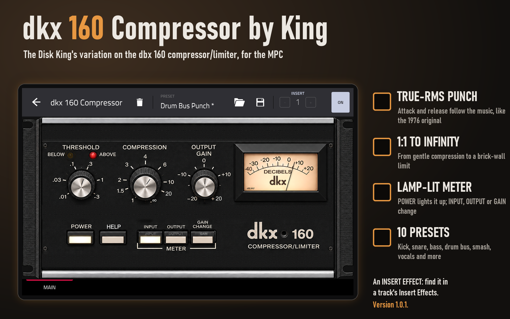
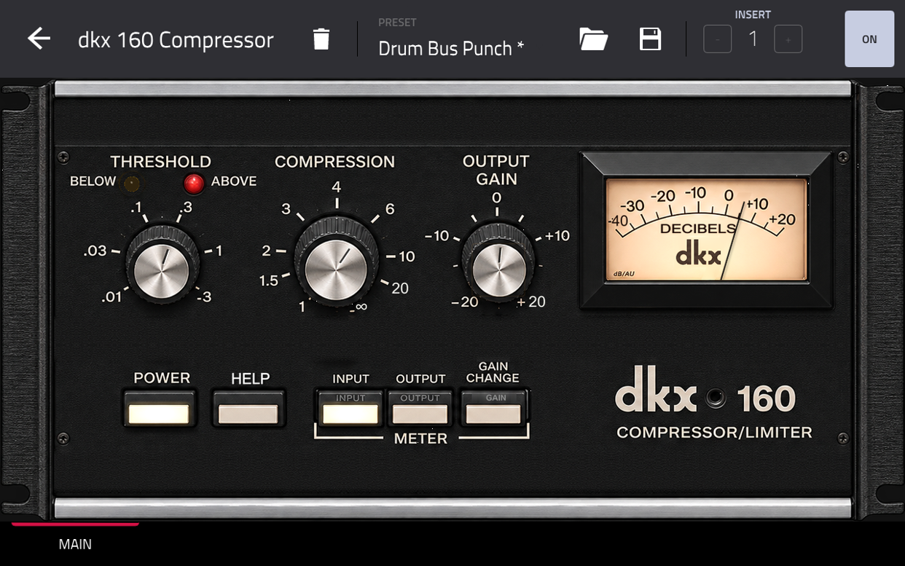
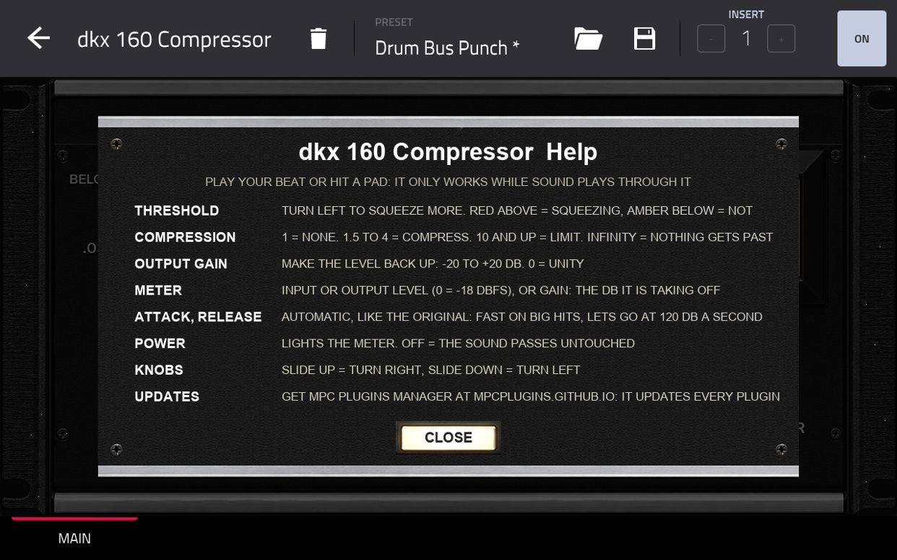

# dkx 160 Compressor (The Disk King)

**The Disk King X, dkx 160 Compressor, inspired by the dbx 160.** A classic 1976 VCA compressor/limiter for Akai MPC
standalone hardware. It is the punchy one: put it on kick, snare, bass or the drum bus. It has:
- true-RMS detection with no attack or release knobs: it follows the music on its own, just like the original;
- compression from 1:1 all the way to infinity;
- the amber BELOW / red ABOVE threshold lights;
- a lamp-lit meter that lights up when you press POWER.

**Version 1.0.1. Tested on Gen 1 (Akai MPC X SE) and Gen 2 (Akai MPC Live III), MPC OS 3.10.1. Use at your own risk.**

## This is an EFFECT: find it in Insert Effects

dkx 160 Compressor is an **insert effect**, not an instrument. To use it:

1. Open the **Mixer** (or a track's / pad's **Insert Effects**) and tap an empty **Insert** slot.
2. Choose **External Plugins → The Disk King → dkx 160 Compressor**. Tap the slot's edit (pencil) icon to see the panel.
3. Pick a preset from the **preset name at the top of the plugin window** (it starts on **Drum Bus Punch**), then play.
4. Tap **HELP** (next to POWER) any time.

**Where you put it decides what it squeezes:** on a pad = that sample only, on a track = the whole track, on the
**Master** insert = your whole beat.

## Download

**Gen 1** (32-bit): MPC Live, Live II, One, One+, X, Key 61, Key 37, Force

**Gen 2** (64-bit): MPC Live III, XL

**Get updates automatically:** a zip you download by hand never updates itself. Install **[MPC Plugins Manager](https://mpcplugins.github.io/p/mpc-plugins-manager/)** once on your MPC: it shows when a new version of dkx 160 Compressor is out and installs it in one tap.

**Easiest:** on your MPC, open **MPC Plugins Manager**, find **dkx 160 Compressor** and tap **Install**.

**By hand, step by step:**
1. Click the **DOWNLOAD** button above. A file called `dkx-160-Compressor-1.0.1-mpc-sdk.zip` lands in your **Downloads** folder.
2. Unzip it. On Windows: right-click the file, then **Extract All**. On a Mac: double-click it.
3. Connect your MPC to the computer with its USB cable and switch it to **Computer Mode**, so its **internal drive** shows up on the computer.
4. On the MPC's internal drive, open the folder **VST2 Plugins** (make it if it is not there).
5. Copy the folder **The Disk King - VST - dkx 160 Compressor** from the unzipped files into **VST2 Plugins**.
6. On the MPC: **Preferences → Enhancements (Beta)** → turn on **Enable Enhancements** and **External Plugin Support** (needs MPC OS 3.10.1 or later). Restart the MPC.
7. Put it in an **Insert Effects** slot (see above) and play.

## Screens

| | |
|---|---|
|  |  |

## Turning the knobs

**Slide your finger up to turn a knob right, slide down to turn it left.** The Q-Link knobs work too
(THRESHOLD, COMPRESSION, OUTPUT GAIN, METER).

## The controls

| Control | What it does |
|---|---|
| THRESHOLD (.01 .. 3 volts) | Where it starts to squeeze. **Turn it left to squeeze more.** The dial is in volts, like the original: .01 V (10 mV) is the most squeeze, 3 V the least (0 VU = 1.23 V = -18 dBFS). |
| BELOW / ABOVE lights | **Amber BELOW** = the sound is under the threshold (no squeezing). **Red ABOVE** = it is squeezing. Right at the threshold both glow dimly, just like the manual says. |
| COMPRESSION (1 .. ∞) | The ratio. **1** = none, **1.5 to 4** = compression, **10 and up** = limiting, **∞** = nothing gets past the threshold. |
| OUTPUT GAIN (-20 .. +20 dB) | Brings the level back up after squeezing. 0 = unity. It does not change how much it squeezes. |
| METER: INPUT / OUTPUT / GAIN | **INPUT** or **OUTPUT** = the level (0 = -18 dBFS, like 0 VU). **GAIN** = how many dB it is taking off (the needle moves left as it squeezes). The selected button glows. |
| POWER | **Lights the meter** (and the threshold lights). Off = the meter goes dark and the sound passes untouched. |
| HELP | Opens the help card. |
| Attack and release | Automatic, like the original: faster the bigger the jump (about 15 ms for 10 dB, 5 ms for 20 dB, 3 ms for 30 dB), and it lets go at about 120 dB per second. That is the 160's punch. |

## Presets

Start here, then turn **THRESHOLD** until the red ABOVE light flickers on the hits and the meter (GAIN) shows the
squeeze you like.

| Preset | THRESHOLD | COMPRESSION | OUTPUT GAIN | Use it on |
|---|---|---|---|---|
| Drum Bus Punch | 0.77 V | 3:1 | +4 dB | The drum bus: punch and glue (loads first) |
| Kick Punch | 1 V | 4:1 | +4 dB | Kick: snap and weight |
| Snare Crack | 0.62 V | 4:1 | +5 dB | Snare: crack and body |
| Bass Leveler | 0.49 V | 6:1 | +6 dB | Bass: even, steady notes |
| Vocal Leveler | 0.39 V | 3:1 | +5 dB | Vocals: keeps them even |
| Drum Smash | 0.15 V | 20:1 | +12 dB | Drums: crushed and pumping |
| Mix Bus Gentle | 1.2 V | 1.5:1 | +1.5 dB | The whole beat: light glue |
| Peak Limiter 10:1 | 2.5 V | 10:1 | +3 dB | Catches the peaks only |
| Hard Limit Inf | 2 V | ∞ | +6 dB | Nothing gets past: loud and flat |
| Clean Line Amp | 3 V | 1:1 | 0 dB | No compression: the manual's "line amplifier" setting |

## About the 160

dbx brought out the 160 in 1976. It was one of the first compressors with **true RMS detection** (it reacts to
loudness the way your ear does) and **feed-forward** gain control, which made "infinite" compression possible without
going unstable. It needs no attack or release knobs, because they follow the music by themselves. It became a studio
favourite for **kick, snare and bass**. dkx 160 follows the original instruction manual:
- the threshold dial in volts (10 mV to 3 V);
- compression from 1:1 to infinity (about 120:1);
- ±20 dB of output gain;
- the amber and red threshold lights;
- the lamp-lit -40 .. +20 meter reading input, output or gain change;
- the published attack figures and the 120 dB/s release.

*dbx is a trademark of its owner. The Disk King is not affiliated with or endorsed by them; the name is used only to
say which classic unit dkx 160 is inspired by. The dkx logo is The Disk King's own.*

## What is new in 1.0.1

- **Presets move the panel:** pick a preset and the knobs, switches and buttons on the panel go to its settings (OUTPUT, THRESHOLD and COMPRESSION knobs, POWER and the meter switch).
- **Starts on Default:** a new "Default" preset (nothing set) is first, and the plugin loads on it until you pick a preset.
- Everything else as in 1.0.0. Your projects still open.

## Older versions

- [1.0.0](https://github.com/mpcplugins/community-plugins/releases/tag/dkx-160-compressor-v1.0.0): first release.

## Known limits

- Like every MPC insert effect, it only works while sound plays through it.
- One shared detector for left and right (stereo-linked), so the stereo picture stays put. (The original was a mono unit.)

## Disclaimer

Provided as is, with no warranty of any kind. Use entirely at your own risk; The Disk King is not responsible in any way
for any loss, damage or problem from using it.

More MPC sounds: https://thediskking.com
