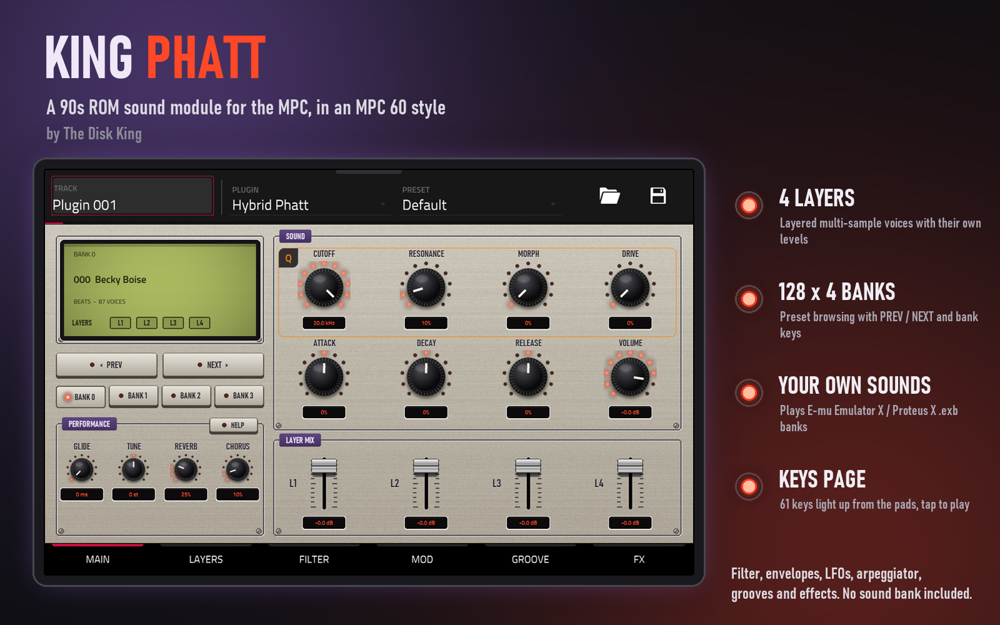
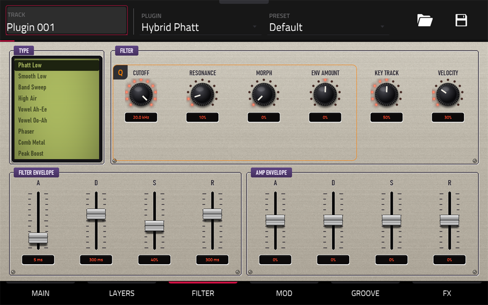
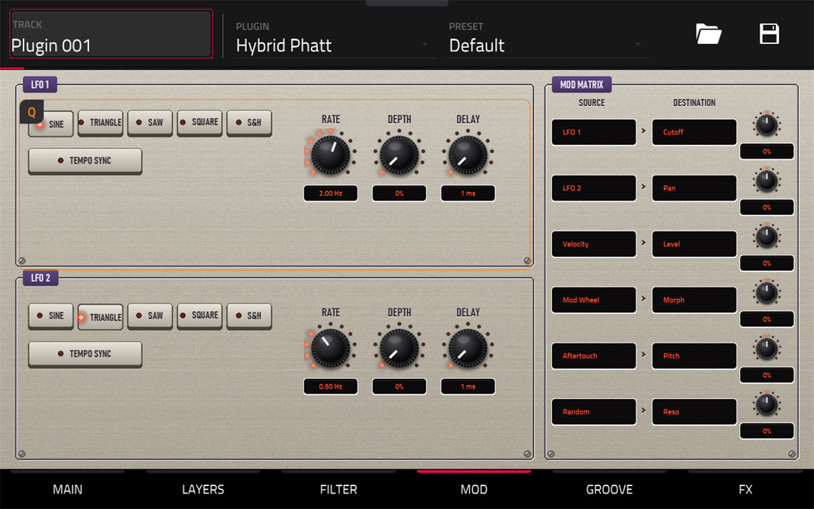
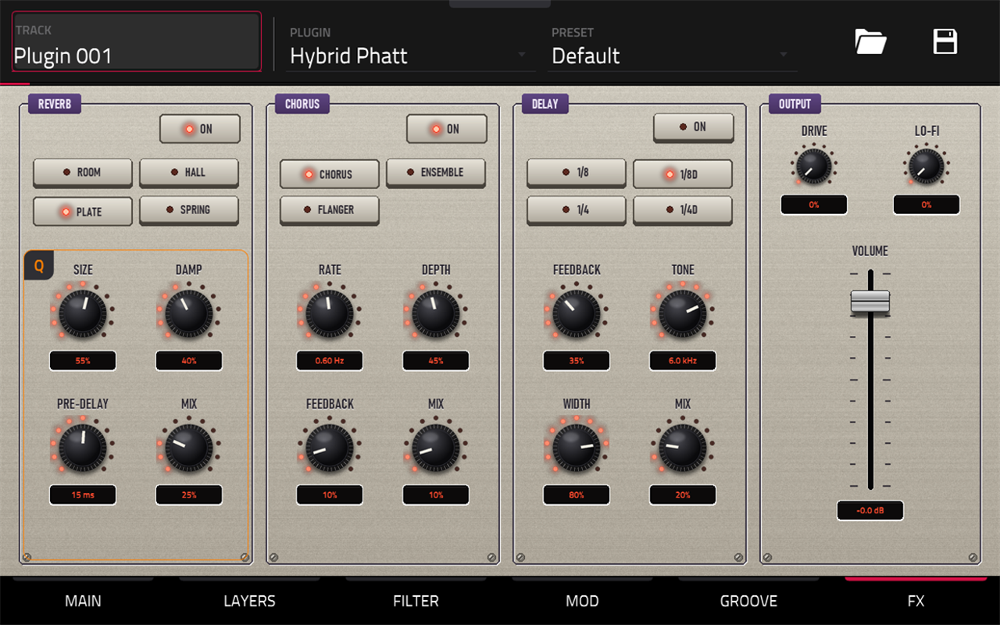

# Hybrid Phatt (The Disk King)

A 90s-style ROM sound module for Akai MPC standalone hardware, in the spirit of the classic hip-hop / R&B rack modules: layered multi-sample voices, a big backlit LCD, and a hardware-style screen that crosses an old MPC 60 with a 90s sound module.

**Version 0.2.0 — beta. Tested on Gen 1 (Akai MPC X SE) and Gen 2 (Akai MPC Live III), MPC OS 3.10.1. Use at your own risk.**

## Download

**Gen 1** (32-bit): MPC Live, Live II, One, One+, X, Key 61, Key 37, Force

**Gen 2** (64-bit): MPC Live III, XL

**Get updates automatically:** a zip you download by hand never updates itself. Install **[MPC Plugins Manager](https://mpcplugins.github.io/p/mpc-plugins-manager/)** once on your MPC: it shows when a new version of Hybrid Phatt is out and installs it in one tap.

**Easiest:** on your MPC, open **MPC Plugins Manager**, find **Hybrid Phatt** and tap **Install**.

**By hand, step by step:**
1. Click the **DOWNLOAD** button above. A file called `Hybrid-Phatt-0.2.0-mpc-sdk.zip` lands in your **Downloads** folder.
2. Unzip it. On Windows: right-click the file, then **Extract All**. On a Mac: double-click it.
3. Connect your MPC to the computer with its USB cable and switch it to **Computer Mode**, so its **internal drive** shows up on the computer.
4. On the MPC's internal drive, open the folder **VST2 Plugins** (make it if it is not there).
5. Copy the folder **The Disk King - VST - Hybrid Phatt** from the unzipped files into **VST2 Plugins**.
6. On the MPC: **Preferences → Enhancements (Beta)** → turn on **Enable Enhancements** and **External Plugin Support** (needs MPC OS 3.10.1 or later). Restart the MPC.
7. Add a **Plugin track** and pick **Hybrid Phatt**.

## All screens

| | |
|---|---|
|  |  |
|  |  |
|  |  |

## What is new in 0.2

- **KEYS page (7th tab):** an on-screen keyboard with Key 61 and Key 37 ranges. Hit a pad and the matching key lights up; tap a key on the screen to play it (handy on an MPC with no keys, like the Live III).
- **HELP popup** on the MAIN page: where the sounds come from and how to load your own bank.
- **Load your own E-mu bank:** put it in a folder named `Hybrid Phatt Sets` at the top of any MPC drive (internal, SSD or USB):
  `Hybrid Phatt Sets / My Bank / My Bank.exb` and `Hybrid Phatt Sets / My Bank / SamplePool / (the .ebl files)`.
- LCD shows **LAYERS L1-L4**: lit when a layer is used, flashing while it plays. Bank line reads "Hybrid Phatt bank".
- Knob and fader values show their units (Hz, ms, dB, semitones).
- PREV / NEXT step one preset per tap and no longer stick down.

## Also in Hybrid Phatt

- Pages: **MAIN, LAYERS, FILTER, MOD, GROOVE, FX, KEYS**, with LED-ring knobs, vertical chrome faders, lit keys and a backlit LCD. Q-Links mapped in groups of four on every page.
- A sample-bank engine that plays an E-mu Emulator X style bank: 4 banks of 128 presets, every voice with its key and velocity splits, root keys, tuning, volume, pan, filter and 6-stage envelope, grouped into 4 layers.

## Not yet

- **No sound bank is included** (copyright). Without one the plugin plays a simple test saw and the LCD says "SOUND BANK NOT FOUND". Load your own .exb as above.
- The MOD, GROOVE and FX pages are on screen but do not change the sound yet.

## Disclaimer

Provided as is, with no warranty of any kind. Use entirely at your own risk; The Disk King is not responsible in any way for any loss, damage or problem from using it.

More MPC sounds: https://thediskking.com
