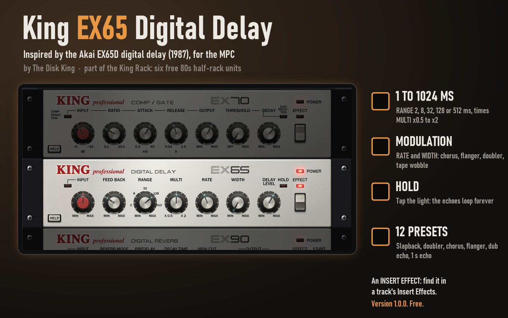
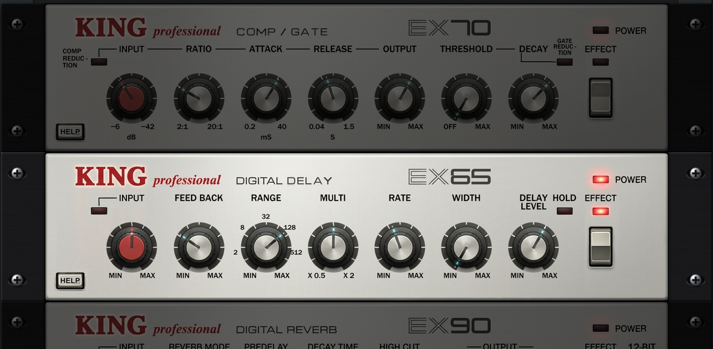
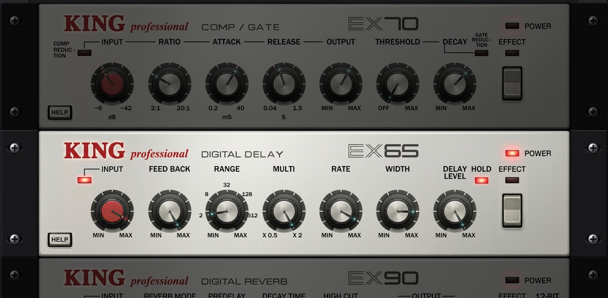
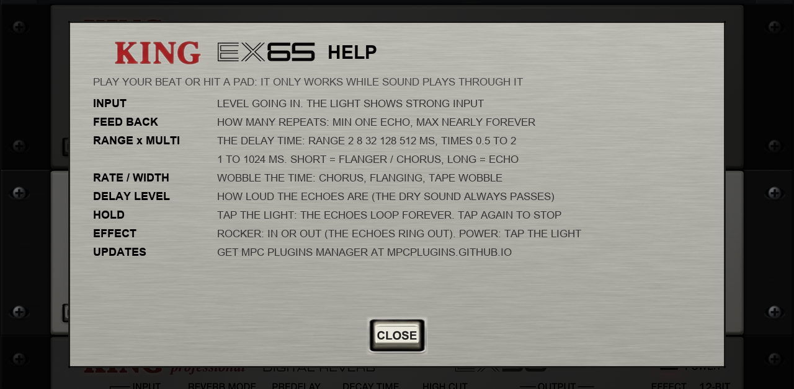

# King EX65 (The Disk King)

**King EX65 by The Disk King: Inspired by the Akai EX65D digital delay (1987).** A half-rack 80s digital delay for Akai MPC standalone hardware, in the King Rack. It has:
- delay time = **RANGE** (2, 8, 32, 128, 512 ms click stops) x **MULTI** (x0.5 to x2): 1 to 1024 ms, Akai's own figures;
- **FEED BACK**, and **RATE** / **WIDTH** modulation for chorus, flanging, doubling and tape wobble;
- **HOLD**: tap the light and the echoes loop forever (a footswitch on the original);
- **DELAY LEVEL**, an **INPUT** knob with its light, an **EFFECT** rocker (the echoes ring out), **POWER** and **HELP**.

**Version 1.0.0. Tested on Gen 1 (Akai MPC X SE) and Gen 2 (Akai MPC Live III), MPC OS 3.10.1. Free. Use at your own risk.**

## The King Rack: get the whole bundle, free

King EX65 is one of the six units of **[The King Rack](../king-rack/)**. Back in 1987-88 Akai made a little family of half-rack studio effects, the **EX series**: a delay, a compressor/gate, a noise reduction, an enhancer, a parametric EQ and a reverb, each with a handful of knobs and a red EFFECT light. The King Rack brings all six to the MPC, each one rebuilt from photos of the real unit and Akai's own published figures. It was made for fun, trying to get as close as possible to the original sound. All six are free.

On the MPC they all sit in the same rack: the one you load is lit in the middle, its neighbours stay in the rack
above and below it, darkened. Get them all:

| Unit | | Inspired by | Download |
|---|---|---|---|
| **[King EX90](../king-ex90/)** | Digital Reverb | after the Akai EX90R (1988) |  |
| **[King EX85](../king-ex85/)** | Parametric EQ | after the Akai EX85P (1987) |  |
| **[King EX80](../king-ex80/)** | Enhancer | after the Akai EX80E (1987) |  |
| **[King EX75](../king-ex75/)** | Noise Reduction | after the Akai EX75N (1987) |  |
| **[King EX70](../king-ex70/)** | Comp / Gate | after the Akai EX70C (1987) |  |
| **[King EX65](../king-ex65/)** (this one) | Digital Delay | after the Akai EX65D (1987) |  |

## This is an EFFECT: find it in Insert Effects

King EX65 is an **insert effect**, not an instrument. To use it:

1. Open the **Mixer** (or a track's / pad's **Insert Effects**) and tap an empty **Insert** slot.
2. Choose **External Plugins → The Disk King → King EX65**. Tap the slot's edit (pencil) icon to see the panel.
3. Pick a preset from the **preset name at the top of the plugin window**, then play.
4. Press **HELP** (bottom left of the panel) any time.

**Where you put it decides what it echoes:** on a pad = that sample, on a track = the whole track.
## Download

**Gen 1** (32-bit): MPC Live, Live II, One, One+, X, Key 61, Key 37, Force

**Gen 2** (64-bit): MPC Live III, XL

**Get updates automatically:** a zip you download by hand never updates itself. Install **[MPC Plugins Manager](https://mpcplugins.github.io/p/mpc-plugins-manager/)** once on your MPC: it shows when a new version of King EX65 is out and installs it in one tap.

**Easiest:** on your MPC, open **MPC Plugins Manager**, find **King EX65** and tap **Install**.

**By hand, step by step:**
1. Click the **DOWNLOAD** button above. A file called `King-EX65-1.0.0-mpc-sdk.zip` lands in your **Downloads** folder.
2. Unzip it. On Windows: right-click the file, then **Extract All**. On a Mac: double-click it.
3. Connect your MPC to the computer with its USB cable and switch it to **Computer Mode**, so its **internal drive** shows up on the computer.
4. On the MPC's internal drive, open the folder **VST2 Plugins** (make it if it is not there).
5. Copy the folder **The Disk King - VST - King EX65** from the unzipped files into **VST2 Plugins**.
6. On the MPC: **Preferences → Enhancements (Beta)** → turn on **Enable Enhancements** and **External Plugin Support** (needs MPC OS 3.10.1 or later). Restart the MPC.
7. Put it in an **Insert Effects** slot (see above) and play.
## Screens

| | | |
|---|---|---|
|  |  |  |
## Turning the knobs

**Slide your finger up to turn a knob right, slide down to turn it left.** RANGE clicks between its five stops. Q-Links: top row INPUT, FEED BACK, RANGE, MULTI; second row RATE, WIDTH, DELAY LEVEL, HOLD; third row EFFECT.

## Presets

The EX65D had no memory (all knobs), so these are standard delay, chorus and flanger settings made only from the knobs on the panel.

| Preset | Delay | FEED BACK | RATE / WIDTH | Use it on |
|---|---|---|---|---|
| Default | 128 ms | 30 % | - | A simple echo (loads first) |
| Slapback | 102 ms | 10 % | - | Vocals, guitars: the 50s slap |
| Doubler | 29 ms | 0 % | 0.6 Hz / 25 % | Fatten a vocal or synth |
| Chorus | 13 ms | 10 % | 0.8 Hz / 60 % | Keys, pads, guitars |
| Flanger | 3 ms | 60 % | 0.25 Hz / 80 % | Drums, hats, guitars |
| Jet Flange | 2 ms | 85 % | 0.12 Hz / 100 % | The big jet sweep |
| Metallic Comb | 4.8 ms | 90 % | - | Robot / metallic effects |
| Short Room | 58 ms | 45 % | - | A small room feel |
| Echo 256 | 256 ms | 35 % | - | Rhythmic echo |
| Dub Echo | 384 ms | 70 % | 0.3 Hz / 10 % | Dub throws |
| Tape Wobble | 307 ms | 50 % | 1.5 Hz / 30 % | Wobbly tape echo |
| Long Echo 1 s | 1024 ms | 45 % | - | The longest delay |

## About the EX65D

Akai's EX65D (1987), the digital delay of the EX series (Sound On Sound, January 1987: "up to one second delay time, feedback and modulation"). Akai's 1988-89 catalogue: delay time 1-1,024 ms, ranges 2, 8, 32, 128, 512 ms, delay frequency response 20 Hz-16 kHz. King EX65 follows those figures. Chosen by The Disk King (not published anywhere free): the RATE and WIDTH ranges and the most FEED BACK (95 %). The original is mono; King EX65 is stereo.

*Akai and EX65D are trademarks of their owner. The Disk King is not affiliated with or endorsed by them; the name is
used only to say which classic unit King EX65 is inspired by. The KING logo is The Disk King's own.*

## Known limits

- Like every MPC insert effect, it only works while sound plays through it.
- Moving RANGE or MULTI while echoes play glides the time (a pitch swoop), as tape-style delays do.

## Disclaimer

Provided as is, with no warranty of any kind. Use entirely at your own risk; The Disk King is not responsible in any way
for any loss, damage or problem from using it.

More MPC sounds: https://thediskking.com
