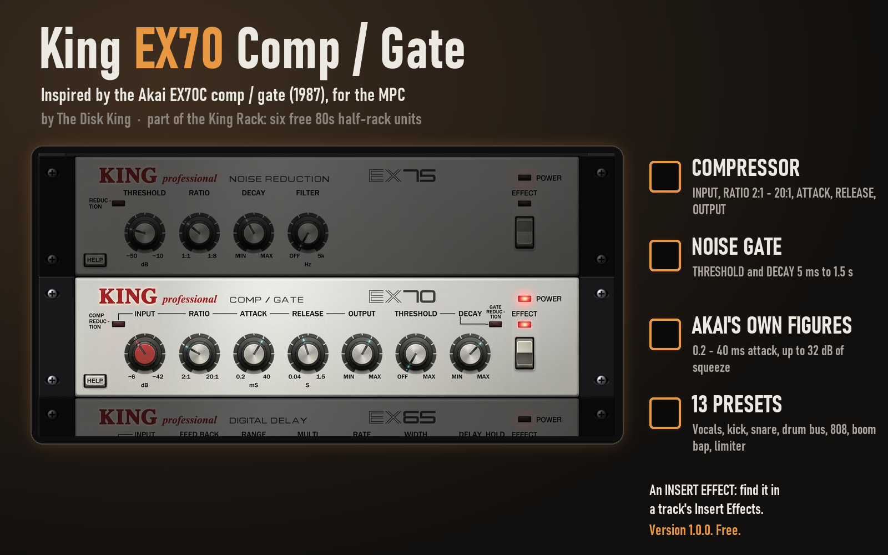
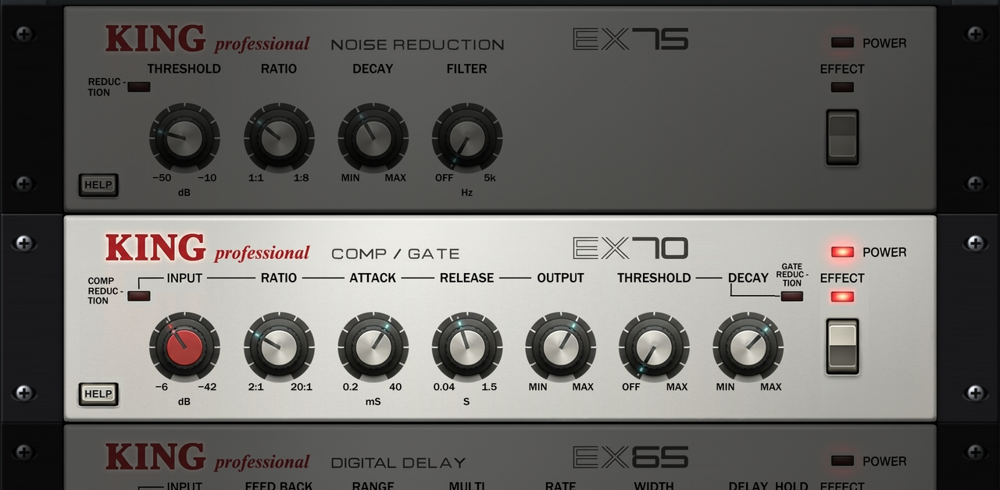
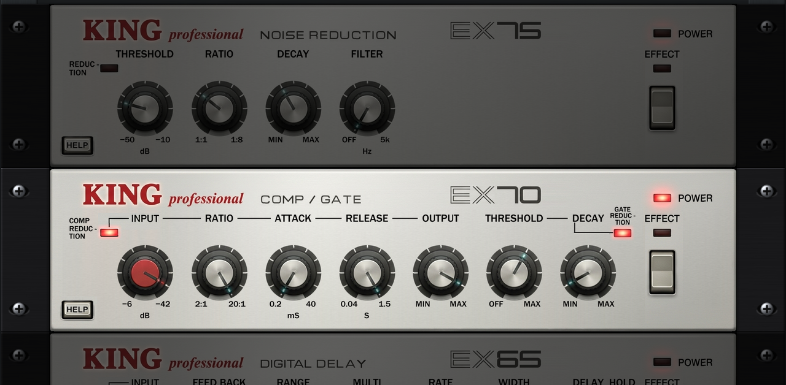
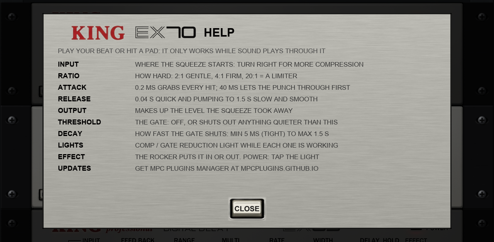

# King EX70 (The Disk King)

**King EX70 by The Disk King: Inspired by the Akai EX70C comp / gate (1987).** A half-rack 80s compressor and noise gate for Akai MPC standalone hardware, in the King Rack. It has:
- a compressor: **INPUT** (-6 to -42 dB), **RATIO** 2:1 to 20:1, **ATTACK** 0.2 to 40 ms, **RELEASE** 0.04 to 1.5 s, **OUTPUT**;
- at most 32 dB of compression (Akai's figure);
- a noise gate: **THRESHOLD** (OFF to MAX) and **DECAY** 5 ms to 1.5 s;
- **COMP REDUCTION** and **GATE REDUCTION** lights, an **EFFECT** rocker, **POWER** and a **HELP** card.

**Version 1.0.0. Tested on an Akai MPC Live III (MPC OS 3.10.1). Free. Use at your own risk.**

## The King Rack: get the whole bundle, free

King EX70 is one of the six units of **[The King Rack](../king-rack/)**. Back in 1987-88 Akai made a little family of half-rack studio effects, the **EX series**: a delay, a compressor/gate, a noise reduction, an enhancer, a parametric EQ and a reverb, each with a handful of knobs and a red EFFECT light. The King Rack brings all six to the MPC, each one rebuilt from photos of the real unit and Akai's own published figures. It was made for fun, trying to get as close as possible to the original sound. All six are free.

On the MPC they all sit in the same rack: the one you load is lit in the middle, its neighbours stay in the rack
above and below it, darkened. Get them all:

| Unit | | Inspired by | Download |
|---|---|---|---|
| **[King EX90](../king-ex90/)** | Digital Reverb | after the Akai EX90R (1988) |  |
| **[King EX85](../king-ex85/)** | Parametric EQ | after the Akai EX85P (1987) |  |
| **[King EX80](../king-ex80/)** | Enhancer | after the Akai EX80E (1987) |  |
| **[King EX75](../king-ex75/)** | Noise Reduction | after the Akai EX75N (1987) |  |
| **[King EX70](../king-ex70/)** (this one) | Comp / Gate | after the Akai EX70C (1987) |  |
| **[King EX65](../king-ex65/)** | Digital Delay | after the Akai EX65D (1987) |  |

## This is an EFFECT: find it in Insert Effects

King EX70 is an **insert effect**, not an instrument. To use it:

1. Open the **Mixer** (or a track's / pad's **Insert Effects**) and tap an empty **Insert** slot.
2. Choose **External Plugins → The Disk King → King EX70**. Tap the slot's edit (pencil) icon to see the panel.
3. Pick a preset from the **preset name at the top of the plugin window**, then play.
4. Press **HELP** (bottom left of the panel) any time.

**Where you put it decides what it squeezes:** on a pad = that sample, on a track = the whole track.
## Download

 

**Get updates automatically:** a zip you download by hand never updates itself. Install **[MPC Plugins Manager](https://mpcplugins.github.io/p/mpc-plugins-manager/)** once on your MPC: it shows when a new version of King EX70 is out and installs it in one tap.

**Easiest:** on your MPC, open **MPC Plugins Manager**, find **King EX70** and tap **Install**.

**By hand, step by step:**
1. Click the **DOWNLOAD** button above. A file called `King-EX70-1.0.0-mpc-sdk.zip` lands in your **Downloads** folder.
2. Unzip it. On Windows: right-click the file, then **Extract All**. On a Mac: double-click it.
3. Connect your MPC to the computer with its USB cable and switch it to **Computer Mode**, so its **internal drive** shows up on the computer.
4. On the MPC's internal drive, open the folder **VST2 Plugins** (make it if it is not there).
5. Copy the folder **The Disk King - VST - King EX70** from the unzipped files into **VST2 Plugins**.
6. On the MPC: **Preferences → Enhancements (Beta)** → turn on **Enable Enhancements** and **External Plugin Support** (needs MPC OS 3.10.1 or later). Restart the MPC.
7. Put it in an **Insert Effects** slot (see above) and play.
## Screens

| | | |
|---|---|---|
|  |  |  |
## Turning the knobs

**Slide your finger up to turn a knob right, slide down to turn it left.** Q-Links: top row INPUT, RATIO, ATTACK, RELEASE; second row OUTPUT, THRESHOLD, DECAY, EFFECT.

## Presets

The EX70C had no memory (all knobs), so these are standard compressor / gate settings made only from the knobs on the panel.

| Preset | INPUT | RATIO | ATTACK | RELEASE | OUTPUT | GATE | Use it on |
|---|---|---|---|---|---|---|---|
| Default | -20 dB | 4:1 | 5 ms | 0.2 s | +4 dB | OFF | A firm start (loads first) |
| Vocal Smooth | -24 dB | 3:1 | 10 ms | 0.15 s | +6 dB | OFF | Vocals |
| Vocal Comp + Gate | -24 dB | 4:1 | 5 ms | 0.15 s | +6 dB | -50 dB, 0.25 s | Vocals with room noise |
| Kick Punch | -18 dB | 4:1 | 20 ms | 0.1 s | +4 dB | -40 dB, 0.15 s | Kicks |
| Snare Snap | -20 dB | 4:1 | 10 ms | 0.08 s | +5 dB | -30 dB, 0.12 s | Snares |
| Snare Gate Tight | -12 dB | 2:1 | 10 ms | 0.1 s | +2 dB | -25 dB, 0.05 s | Snare with spill |
| Drum Bus Glue | -16 dB | 2:1 | 30 ms | 0.3 s | +3 dB | OFF | A whole drum track |
| Bass Even | -22 dB | 4:1 | 10 ms | 0.25 s | +6 dB | OFF | Bass |
| 808 Control | -18 dB | 3:1 | 30 ms | 0.4 s | +4 dB | OFF | 808s |
| Boom Bap Squash | -36 dB | 10:1 | 1 ms | 0.1 s | +12 dB | OFF | Crushed drum loops |
| Limiter | -10 dB | 20:1 | 0.2 ms | 0.1 s | +6 dB | OFF | Catch peaks |
| Guitar Sustain | -32 dB | 8:1 | 5 ms | 0.6 s | +12 dB | -48 dB, 0.5 s | Guitars |
| Noisy Sample Gate | -12 dB | 2:1 | 10 ms | 0.2 s | +1 dB | -45 dB, 0.3 s | Hissy samples |

## About the EX70C

Akai's EX70C (1987), the compressor/gate of the EX series. Akai's 1988-89 catalogue: compressor attack 0.2-40 ms, release 40 ms-1.5 s, maximum compression 32 dB, gate decay 5 ms-1.5 s. Two real units were linked with SYNC for stereo; King EX70 is always stereo-linked. Not published anywhere free, so chosen by The Disk King: the gate's dB range (OFF, -70 to -10 dB) and the OUTPUT range (-20 to +20 dB).

*Akai and EX70C are trademarks of their owner. The Disk King is not affiliated with or endorsed by them; the name is
used only to say which classic unit King EX70 is inspired by. The KING logo is The Disk King's own.*

## Known limits

- Like every MPC insert effect, it only works while sound plays through it.
- The gate needs about 20 ms to notice the sound has stopped (normal for a gate), then closes over DECAY.

## Disclaimer

Provided as is, with no warranty of any kind. Use entirely at your own risk; The Disk King is not responsible in any way
for any loss, damage or problem from using it.

More MPC sounds: https://thediskking.com
