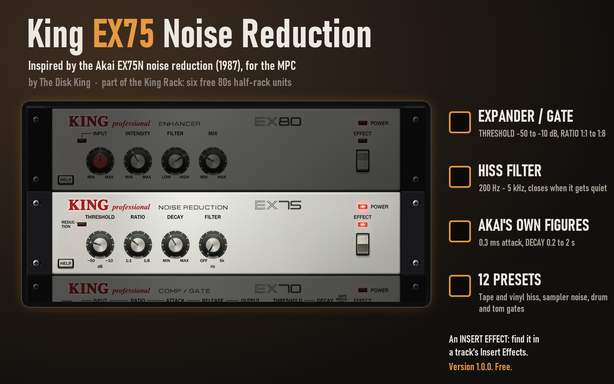
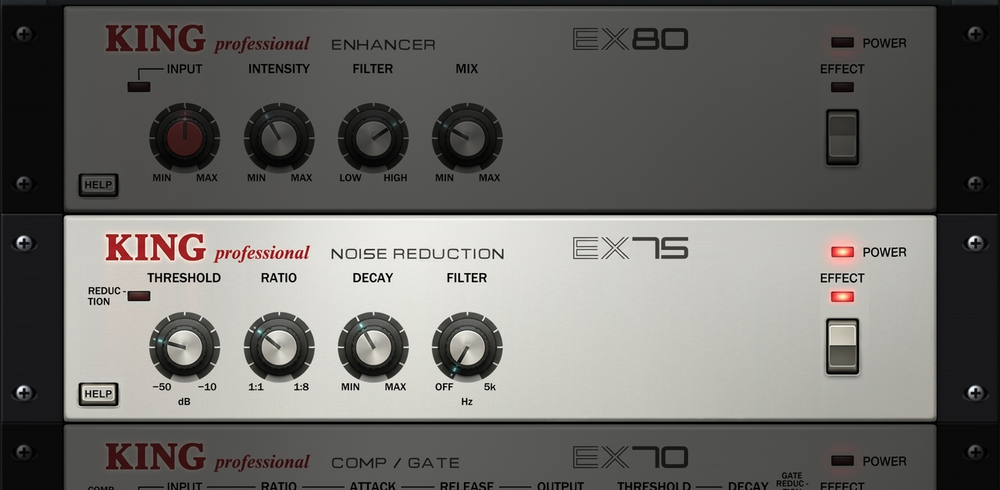
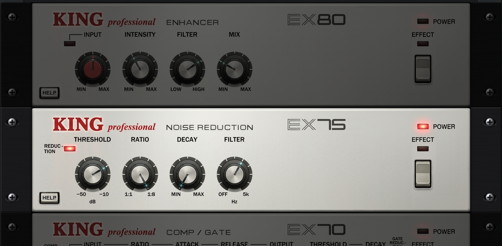
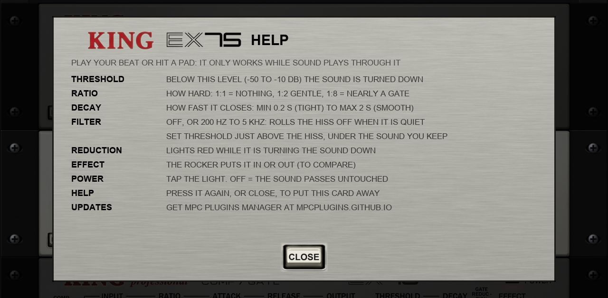

# King EX75 (The Disk King)

**King EX75 by The Disk King: Inspired by the Akai EX75N noise reduction (1987).** A half-rack 80s noise reduction (expander / gate) for Akai MPC standalone hardware, in the King Rack. It has:
- **THRESHOLD** -50 to -10 dB: below it the sound is turned down;
- **RATIO** 1:1 to 1:8: from a gentle expander to nearly a gate;
- a 0.3 ms attack and a **DECAY** of 0.2 to 2 seconds (Akai's own figures);
- **FILTER** OFF or 200 Hz to 5 kHz (6 dB/oct): rolls the hiss off when the sound gets quiet;
- a **REDUCTION** light, an **EFFECT** rocker, **POWER** and a **HELP** card.

**Version 1.0.0. Tested on Gen 1 (Akai MPC X SE) and Gen 2 (Akai MPC Live III), MPC OS 3.10.1. Free. Use at your own risk.**

## The King Rack: get the whole bundle, free

King EX75 is one of the six units of **[The King Rack](../king-rack/)**. Back in 1987-88 Akai made a little family of half-rack studio effects, the **EX series**: a delay, a compressor/gate, a noise reduction, an enhancer, a parametric EQ and a reverb, each with a handful of knobs and a red EFFECT light. The King Rack brings all six to the MPC, each one rebuilt from photos of the real unit and Akai's own published figures. It was made for fun, trying to get as close as possible to the original sound. All six are free.

On the MPC they all sit in the same rack: the one you load is lit in the middle, its neighbours stay in the rack
above and below it, darkened. Get them all:

| Unit | | Inspired by | Download |
|---|---|---|---|
| **[King EX90](../king-ex90/)** | Digital Reverb | after the Akai EX90R (1988) |  |
| **[King EX85](../king-ex85/)** | Parametric EQ | after the Akai EX85P (1987) |  |
| **[King EX80](../king-ex80/)** | Enhancer | after the Akai EX80E (1987) |  |
| **[King EX75](../king-ex75/)** (this one) | Noise Reduction | after the Akai EX75N (1987) |  |
| **[King EX70](../king-ex70/)** | Comp / Gate | after the Akai EX70C (1987) |  |
| **[King EX65](../king-ex65/)** | Digital Delay | after the Akai EX65D (1987) |  |

## This is an EFFECT: find it in Insert Effects

King EX75 is an **insert effect**, not an instrument. To use it:

1. Open the **Mixer** (or a track's / pad's **Insert Effects**) and tap an empty **Insert** slot.
2. Choose **External Plugins → The Disk King → King EX75**. Tap the slot's edit (pencil) icon to see the panel.
3. Pick a preset from the **preset name at the top of the plugin window**, then play.
4. Press **HELP** (bottom left of the panel) any time.

**Setting it up:** play the sound, turn THRESHOLD up until the hiss (or the spill between hits) goes away but the part you want stays whole. The red REDUCTION light shows when it works.
## Download

**Gen 1** (32-bit): MPC Live, Live II, One, One+, X, Key 61, Key 37, Force

**Gen 2** (64-bit): MPC Live III, XL

**Get updates automatically:** a zip you download by hand never updates itself. Install **[MPC Plugins Manager](https://mpcplugins.github.io/p/mpc-plugins-manager/)** once on your MPC: it shows when a new version of King EX75 is out and installs it in one tap.

**Easiest:** on your MPC, open **MPC Plugins Manager**, find **King EX75** and tap **Install**.

**By hand, step by step:**
1. Click the **DOWNLOAD** button above. A file called `King-EX75-1.0.0-mpc-sdk.zip` lands in your **Downloads** folder.
2. Unzip it. On Windows: right-click the file, then **Extract All**. On a Mac: double-click it.
3. Connect your MPC to the computer with its USB cable and switch it to **Computer Mode**, so its **internal drive** shows up on the computer.
4. On the MPC's internal drive, open the folder **VST2 Plugins** (make it if it is not there).
5. Copy the folder **The Disk King - VST - King EX75** from the unzipped files into **VST2 Plugins**.
6. On the MPC: **Preferences → Enhancements (Beta)** → turn on **Enable Enhancements** and **External Plugin Support** (needs MPC OS 3.10.1 or later). Restart the MPC.
7. Put it in an **Insert Effects** slot (see above) and play.
## Screens

| | | |
|---|---|---|
|  |  |  |
## Turning the knobs

**Slide your finger up to turn a knob right, slide down to turn it left.** Q-Links: top row THRESHOLD, RATIO, DECAY, FILTER; second row EFFECT.

## Presets

The EX75N had no memory (all knobs), so these are standard noise gate / expander settings made only from the knobs on the panel. Tested on drums with tape hiss: every preset takes the hiss down between hits and keeps the hits whole.

| Preset | THRESHOLD | RATIO | DECAY | FILTER | Use it on |
|---|---|---|---|---|---|
| Default | -40 dB | 1:2 | 0.5 s | OFF | A gentle start (loads first) |
| Tape Hiss | -45 dB | 1:2 | 0.8 s | 3 kHz | Cassette and reel-to-reel hiss |
| Vinyl Sample Hiss | -42 dB | 1:1.5 | 1.0 s | 4 kHz | Samples from records |
| Old Sampler Noise | -46 dB | 1:2 | 0.6 s | 5 kHz | Old 12-bit samplers |
| Synth Pad Hiss | -48 dB | 1:1.5 | 2.0 s | 3 kHz | Old synths, long tails |
| Guitar Amp Buzz | -40 dB | 1:4 | 0.3 s | 2 kHz | Amp hiss and buzz |
| Vocal Cleanup | -38 dB | 1:3 | 0.4 s | OFF | Room noise and breaths |
| Drum Gate Tight | -25 dB | 1:8 | 0.2 s | OFF | Tight, punchy drums |
| Snare Spill Gate | -22 dB | 1:6 | 0.25 s | OFF | A snare with kick and hats bleeding in |
| Tom Gate | -28 dB | 1:6 | 0.6 s | OFF | Toms: keep the ring |
| Gentle Expander | -35 dB | 1:1.5 | 0.8 s | OFF | A whole mix: a little more space |
| Hard Gate | -20 dB | 1:8 | 0.2 s | OFF | Choppy gated effects |

## About the EX75N

Akai's EX75N (1987), single-ended noise reduction (Sound On Sound, January 1987). Akai's 1988-89 catalogue: ratio 1:1-1:8, attack under 0.3 ms, decay 0.2-2 s, low pass filter 200 Hz-5 kHz (6 dB/oct). An owner described it as "a mono expander ... far less obtrusive than a noise gate", with the filter coming in on the quiet parts: King EX75 works the same way. The original is mono; King EX75 is stereo.

*Akai and EX75N are trademarks of their owner. The Disk King is not affiliated with or endorsed by them; the name is
used only to say which classic unit King EX75 is inspired by. The KING logo is The Disk King's own.*

## Known limits

- Like every MPC insert effect, it only works while sound plays through it.

## Disclaimer

Provided as is, with no warranty of any kind. Use entirely at your own risk; The Disk King is not responsible in any way
for any loss, damage or problem from using it.

More MPC sounds: https://thediskking.com
