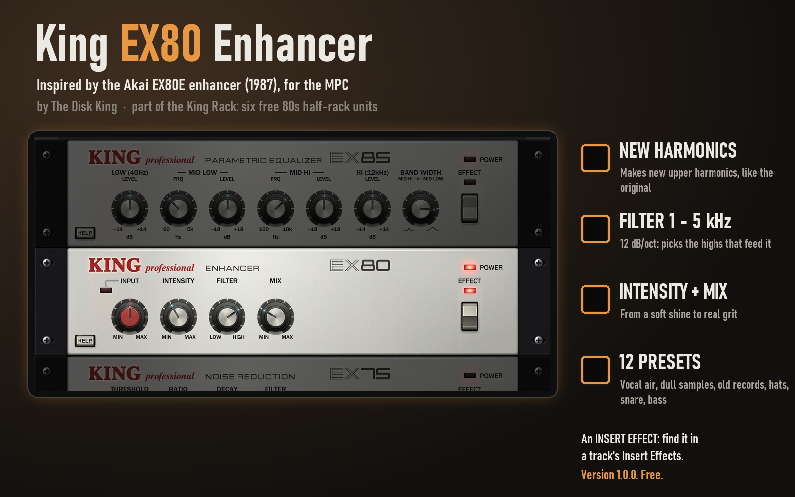
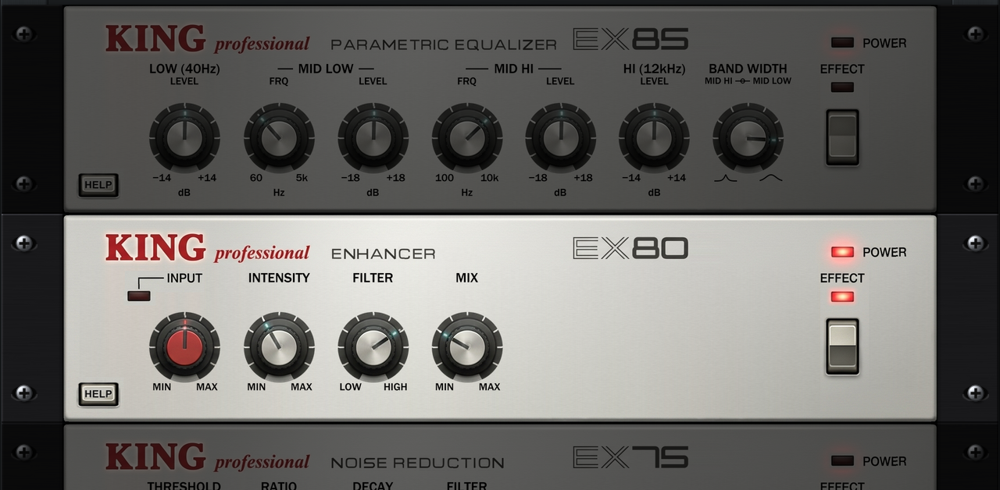
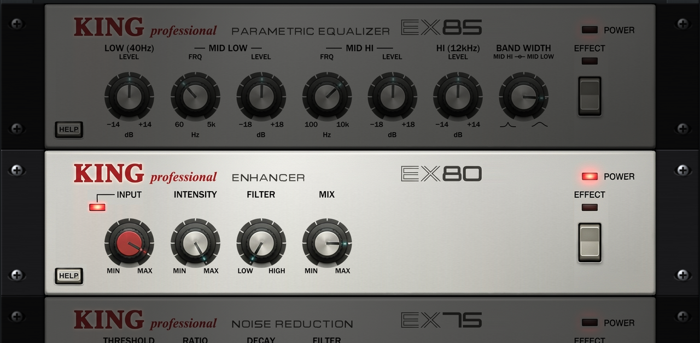
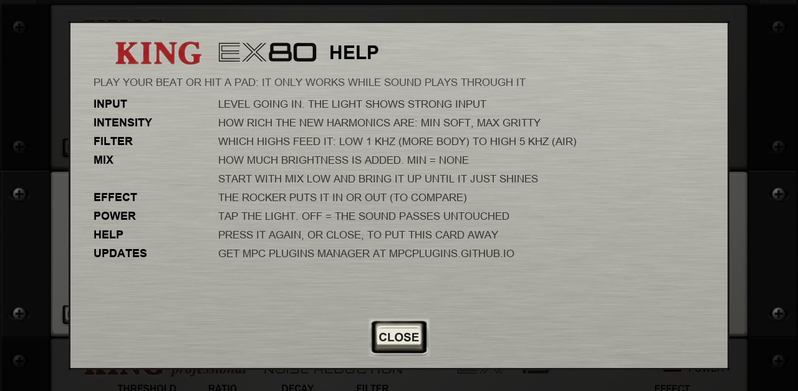

# King EX80 (The Disk King)

**King EX80 by The Disk King: Inspired by the Akai EX80E enhancer (1987).** A half-rack 80s harmonic exciter for Akai MPC standalone hardware, in the King Rack. It has:
- a harmonic generator that makes **new upper harmonics** (as Akai said, "to brighten dull mixes");
- **FILTER** 1 to 5 kHz (12 dB/oct, Akai's figures): picks which highs feed it;
- **INTENSITY** (from a soft shine to real grit) and **MIX** (how much is added);
- an **INPUT** knob with its light, an **EFFECT** rocker, **POWER** and a **HELP** card.

**Version 1.0.0. Tested on Gen 1 (Akai MPC X SE) and Gen 2 (Akai MPC Live III), MPC OS 3.10.1. Free. Use at your own risk.**

## The King Rack: get the whole bundle, free

King EX80 is one of the six units of **[The King Rack](../king-rack/)**. Back in 1987-88 Akai made a little family of half-rack studio effects, the **EX series**: a delay, a compressor/gate, a noise reduction, an enhancer, a parametric EQ and a reverb, each with a handful of knobs and a red EFFECT light. The King Rack brings all six to the MPC, each one rebuilt from photos of the real unit and Akai's own published figures. It was made for fun, trying to get as close as possible to the original sound. All six are free.

On the MPC they all sit in the same rack: the one you load is lit in the middle, its neighbours stay in the rack
above and below it, darkened. Get them all:

| Unit | | Inspired by | Download |
|---|---|---|---|
| **[King EX90](../king-ex90/)** | Digital Reverb | after the Akai EX90R (1988) |  |
| **[King EX85](../king-ex85/)** | Parametric EQ | after the Akai EX85P (1987) |  |
| **[King EX80](../king-ex80/)** (this one) | Enhancer | after the Akai EX80E (1987) |  |
| **[King EX75](../king-ex75/)** | Noise Reduction | after the Akai EX75N (1987) |  |
| **[King EX70](../king-ex70/)** | Comp / Gate | after the Akai EX70C (1987) |  |
| **[King EX65](../king-ex65/)** | Digital Delay | after the Akai EX65D (1987) |  |

## This is an EFFECT: find it in Insert Effects

King EX80 is an **insert effect**, not an instrument. To use it:

1. Open the **Mixer** (or a track's / pad's **Insert Effects**) and tap an empty **Insert** slot.
2. Choose **External Plugins → The Disk King → King EX80**. Tap the slot's edit (pencil) icon to see the panel.
3. Pick a preset from the **preset name at the top of the plugin window**, then play.
4. Press **HELP** (bottom left of the panel) any time.

**Start with MIX low** and bring it up until the sound just shines. Too much = harsh.
## Download

 Gen 1, Gen 2 and works-on-both downloads of every version, added up.

**Gen 1** (32-bit): MPC Live, Live II, One, One+, X, Key 61, Key 37, Force

**Gen 2** (64-bit): MPC Live III, XL

**Get updates automatically:** a zip you download by hand never updates itself. Install **[MPC Plugins Manager](https://mpcplugins.github.io/p/mpc-plugins-manager/)** once on your MPC: it shows when a new version of King EX80 is out and installs it in one tap.

**Easiest:** on your MPC, open **MPC Plugins Manager**, find **King EX80** and tap **Install**.

**By hand, step by step:**
1. Click the **DOWNLOAD** button above. A file called `King-EX80-1.0.0-mpc-sdk.zip` lands in your **Downloads** folder.
2. Unzip it. On Windows: right-click the file, then **Extract All**. On a Mac: double-click it.
3. Connect your MPC to the computer with its USB cable and switch it to **Computer Mode**, so its **internal drive** shows up on the computer.
4. On the MPC's internal drive, open the folder **VST2 Plugins** (make it if it is not there).
5. Copy the folder **The Disk King - VST - King EX80** from the unzipped files into **VST2 Plugins**.
6. On the MPC: **Preferences → Enhancements (Beta)** → turn on **Enable Enhancements** and **External Plugin Support** (needs MPC OS 3.10.1 or later). Restart the MPC.
7. Put it in an **Insert Effects** slot (see above) and play.
## Screens

| | | |
|---|---|---|
|  |  |  |
## Turning the knobs

**Slide your finger up to turn a knob right, slide down to turn it left.** Q-Links: top row INPUT, INTENSITY, FILTER, MIX; second row EFFECT.

## The controls

| Control | What it does |
|---|---|
| INPUT + light | The level going in (-18 .. +18 dB, 12 o'clock = 0). The light shows strong input. |
| INTENSITY | How rich the new harmonics are: MIN soft, MAX gritty. |
| FILTER (LOW .. HIGH) | Which highs feed the generator: LOW 1 kHz (more body) to HIGH 5 kHz (air). |
| MIX | How much is added to the untouched sound. MIN = none. |
| EFFECT rocker + light | In or out, to compare. |
| POWER | Tap the red light. Off = untouched. |
| HELP | The help card. |

## Presets

The EX80E had no memory (all knobs), so these are standard exciter settings made only from the knobs on the panel.

| Preset | INTENSITY | FILTER | MIX | Use it on |
|---|---|---|---|---|
| Default | 40 % | 3 kHz | 30 % | Anything (loads first) |
| Vocal Air | 35 % | 4 kHz | 30 % | Vocals: air and clarity |
| Dull Sample Lift | 50 % | 2.5 kHz | 45 % | Dull samples |
| Old Record Shine | 60 % | 3 kHz | 40 % | Samples from old records |
| Hi-Hat Sizzle | 55 % | 5 kHz | 40 % | Hats and cymbals |
| Snare Crack | 60 % | 2 kHz | 35 % | Snares |
| Kick Click | 70 % | 1.5 kHz | 30 % | Kicks: the beater cuts through |
| Bass Presence | 70 % | 1 kHz | 35 % | Bass, heard on small speakers |
| Mix Sparkle | 40 % | 3 kHz | 25 % | A whole beat |
| Guitar Bite | 65 % | 1.8 kHz | 40 % | Guitars |
| Synth Shine | 45 % | 3 kHz | 35 % | Pads and synths |
| Max Grit | 100 % | 1 kHz | 80 % | Effect: gritty and bright |

## About the EX80E

Akai's EX80E (1987), the enhancer of the EX series; Sound On Sound (January 1987): it "generates upper harmonics to brighten dull mixes". Akai's 1988-89 catalogue: high pass 1 Hz-5 kHz (harmonic generation), filter 1 kHz-5 kHz (-12 dB/oct). Its exact harmonic circuit is not published anywhere free, so King EX80 uses a standard exciter design built to those figures. The original is mono; King EX80 is stereo.

*Akai and EX80E are trademarks of their owner. The Disk King is not affiliated with or endorsed by them; the name is
used only to say which classic unit King EX80 is inspired by. The KING logo is The Disk King's own.*

## Known limits

- Like every MPC insert effect, it only works while sound plays through it.
- It adds brightness; on an already bright mix go easy on MIX.

## Disclaimer

Provided as is, with no warranty of any kind. Use entirely at your own risk; The Disk King is not responsible in any way
for any loss, damage or problem from using it.

More MPC sounds: https://thediskking.com
