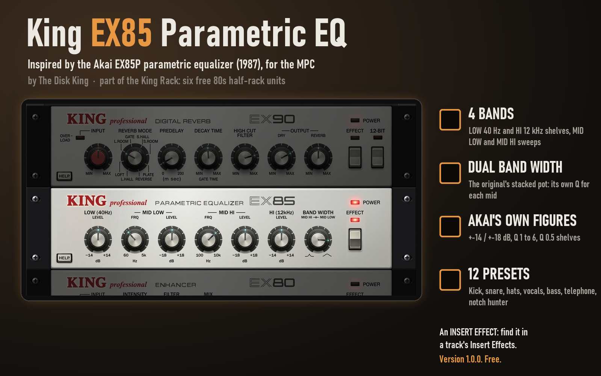
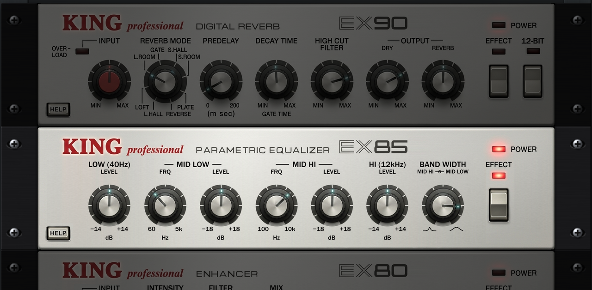
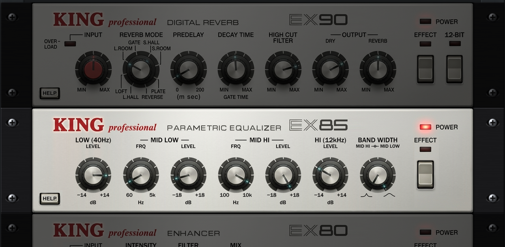
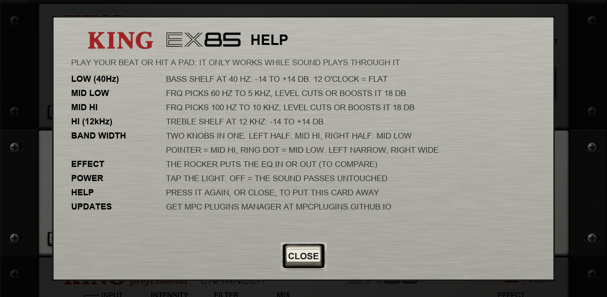

# King EX85 (The Disk King)

**King EX85 by The Disk King: Inspired by the Akai EX85P parametric equalizer (1987).** A half-rack 80s four-band EQ for Akai MPC standalone hardware, in the King Rack. It has:
- a **LOW** shelf at 40 Hz and a **HI** shelf at 12 kHz, each -14 to +14 dB (Q 0.5, Akai's figure);
- two sweepable mids: **MID LOW** 60 Hz to 5 kHz and **MID HI** 100 Hz to 10 kHz, each -18 to +18 dB;
- the original's **dual BAND WIDTH** knob: its own width (Q 6 narrow to 1 wide) for each mid band;
- an **EFFECT** rocker to switch the EQ in and out, **POWER** and a **HELP** card.

**Version 1.0.0. Tested on Gen 1 (Akai MPC X SE) and Gen 2 (Akai MPC Live III), MPC OS 3.10.1. Free. Use at your own risk.**

## The King Rack: get the whole bundle, free

King EX85 is one of the six units of **[The King Rack](../king-rack/)**. Back in 1987-88 Akai made a little family of half-rack studio effects, the **EX series**: a delay, a compressor/gate, a noise reduction, an enhancer, a parametric EQ and a reverb, each with a handful of knobs and a red EFFECT light. The King Rack brings all six to the MPC, each one rebuilt from photos of the real unit and Akai's own published figures. It was made for fun, trying to get as close as possible to the original sound. All six are free.

On the MPC they all sit in the same rack: the one you load is lit in the middle, its neighbours stay in the rack
above and below it, darkened. Get them all:

| Unit | | Inspired by | Download |
|---|---|---|---|
| **[King EX90](../king-ex90/)** | Digital Reverb | after the Akai EX90R (1988) |  |
| **[King EX85](../king-ex85/)** (this one) | Parametric EQ | after the Akai EX85P (1987) |  |
| **[King EX80](../king-ex80/)** | Enhancer | after the Akai EX80E (1987) |  |
| **[King EX75](../king-ex75/)** | Noise Reduction | after the Akai EX75N (1987) |  |
| **[King EX70](../king-ex70/)** | Comp / Gate | after the Akai EX70C (1987) |  |
| **[King EX65](../king-ex65/)** | Digital Delay | after the Akai EX65D (1987) |  |

## This is an EFFECT: find it in Insert Effects

King EX85 is an **insert effect**, not an instrument. To use it:

1. Open the **Mixer** (or a track's / pad's **Insert Effects**) and tap an empty **Insert** slot.
2. Choose **External Plugins → The Disk King → King EX85**. Tap the slot's edit (pencil) icon to see the panel.
3. Pick a preset from the **preset name at the top of the plugin window**, then play.
4. Press **HELP** (bottom left of the panel) any time.

**Where you put it decides what it EQs:** on a pad = that sample only, on a track = the whole track.
## Download

**Gen 1** (32-bit): MPC Live, Live II, One, One+, X, Key 61, Key 37, Force

**Gen 2** (64-bit): MPC Live III, XL

**Get updates automatically:** a zip you download by hand never updates itself. Install **[MPC Plugins Manager](https://mpcplugins.github.io/p/mpc-plugins-manager/)** once on your MPC: it shows when a new version of King EX85 is out and installs it in one tap.

**Easiest:** on your MPC, open **MPC Plugins Manager**, find **King EX85** and tap **Install**.

**By hand, step by step:**
1. Click the **DOWNLOAD** button above. A file called `King-EX85-1.0.0-mpc-sdk.zip` lands in your **Downloads** folder.
2. Unzip it. On Windows: right-click the file, then **Extract All**. On a Mac: double-click it.
3. Connect your MPC to the computer with its USB cable and switch it to **Computer Mode**, so its **internal drive** shows up on the computer.
4. On the MPC's internal drive, open the folder **VST2 Plugins** (make it if it is not there).
5. Copy the folder **The Disk King - VST - King EX85** from the unzipped files into **VST2 Plugins**.
6. On the MPC: **Preferences → Enhancements (Beta)** → turn on **Enable Enhancements** and **External Plugin Support** (needs MPC OS 3.10.1 or later). Restart the MPC.
7. Put it in an **Insert Effects** slot (see above) and play.
## Screens

| | | |
|---|---|---|
|  |  |  |
## Turning the knobs

**Slide your finger up to turn a knob right, slide down to turn it left.** 12 o'clock on every LEVEL knob is flat. Q-Links: top row LOW, MID LOW FRQ, MID LOW LEVEL, MID HI FRQ; second row MID HI LEVEL, HI, BAND WIDTH (MID HI), BAND WIDTH (MID LOW); third row EFFECT.

## The controls

| Control | What it does |
|---|---|
| LOW (40Hz) LEVEL | Bass shelf: -14 .. +14 dB. |
| MID LOW FRQ / LEVEL | 60 Hz .. 5 kHz, cut or boost -18 .. +18 dB. |
| MID HI FRQ / LEVEL | 100 Hz .. 10 kHz, cut or boost -18 .. +18 dB. |
| HI (12kHz) LEVEL | Treble shelf: -14 .. +14 dB. |
| BAND WIDTH | Two knobs in one, like the original's stacked pot. **Touch the left half for MID HI, the right half for MID LOW.** Pointer = MID HI, ring dot = MID LOW. Left narrow (Q 6), right wide (Q 1). |
| EFFECT rocker + light | EQ in or out, to compare. |
| POWER | Tap the red light. Off = untouched. |
| HELP | The help card. |

## Presets

The EX85P had no memory (all knobs), so these are standard EQ moves made only from the knobs on the panel. Q = BAND WIDTH.

| Preset | LOW | MID LOW | MID HI | HI | Use it on |
|---|---|---|---|---|---|
| Default | 0 | 300 Hz, 0 dB | 2 kHz, 0 dB | 0 | Flat (loads first) |
| Kick Punch | +5 | 380 Hz -6 dB, Q 2 | 3.5 kHz +4 dB, Q 1.4 | 0 | Kick: weight, less box, more click |
| Snare Crack | -3 | 200 Hz +3 dB, Q 1.4 | 5 kHz +4 dB, Q 1 | +2 | Snare: body and crack |
| Hi-Hat Air | -14 | 400 Hz -4 dB, Q 1 | 8 kHz +3 dB, Q 1 | +5 | Hats and cymbals |
| Vocal Presence | -6 | 250 Hz -3 dB, Q 1.4 | 3 kHz +4 dB, Q 1.2 | +3 | Vocals: less mud, more forward |
| De-Mud | 0 | 300 Hz -4 dB, Q 1 | flat | 0 | Busy mixes and samples |
| Bass Weight | +4 | 100 Hz +3 dB, Q 1 | 800 Hz +3 dB, Q 1.4 | -4 | Bass, heard on small speakers |
| Boom Bap Drums | +3 | 100 Hz +2 dB, Q 1 | 2.5 kHz +3 dB, Q 1 | -3 | Drum loops: fat, punchy, dusty top |
| Telephone | -14 | 100 Hz -18 dB, Q 1 | 1.5 kHz +8 dB, Q 1 | -14 | The old phone / radio voice |
| Sample Warmth | +2 | 200 Hz +2 dB, Q 1 | 4 kHz -3 dB, Q 1 | -6 | Records and samples |
| Notch Hunter | 0 | flat | 1 kHz +15 dB, Q 6 | 0 | Sweep MID HI FRQ to find a ring, then cut it |
| Bright Mix | +1 | flat | 3 kHz +1.5 dB, Q 1 | +4 | A whole beat, a little open |

## About the EX85P

Akai's EX85P (1987): an analog, all-knob four-band EQ. Akai's 1988-89 catalogue: LOW 40 Hz fixed +-14 dB Q 0.5; MID LOW 60 Hz-5 kHz +-18 dB Q 1-6; MID HI 100 Hz-10 kHz +-18 dB Q 1-6; HI 12 kHz fixed +-14 dB Q 0.5. King EX85 follows those figures and the panel of a real unit. The original is mono; King EX85 is stereo.

*Akai and EX85P are trademarks of their owner. The Disk King is not affiliated with or endorsed by them; the name is
used only to say which classic unit King EX85 is inspired by. The KING logo is The Disk King's own.*

## Known limits

- Like every MPC insert effect, it only works while sound plays through it.
- Big boosts can clip, like on the original: turn a LEVEL down if it distorts.

## Disclaimer

Provided as is, with no warranty of any kind. Use entirely at your own risk; The Disk King is not responsible in any way
for any loss, damage or problem from using it.

More MPC sounds: https://thediskking.com
