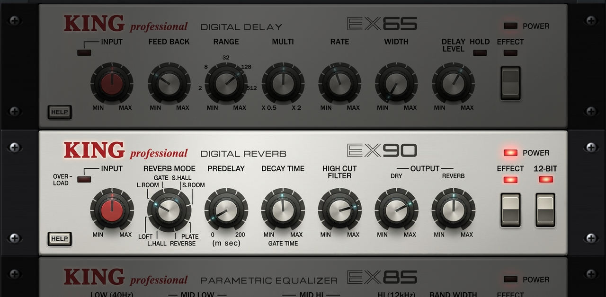
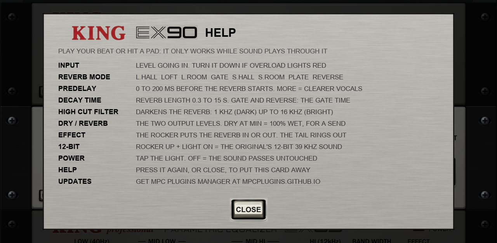

# King EX90 (The Disk King)

**King EX90 by The Disk King: Inspired by the Akai EX90R digital reverb (1988).** A half-rack 80s studio reverb for
Akai MPC standalone hardware, in the King Rack. It has:
- eight reverb modes: L.HALL, LOFT, L.ROOM, GATE, S.HALL, S.ROOM, PLATE and REVERSE;
- the big 80s **gated** drum sound and a **reverse** swell;
- predelay 0 to 200 ms, decay 0.3 to 15 seconds (or the gate time), and a steep HIGH CUT filter;
- separate DRY and REVERB levels, an OVERLOAD light and an EFFECT rocker that lets the tail ring out;
- a **12-BIT** rocker for the original's gritty 12-bit, 39 kHz sound.

**Version 1.1.0 (the King Rack). Tested on Gen 1 (Akai MPC X SE) and Gen 2 (Akai MPC Live III), MPC OS 3.10.1. Free. Use at your own risk.**

## The King Rack: get the whole bundle, free

King EX90 is one of the six units of **[The King Rack](../king-rack/)**. Back in 1987-88 Akai made a little family of half-rack studio effects, the **EX series**: a delay, a compressor/gate, a noise reduction, an enhancer, a parametric EQ and a reverb, each with a handful of knobs and a red EFFECT light. The King Rack brings all six to the MPC, each one rebuilt from photos of the real unit and Akai's own published figures. It was made for fun, trying to get as close as possible to the original sound. All six are free.

On the MPC they all sit in the same rack: the one you load is lit in the middle, its neighbours stay in the rack
above and below it, darkened. Get them all:

| Unit | | Inspired by | Download |
|---|---|---|---|
| **[King EX90](../king-ex90/)** (this one) | Digital Reverb | after the Akai EX90R (1988) |  |
| **[King EX85](../king-ex85/)** | Parametric EQ | after the Akai EX85P (1987) |  |
| **[King EX80](../king-ex80/)** | Enhancer | after the Akai EX80E (1987) |  |
| **[King EX75](../king-ex75/)** | Noise Reduction | after the Akai EX75N (1987) |  |
| **[King EX70](../king-ex70/)** | Comp / Gate | after the Akai EX70C (1987) |  |
| **[King EX65](../king-ex65/)** | Digital Delay | after the Akai EX65D (1987) |  |

## The King Rack: get the whole bundle, free

King EX90 is one of the six units of **[The King Rack](../king-rack/)**. Back in 1987-88 Akai made a little family of half-rack studio effects, the **EX series**: a delay, a compressor/gate, a noise reduction, an enhancer, a parametric EQ and a reverb, each with a handful of knobs and a red EFFECT light. The King Rack brings all six to the MPC, each one rebuilt from photos of the real unit and Akai's own published figures. It was made for fun, trying to get as close as possible to the original sound. All six are free.

On the MPC they all sit in the same rack: the one you load is lit in the middle, its neighbours stay in the rack
above and below it, darkened. Get them all:

| Unit | | Inspired by | Download |
|---|---|---|---|
| **[King EX90](../king-ex90/)** (this one) | Digital Reverb | after the Akai EX90R (1988) |  |
| **[King EX85](../king-ex85/)** | Parametric EQ | after the Akai EX85P (1987) |  |
| **[King EX80](../king-ex80/)** | Enhancer | after the Akai EX80E (1987) |  |
| **[King EX75](../king-ex75/)** | Noise Reduction | after the Akai EX75N (1987) |  |
| **[King EX70](../king-ex70/)** | Comp / Gate | after the Akai EX70C (1987) |  |
| **[King EX65](../king-ex65/)** | Digital Delay | after the Akai EX65D (1987) |  |

## The King Rack: get the whole bundle, free

King EX90 is one of the six units of **[The King Rack](../king-rack/)**. Back in 1987-88 Akai made a little family of half-rack studio effects, the **EX series**: a delay, a compressor/gate, a noise reduction, an enhancer, a parametric EQ and a reverb, each with a handful of knobs and a red EFFECT light. The King Rack brings all six to the MPC, each one rebuilt from photos of the real unit and Akai's own published figures. It was made for fun, trying to get as close as possible to the original sound. All six are free.

On the MPC they all sit in the same rack: the one you load is lit in the middle, its neighbours stay in the rack
above and below it, darkened. Get them all:

| Unit | | Inspired by | Download |
|---|---|---|---|
| **[King EX90](../king-ex90/)** (this one) | Digital Reverb | after the Akai EX90R (1988) |  |
| **[King EX85](../king-ex85/)** | Parametric EQ | after the Akai EX85P (1987) |  |
| **[King EX80](../king-ex80/)** | Enhancer | after the Akai EX80E (1987) |  |
| **[King EX75](../king-ex75/)** | Noise Reduction | after the Akai EX75N (1987) |  |
| **[King EX70](../king-ex70/)** | Comp / Gate | after the Akai EX70C (1987) |  |
| **[King EX65](../king-ex65/)** | Digital Delay | after the Akai EX65D (1987) |  |

## This is an EFFECT: find it in Insert Effects

King EX90 is an **insert effect**, not an instrument. To use it:

1. Open the **Mixer** (or a track's / pad's **Insert Effects**) and tap an empty **Insert** slot.
2. Choose **External Plugins → The Disk King → King EX90**. Tap the slot's edit (pencil) icon to see the panel.
3. Pick a preset from the **preset name at the top of the plugin window**, then play.
4. Press **HELP** (bottom left of the panel) any time.

**Where you put it decides what it reverbs:** on a pad = that sample only, on a track = the whole track. For a reverb
shared by several tracks, put it on a **Return** with **DRY at MIN** (100% wet) and send to it.

## Download

**Gen 1** (32-bit): MPC Live, Live II, One, One+, X, Key 61, Key 37, Force

**Gen 2** (64-bit): MPC Live III, XL

**Get updates automatically:** a zip you download by hand never updates itself. Install **[MPC Plugins Manager](https://mpcplugins.github.io/p/mpc-plugins-manager/)** once on your MPC: it shows when a new version of King EX90 is out and installs it in one tap.

**Easiest:** on your MPC, open **MPC Plugins Manager**, find **King EX90** and tap **Install**.

**By hand, step by step:**
1. Click the **DOWNLOAD** button above. A file called `King-EX90-1.1.0-mpc-sdk.zip` lands in your **Downloads** folder.
2. Unzip it. On Windows: right-click the file, then **Extract All**. On a Mac: double-click it.
3. Connect your MPC to the computer with its USB cable and switch it to **Computer Mode**, so its **internal drive** shows up on the computer.
4. On the MPC's internal drive, open the folder **VST2 Plugins** (make it if it is not there).
5. Copy the folder **The Disk King - VST - King EX90** from the unzipped files into **VST2 Plugins**.
6. On the MPC: **Preferences → Enhancements (Beta)** → turn on **Enable Enhancements** and **External Plugin Support** (needs MPC OS 3.10.1 or later). Restart the MPC.
7. Put it in an **Insert Effects** slot (see above) and play.

## Screens

| | |
|---|---|
|  |  |

## Turning the knobs

**Slide your finger up to turn a knob right, slide down to turn it left.** The Q-Link knobs work too: top row INPUT,
REVERB MODE, PREDELAY, DECAY TIME; second row HIGH CUT, DRY, REVERB, EFFECT.

## The controls

| Control | What it does |
|---|---|
| INPUT (-18 .. +18 dB) | The level going in (0 dB at 12 o'clock). Turn it down if the red **OVERLOAD** light comes on. |
| REVERB MODE | Eight click stops. **L.HALL** deep and warm (mids and lows), **LOFT** extra-wide stereo, **L.ROOM** large room, **GATE** the 80s gated reverb, **S.HALL** small hall, **S.ROOM** bright small room, **PLATE** dense and bright, **REVERSE** a backwards swell. |
| PREDELAY (0 .. 200 ms) | The gap before the reverb starts. More = the dry sound stays clear in front (great on vocals and piano). |
| DECAY TIME (0.3 .. 15 s) | How long the reverb rings. In **GATE** and **REVERSE** it is the **GATE TIME** (80 ms .. 1.5 s): how long before the reverb is cut off. |
| HIGH CUT FILTER (1 .. 16 kHz) | Darkens the reverb with a steep 24 dB/octave filter: MIN = dark and soft, MAX = bright and crisp. |
| OUTPUT DRY / REVERB | The two levels, separately. **DRY at MIN = 100% wet** (for a send / return). |
| EFFECT rocker + light | Puts the reverb in or out. Like the original, when you switch it out the tail **rings out naturally** instead of stopping dead. Rocker up and light on = in. |
| 12-BIT rocker + light | Rocker up and light on = the original's **12-bit, 39 kHz** converter sound (a little grit and a darker top). Down = clean. |
| POWER | Tap the red light. Off = the sound passes untouched. |
| HELP | Opens the help card; CLOSE (or HELP again) puts it away. |

## Presets

Every preset is made only from the knobs and switches on the panel, so you can build any of them by hand.

| Preset | Mode | Predelay | Decay / Gate | High cut | Dry | Reverb | Use it on |
|---|---|---|---|---|---|---|---|
| Default | L.ROOM | 20 ms | 2.0 s | 8 kHz | 0 dB | -6 dB | Anything: a good all-round room (loads first) |
| Big Gated Drums | GATE | 10 ms | gate 0.35 s | 10 kHz | 0 dB | -3 dB | Snare and toms: the 80s gated drum sound |
| Snare Plate | PLATE | 20 ms | 1.6 s | 8 kHz | 0 dB | -6 dB | Snare: a classic bright plate |
| Vocal Plate | PLATE | 60 ms | 2.2 s | 7 kHz | 0 dB | -8 dB | Vocals: smooth, the voice stays in front |
| Drum Machine Room | S.ROOM | 5 ms | 0.9 s | 12 kHz | 0 dB | -6 dB | Drum machines: a short, bright room |
| Large Room Kit | L.ROOM | 10 ms | 1.4 s | 9 kHz | 0 dB | -6 dB | A whole drum kit |
| Small Hall Vocal | S.HALL | 40 ms | 1.8 s | 8 kHz | 0 dB | -8 dB | Vocals and keys |
| Concert Hall | L.HALL | 30 ms | 3.5 s | 6 kHz | 0 dB | -6 dB | Strings, pads, ballads |
| Hall Strings | PLATE | 40 ms | 4.0 s | 2.5 kHz | 0 dB | -4 dB | Strings with the filter closed (a big, soft hall) |
| Crisp Piano Loft | LOFT | 120 ms | 2.5 s | 16 kHz | 0 dB | -6 dB | Piano: long predelay, filter open, crisp and wide |
| Reverse Swell | REVERSE | 0 ms | gate 0.8 s | 10 kHz | 0 dB | -3 dB | Snare or vocal hits that swell up backwards |
| Ambient Wash | L.HALL | 80 ms | 12 s | 4 kHz | -3 dB | -3 dB | Pads and ambient beds |
| Send 100% Wet | L.ROOM | 20 ms | 2.0 s | 8 kHz | off | 0 dB | On a Return: only the reverb |

All presets start with EFFECT in, 12-BIT on (the original's sound) and POWER on.

## About the EX90R

Akai brought out the EX90R in 1988, a small half-rack digital reverb (two fit side by side in one rack space). It had
no presets and no MIDI, just knobs: eight modes on a click-stop dial, predelay up to 200 ms, decay from 1 to 15 seconds
(the gate time in GATE mode), a 1 to 16 kHz high cut, separate dry and effect levels and an effect on/off switch whose
tail decays naturally. Inside, it ran at 12 bits and 39 kHz. King EX90 follows that panel and fixes what the reviews
complained about: the decay really reaches 15 seconds, the gate goes much shorter, and turning a knob while sound plays
no longer makes noise.

*Akai and EX90R are trademarks of their owner. The Disk King is not affiliated with or endorsed by them; the name is
used only to say which classic unit King EX90 is inspired by. The KING logo is The Disk King's own.*

## What's new in 1.1.0

- The King Rack: King EX90 now sits in one rack with the five other King units (darkened above and below it).
- The sound is unchanged; your projects and presets load as before.

## What's new in 1.1.0

- The King Rack: King EX90 now sits in one rack with the five other King units (darkened above and below it).
- The sound is unchanged; your projects and presets load as before.

## What's new in 1.1.0

- The King Rack: King EX90 now sits in one rack with the five other King units (darkened above and below it).
- The sound is unchanged; your projects and presets load as before.

## Known limits

- Like every MPC insert effect, it only works while sound plays through it.
- Changing REVERB MODE while sound plays fades the reverb out and back in (no click), so the old tail is cut.

## Disclaimer

Provided as is, with no warranty of any kind. Use entirely at your own risk; The Disk King is not responsible in any way
for any loss, damage or problem from using it.

More MPC sounds: https://thediskking.com
