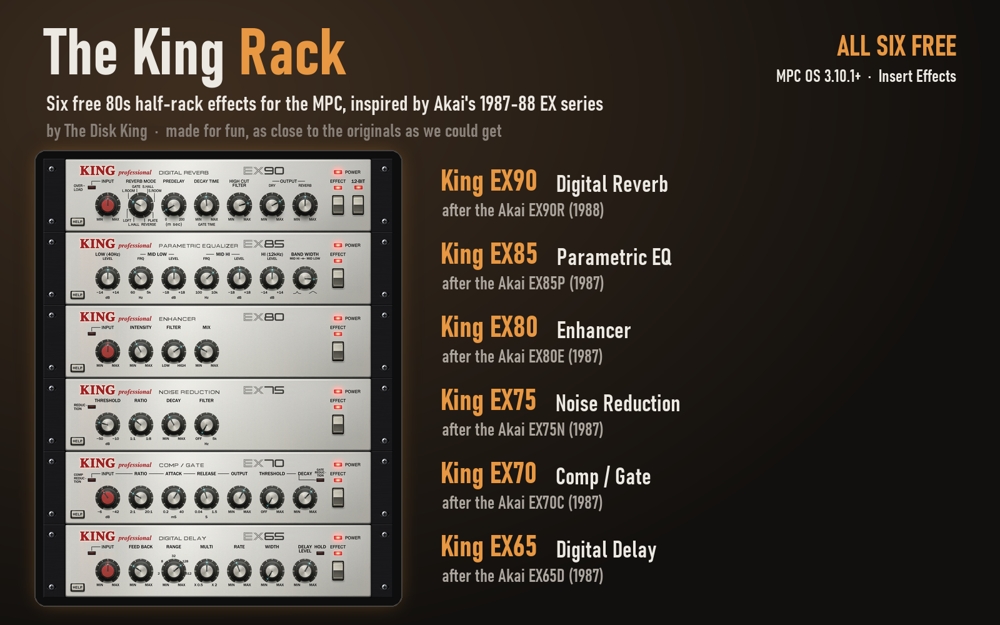
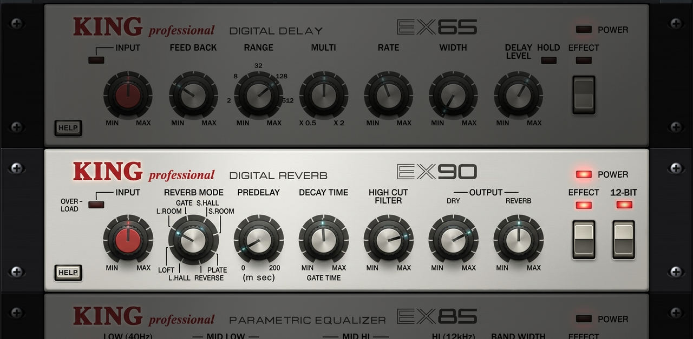
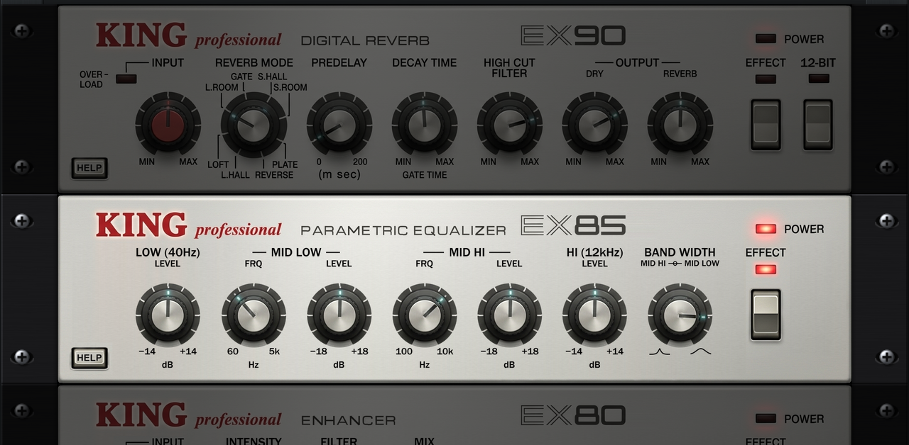
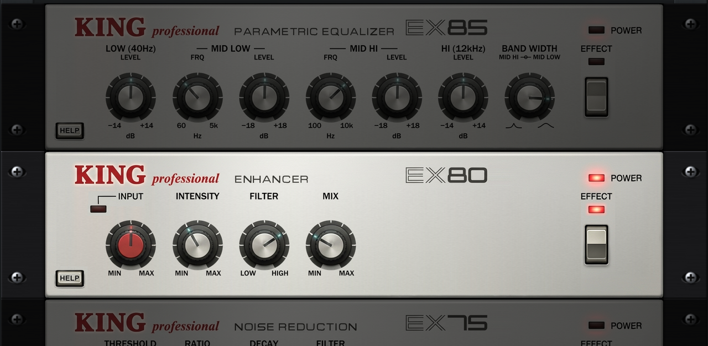
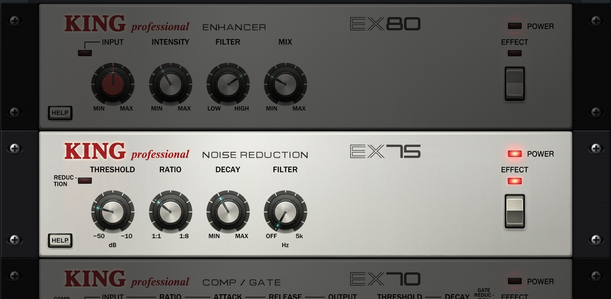
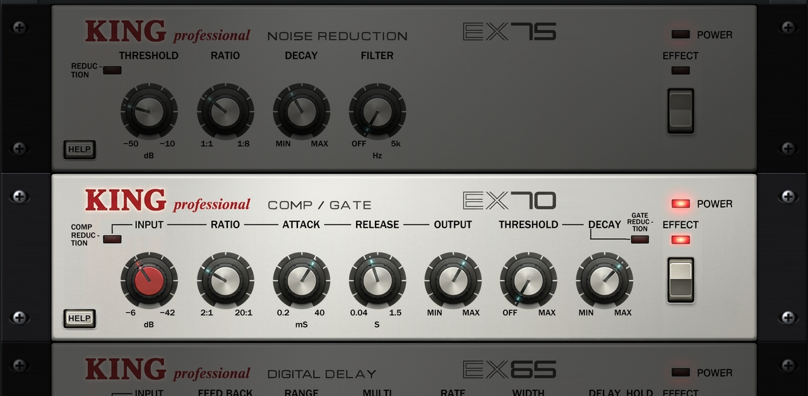
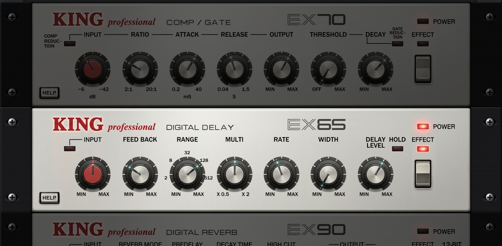

# The King Rack (The Disk King)

**Six free 80s half-rack effects for the Akai MPC, inspired by Akai's 1987-88 EX series.**

Back in 1987-88 Akai made a little family of half-rack studio effects, the **EX series**: a delay, a compressor/gate, a noise reduction, an enhancer, a parametric EQ and a reverb, each with a handful of knobs and a red EFFECT light. The King Rack brings all six to the MPC, each one rebuilt from photos of the real unit and Akai's own published figures. It was made for fun, trying to get as close as possible to the original sound. All six are free.

On the MPC all six sit in the same rack: load one and it lights up in the middle, with its neighbours in the rack
above and below it, darkened (each works with its own plugin). They are **insert effects**: find them in a track's
or pad's **Insert Effects → External Plugins → The Disk King**.

## Get all six (free)

| | Unit | Download |
|---|---|---|
|  | **[King EX90](../king-ex90/)** Digital Reverb after the Akai EX90R (1988) |  |
|  | **[King EX85](../king-ex85/)** Parametric EQ after the Akai EX85P (1987) |  |
|  | **[King EX80](../king-ex80/)** Enhancer after the Akai EX80E (1987) |  |
|  | **[King EX75](../king-ex75/)** Noise Reduction after the Akai EX75N (1987) |  |
|  | **[King EX70](../king-ex70/)** Comp / Gate after the Akai EX70C (1987) |  |
|  | **[King EX65](../king-ex65/)** Digital Delay after the Akai EX65D (1987) |  |

**Easiest:** on your MPC, open **[MPC Plugins Manager](https://mpcplugins.github.io/p/mpc-plugins-manager/)**, find
each King unit and tap **Install**. It also brings you every update.

**By hand:** download each zip above, unzip it, and copy its **The Disk King - VST - King EX..** folder into the
**VST2 Plugins** folder on your MPC's internal drive (MPC OS 3.10.1 or later, with **Preferences → Enhancements (Beta)
→ Enable Enhancements** and **External Plugin Support** on). Restart the MPC. Each unit's page has the full steps.

## The six

- **[King EX90](../king-ex90/)**: Inspired by the Akai EX90R digital reverb: 8 modes, 80s gated drums, reverse, 12-bit.
- **[King EX85](../king-ex85/)**: Inspired by the Akai EX85P parametric EQ: 40 Hz and 12 kHz shelves, two sweepable mids, dual BAND WIDTH.
- **[King EX80](../king-ex80/)**: Inspired by the Akai EX80E enhancer: new upper harmonics to brighten dull sounds.
- **[King EX75](../king-ex75/)**: Inspired by the Akai EX75N noise reduction: expander / gate with a filter that rolls off the hiss.
- **[King EX70](../king-ex70/)**: Inspired by the Akai EX70C comp / gate: 2:1 to 20:1, attack, release, and a gate with decay.
- **[King EX65](../king-ex65/)**: Inspired by the Akai EX65D digital delay: 1 to 1024 ms, feedback, modulation, HOLD.

*Akai and the model names EX65D, EX70C, EX75N, EX80E, EX85P and EX90R are trademarks of their owner. The Disk King is
not affiliated with or endorsed by them; the names are used only to say which classic units the King Rack is inspired
by. The KING logo is The Disk King's own.*

Provided as is, with no warranty of any kind. Use entirely at your own risk.

More MPC sounds: https://thediskking.com
