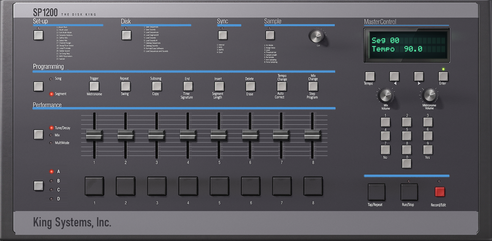

# KING SP-1200 (The Disk King)

KING SP-1200 by The Disk King: Inspired by the E-mu SP-1200, the original 1987 12-bit sampling drum machine. An instrument plugin for Akai MPC standalone hardware. Not affiliated with E-mu.

**Version 0.3.2 — beta. For Gen1 and Gen2 MPCs. Tested on an Akai MPC Live III (MPC OS 3.10.1). Use at your own risk.**

## Download

 

The button above is the zip that works on **both** generations (the MPC picks the right build). Or pick yours:

| Your MPC | Download |
|---|---|
| **Gen1** (32-bit): MPC Live, Live II, One, One+, X, Key 61, Key 37, Force | [KING-SP-1200-0.3.2-mpc-armv7.zip](https://github.com/mpcplugins/community-plugins/releases/download/king-sp-1200-v0.3.2/KING-SP-1200-0.3.2-mpc-armv7.zip) |
| **Gen2** (64-bit): MPC Live III, XL | [KING-SP-1200-0.3.2-mpc-aarch64.zip](https://github.com/mpcplugins/community-plugins/releases/download/king-sp-1200-v0.3.2/KING-SP-1200-0.3.2-mpc-aarch64.zip) |

Tested on Gen2 (MPC Live III). The Gen1 build is made from the same code but has not been tested on Gen1 hardware yet: tell us if it works on yours.

**Get updates automatically:** a zip you download by hand never updates itself. Install **[MPC Plugins Manager](https://mpcplugins.github.io/p/mpc-plugins-manager/)** once on your MPC: it shows when a new version of KING SP-1200 is out and installs it in one tap.

**By hand, step by step:**
1. Click the **DOWNLOAD** button above. A file called `KING-SP-1200-0.3.2-mpc-sdk.zip` lands in your **Downloads** folder.
2. Unzip it. On Windows: right-click the file, then **Extract All**. On a Mac: double-click it.
3. Connect your MPC to the computer with its USB cable and switch it to **Computer Mode**, so its **internal drive** shows up on the computer.
4. On the MPC's internal drive, open the folder **VST2 Plugins** (make it if it is not there).
5. Copy the folder **The Disk King - VST - KING SP-1200** from the unzipped files into **VST2 Plugins**.
6. On the MPC: **Preferences → Enhancements (Beta)** → turn on **Enable Enhancements** and **External Plugin Support** (needs MPC OS 3.10.1 or later). Restart the MPC.
7. Add a **Plugin track** and pick **KING SP-1200**.

## What it does

- 12-bit sound at 26,040 samples a second, 10 seconds of memory, no sound longer than 2.5 seconds, 32 sounds in banks A-D.
- 8 channels, one voice each, with the original filters: 1-2 dynamic, 3-6 fixed, 7-8 none. Outputs 1-2 = mix, 3-18 = channels 1-8.
- MPC pads play notes 37-68 (A1-D8). Q-Links 1-8 move the faders.
- Set-up 11-20, 22, 23, the Specials, Disk save/load (folder "KING SP-1200 Disks" on the MPC drive), tempo.
- Tap a printed function list to read it large. Tap the King Systems nameplate for Settings.
- Coming: the built-in sequencer (segments and songs) and sampling.
