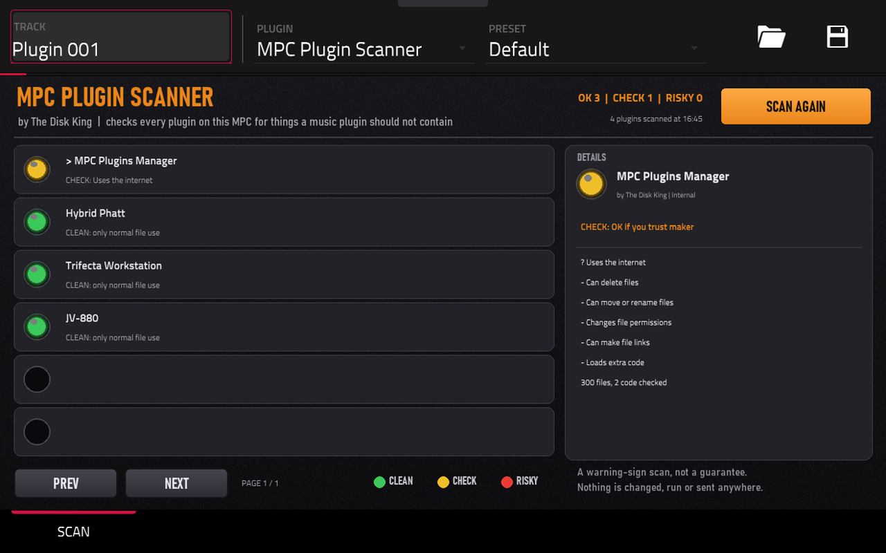
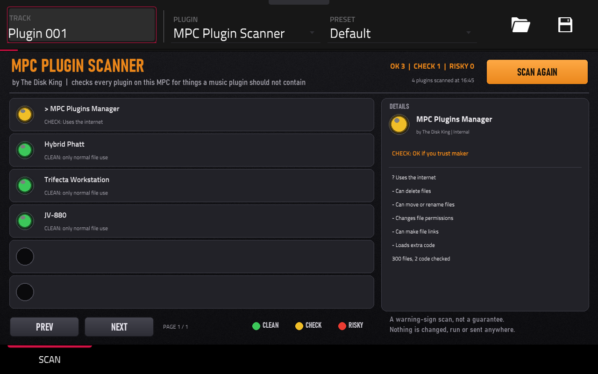
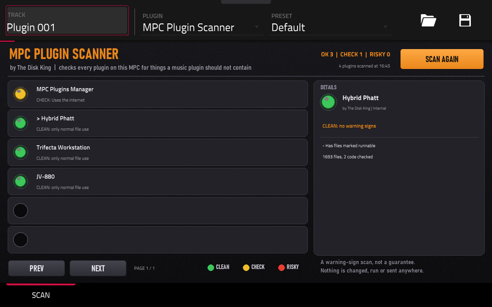

# MPC Plugin Scanner (The Disk King)

**A safety check for the plugins on your MPC — and it runs right on the MPC.**

Plugins for the MPC are free and come from many different makers. A plugin runs inside your MPC with full access to it.
MPC Plugin Scanner looks inside every plugin you have installed and tells you, in plain words, if anything in it does
something a music plugin should never need to do.

**Version 1.0.0. Tested on an Akai MPC Live III (MPC OS 3.10.1).**



## All screens

| | |
|---|---|
|  |  |

## How to use it

1. Install it like any plugin (or with MPC Plugins Manager).
2. Add a **Plugin track** and pick **MPC Plugin Scanner**. It scans straight away.
3. Every plugin gets a light: 🟢 **CLEAN**, 🟡 **CHECK** or 🔴 **RISKY**, with its main reason. The worst are listed first.
4. Tap a plugin to see **all** its reasons on the right. **SCAN AGAIN** re-checks; **PREV / NEXT** page through long lists.

It checks every `VST2 Plugins` folder on every drive: internal, SSD and USB. It makes no sound.

## What it looks for

It reads each plugin's code and files **without running them**:

**🔴 RISKY: things a music plugin should never need**
- Running other programs or shell commands (`system`, `exec…`, `/bin/sh`, `sh -c`)
- Delete-everything and disk-erasing commands (`rm -rf`, `mkfs`, `dd`)
- Download commands, hidden scripts, extra programs or system drivers (`.ko`) inside the plugin folder
- Back doors / remote logins (`authorized_keys`, `dropbear`, `telnetd`), reading system passwords
- Changing its own system rights, spying on other programs, changing the system setup, restarting the MPC, loading drivers
- Files with special system rights, or links that lead outside the plugin's own folder

**🟡 CHECK: fine only if you trust the maker**
- Uses the internet (normal for an online installer such as MPC Plugins Manager)
- Starts background tasks, stops other programs, reads the system's user list

**🟢 CLEAN** — no warning signs. Normal file use (saving presets, deleting or renaming its own files) is only shown as a note.

## What it never does

- It **changes nothing**, **runs nothing** and **sends nothing** anywhere. No internet, no data collection.
- It does not list itself (its own code contains the list of warning words it looks for).

**Please note:** this is a warning-sign scan, not a guarantee. Cleverly written code can hide what it does. A red light
means "remove it unless you really trust the maker"; a green light means no warning signs were found.

## Install

Needs MPC OS 3.10.1 or later, with **Preferences → Enhancements (Beta) → Enable Enhancements** and **External Plugin Support** on.

1. Download `MPC-Plugin-Scanner-1.0.0-mpc-sdk.zip` from the Releases page.
2. Copy the folder `The Disk King - VST - MPC Plugin Scanner` into `VST2 Plugins` on your MPC's internal drive.
3. Restart the MPC and load **MPC Plugin Scanner** on a plugin track.

Or install it in one tap with [MPC Plugins Manager](https://github.com/mpcplugins/mpc-plugins-manager).

## Build from source

Built with Akai's MPC Plugin SDK. Put this folder in the SDK's `plugins/` folder as `MPC Plugin Scanner`, then:

```
python tools/build.py "plugins/MPC Plugin Scanner"
python "plugins/MPC Plugin Scanner/make_skin.py"
python tools/build.py "plugins/MPC Plugin Scanner"
```

## Disclaimer

Provided as is, with no warranty of any kind. Use at your own risk; The Disk King is not responsible in any way for any
loss, damage or problem from using it or from any plugin it checks.

More MPC sounds and plugins: https://thediskking.com
