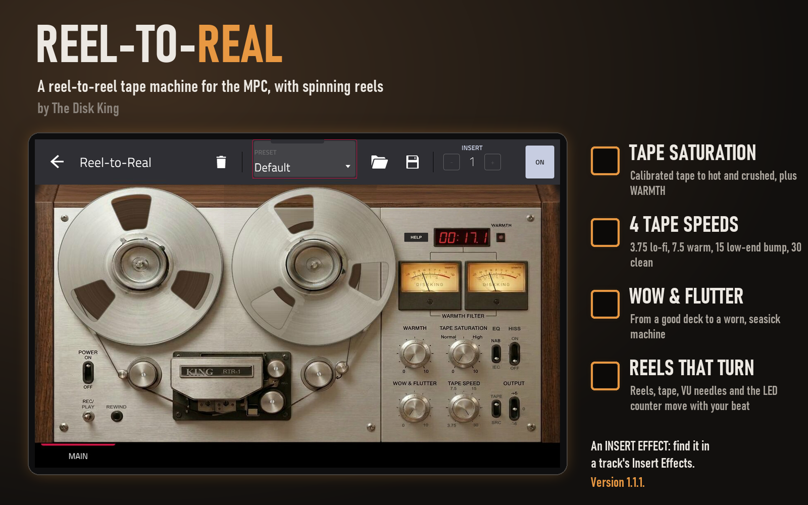
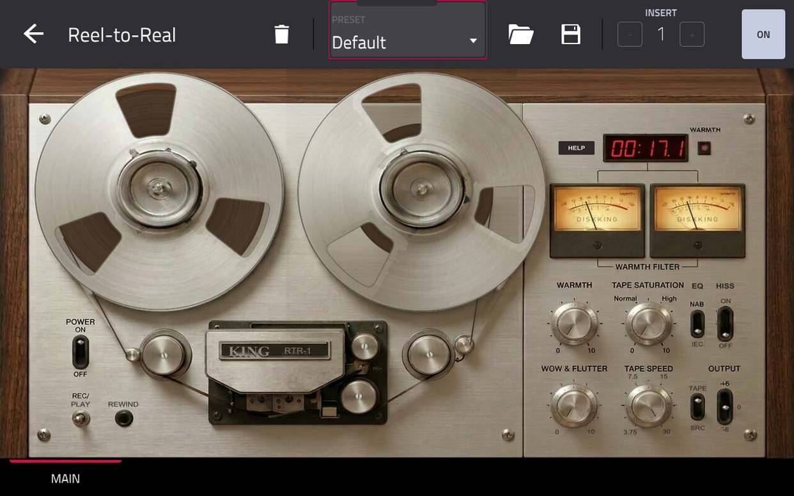
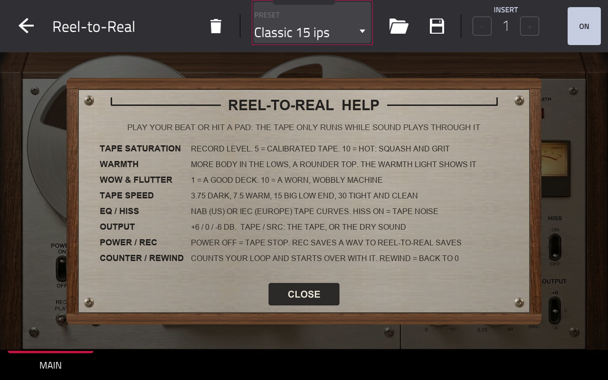

# Reel-to-Real (The Disk King)

A reel-to-reel tape machine for Akai MPC standalone hardware. Run your beat, a track or a single sample through
tape: saturation, warmth, wow and flutter, tape speed from 3.75 to 30 inches per second, real NAB / IEC tape
curves, hiss, tape stop, and recording to a WAV. While the sound plays, the reels really turn (the full reel slowly,
the empty one fast), the tape moves from one reel to the other, the VU needles move and the red counter runs.

**Version 1.1.1. Tested on Gen 1 (Akai MPC X SE) and Gen 2 (Akai MPC Live III), MPC OS 3.10.1. Use at your own risk.**

## This is an EFFECT: find it in Insert Effects

Reel-to-Real is an **insert effect**, not an instrument. To use it:

1. Open the **Mixer** (or a track's / pad's **Insert Effects**) and tap an empty **Insert** slot.
2. Choose **External Plugins → The Disk King → Reel-to-Real**. Tap the slot's edit (pencil) icon to see the deck.
3. Pick a preset from the **preset name at the top of the plugin window** (it starts on **Classic 15 ips**), then play.
4. Tap **HELP** on the deck any time.

**Where you put it decides what goes on tape:** on a pad = that sample only, on a track = the whole track, on the
**Master** insert = your whole beat.

The tape only runs while sound plays through it (that is how the MPC runs insert effects): with no sound the reels
coast to a stop.

## Download

**Gen 1** (32-bit): MPC Live, Live II, One, One+, X, Key 61, Key 37, Force

**Gen 2** (64-bit): MPC Live III, XL

**Get updates automatically:** a zip you download by hand never updates itself. Install **[MPC Plugins Manager](https://mpcplugins.github.io/p/mpc-plugins-manager/)** once on your MPC: it shows when a new version of Reel-to-Real is out and installs it in one tap.

**Easiest:** on your MPC, open **MPC Plugins Manager**, find **Reel-to-Real** and tap **Install**.

**By hand, step by step:**
1. Click the **DOWNLOAD** button above. A file called `Reel-to-Real-1.1.1-mpc-sdk.zip` lands in your **Downloads** folder.
2. Unzip it. On Windows: right-click the file, then **Extract All**. On a Mac: double-click it.
3. Connect your MPC to the computer with its USB cable and switch it to **Computer Mode**, so its **internal drive** shows up on the computer.
4. On the MPC's internal drive, open the folder **VST2 Plugins** (make it if it is not there).
5. Copy the folder **The Disk King - VST - Reel-to-Real** from the unzipped files into **VST2 Plugins**.
6. On the MPC: **Preferences → Enhancements (Beta)** → turn on **Enable Enhancements** and **External Plugin Support** (needs MPC OS 3.10.1 or later). Restart the MPC.
7. Put it in an **Insert Effects** slot (see above) and play.

## Screens

| | |
|---|---|
|  |  |

## The controls

| Control | What it does |
|---|---|
| TAPE SATURATION (Normal..High, 0-10) | The record level. **5 = calibrated tape** (a clean, glued tape sound). Up to 10 = recorded hot: squash, 3rd-harmonic grit, and the highs squash first, like real tape. 0 = recorded low and clean. |
| WARMTH (0-10) | More body in the lows (up to +6 dB) and a rounder top (up to -8 dB), plus a little tube-like 2nd harmonic. The WARMTH light shows it is on. |
| WOW & FLUTTER (0-10) | Pitch wobble. 1 = a good deck, 10 = a worn, seasick machine. The flutter speed follows the tape speed, like the real capstan and rollers. |
| TAPE SPEED (3.75 / 7.5 / 15 / 30 ips) | 3.75: dark, lo-fi, more hiss. 7.5: warm. 15: the classic low-end "head bump". 30: tight and clean. It also sets how fast the reels turn. |
| EQ (NAB / IEC) | The two real tape EQ standards (US NAB or European IEC), with the right curves for each speed. |
| HISS (ON / OFF) | Real tape noise, louder at slow speeds; recording hotter lowers it under the music. |
| OUTPUT (+6 / 0 / -6 dB) | Output level. Tap the top, middle or bottom of the switch. |
| TAPE / SRC | Hear the tape, or the dry sound to compare. |
| POWER | OFF = a tape stop (the tape slows to a halt). ON = back. |
| REC / PLAY | REC records what you hear to a WAV in **Reel-to-Real Saves** on the drive. The counter shows -rEC-, then SAVEd. |
| REWIND | Spins the reels back to 00:00.0. |
| VU meters, counter | The VU needles show the output level in real dB. While your sequence plays, the counter counts your loop and goes back to 00:00.0 each time it starts over; with only pads, it shows tape time. |

## Presets

SATURATION 5 is calibrated tape; WOW & FLUTTER 1 is a good deck. OUTPUT 0 dB and POWER on in all of them.

| Preset | Speed | EQ | SATURATION | WARMTH | WOW & FLUTTER | HISS | Use it on |
|---|---|---|---|---|---|---|---|
| Classic 15 ips | 15 | NAB | 6 | 3 | 2 | off | Anything: the classic tape sound (loads first) |
| Mix Bus 15 ips | 15 | NAB | 5 | 0 | 1 | off | The whole beat: rounder, more low end |
| Mix Bus 30 ips | 30 | IEC | 5 | 0 | 1 | off | The whole beat: tighter and cleaner |
| Mastering 30 ips | 30 | IEC | 4 | 0 | 0.5 | off | The Master, gently |
| Drum Bus 15 ips | 15 | NAB | 7 | 1 | 1 | off | Drums: punch and crunch |
| Overheads 30 ips | 30 | IEC | 6 | 0 | 1 | off | Cymbals and overheads: smooths the harshness |
| Bass 15 ips | 15 | NAB | 6 | 2 | 1 | off | Bass: low-end bump and warmth |
| Warm & Fat 7.5 | 7.5 | NAB | 6 | 3 | 1.5 | on | Samples, keys, vocals: warm and fat |
| Home Deck 3.75 | 3.75 | NAB | 6 | 3 | 2.5 | on | Lo-fi: a home deck at slow speed |
| Worn Tape 3.75 | 3.75 | NAB | 7 | 6 | 8 | on | Lo-fi: an old, worn, wobbly tape |
| Clean Transport | 30 | IEC | 0 | 0 | 0 | off | No tape colour (just the deck moving) |

The settings follow published specs of classic 1/4-inch decks and tape (calibration level, head bump, tape EQ
time constants, wow and flutter, hiss) and how engineers describe the speeds: 30 ips tight and clean for mix bus
and mastering, 15 ips rounder with more low end for rock mixes and drums, 7.5 and below warm and fat.

## What is new in 1.1.1

- **Presets move the panel:** pick a preset and the knobs, switches and buttons on the panel go to its settings.
- **Starts on Default:** a new "Default" preset (nothing set) is first, and the plugin loads on it until you pick a preset.
- **DISKKING on the meters:** the meter faces now carry The Disk King's DISKKING brand, in the Diskking 670 meter's lettering.
- Everything else as in 1.1.0. Your projects still open.

## What is new in 1.1.0

- **The counter follows your loop:** while the MPC sequence plays, it shows the time from the start of the loop and resets to 00:00.0 every pass (a 4-bar loop at 90 BPM counts to 00:10.6, then starts over).
- **Fills the whole MPC screen** (the deck is stretched evenly, so nothing is cut off and no dark bars).
- **New HELP card in the deck's own look:** wood frame, brushed panel, the panel's lettering and corner screws.

## Older versions

- [1.1.0](https://github.com/mpcplugins/community-plugins/releases/tag/reel-to-real-v1.1.0): the counter follows your loop, full-screen deck, new HELP card.
- [1.0.0](https://github.com/mpcplugins/community-plugins/releases/tag/reel-to-real-v1.0.0): first release.

## Known limits

- The tape (and the reels) only run while sound plays through the plugin; that is how the MPC runs insert effects.
- REC saves up to 3 minutes per take.

## Disclaimer

Provided as is, with no warranty of any kind. Use entirely at your own risk; The Disk King is not responsible in any way
for any loss, damage or problem from using it.

More MPC sounds: https://thediskking.com
