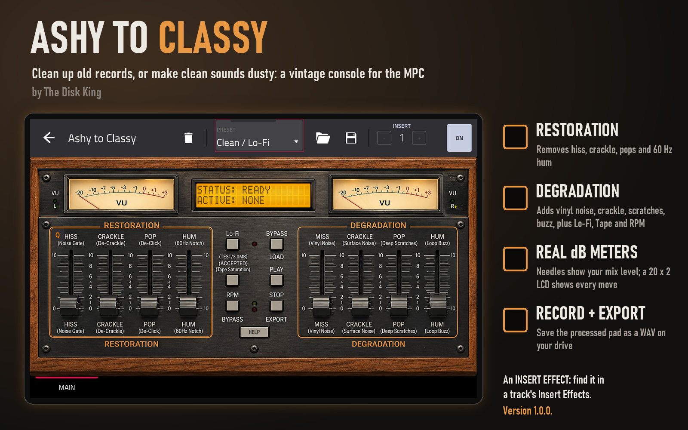

Ashy to Classy 1.0.0 by The Disk King

**First release.** A vintage console for the MPC: clean up old records, or make clean sounds dusty.

**It is an EFFECT: find it in Insert Effects.** It is not in the Plugin track list. Open the Mixer (or a track's Insert Effects), tap an empty Insert slot and choose External Plugins → The Disk King → Ashy to Classy. Then **hit the pad the sample is on** to hear it with the effects: the plugin only runs while sound plays through it. Tap HELP on the console any time.

- **Restoration:** hiss, crackle, pop and 60 Hz hum removal.
- **Degradation:** vinyl noise, surface crackle, deep scratches, loop buzz.
- **Lo-Fi, Tape, RPM** (wow and flutter) and **Bypass**.
- **Level meters in real dB**, an amber 20 x 2 LCD, HELP pop-up, 7 presets, Q-Links on all faders.
- **Record and export** the processed pad as a WAV (`Ashy to Classy Saves` on the drive).

Known limit: crackle and pop removal is gentle in 1.0; a stronger de-crackler is planned. Tested on an Akai MPC Live III, MPC OS 3.10.1.

Install: copy `The Disk King - VST - Ashy to Classy` into `VST2 Plugins` on your MPC's internal drive (MPC OS 3.10.1+, Enhancements and External Plugin Support on), or install it with MPC Plugins Manager.

Provided as is, with no warranty. Use at your own risk; The Disk King is not responsible in any way for any loss or damage.
