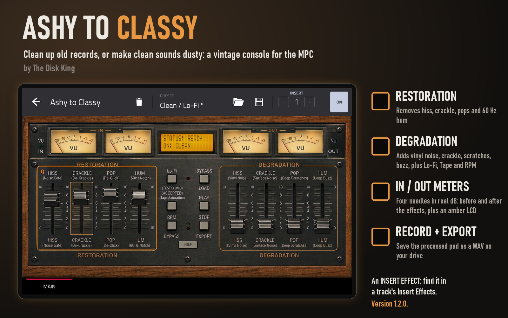

Ashy to Classy 1.2.0 by The Disk King

**New look and four meters.** A fresh console with **IN** and **OUT** meter pairs, so you can see exactly what the effects do to your level.

- **Four VU meters in real dB:** the **IN** pair shows the sound coming in (before the effects), and the **OUT** pair shows it going out (after). Use them to match levels, then compare with BYPASS at the same loudness. The IN and OUT lights show when sound is coming in and going out.
- **New artwork:** a wider console with IN / OUT plaques and a 16 x 2 amber dot-matrix LCD (status, what is on, and the value of any fader you move).
- **HELP** explains where to put it: on a pad = that sample only, on a track = the whole track, on the Master = the whole beat.
- **Fixed:** the Q-Link outline now sits exactly on the RESTORATION and DEGRADATION panels.
- Your 1.0 projects still open: no settings were renamed or moved.

**It is an EFFECT: find it in Insert Effects** (Mixer or a track's Insert Effects → External Plugins → The Disk King → Ashy to Classy), then **hit the pad the sample is on** to hear it. Tested on an Akai MPC Live III, MPC OS 3.10.1.

Install: copy `The Disk King - VST - Ashy to Classy` into `VST2 Plugins` on your MPC's internal drive (MPC OS 3.10.1+, Enhancements and External Plugin Support on), or install it with MPC Plugins Manager. Updating from 1.0: replace the old folder, then remove the plugin from its insert slot and add it again.

Provided as is, with no warranty. Use at your own risk; The Disk King is not responsible in any way for any loss or damage.
