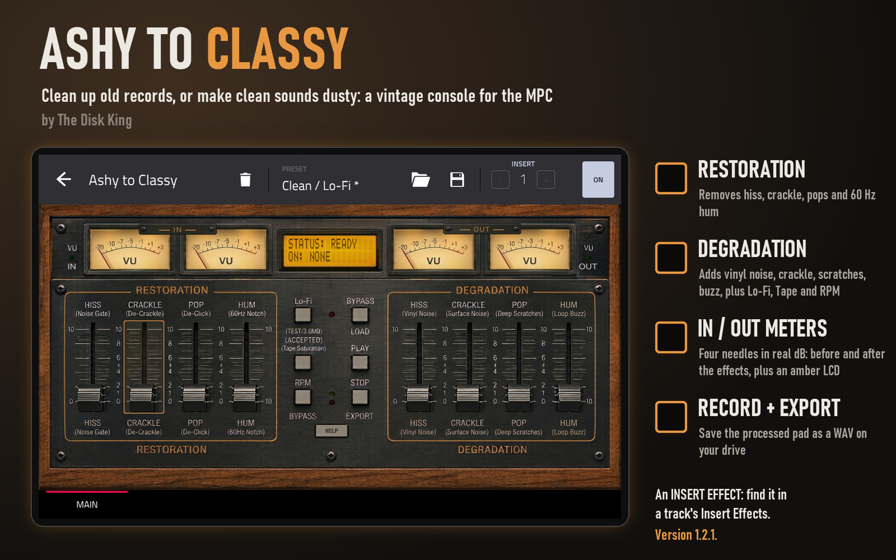

Ashy to Classy 1.2.1 by The Disk King

**Cleaner panels.** A small look update to 1.2.

- **No more orange Q-Link box** drawn over the RESTORATION and DEGRADATION panels. The Q-Link knobs still work the same (top row = Restoration faders, second row = Degradation faders).
- **The selected-fader outline is now very faint** (10% opacity), so it no longer covers the art.
- Everything else is the same as 1.2.0: four IN / OUT meters in real dB, the 16 x 2 amber LCD, HELP, record and export. Your 1.0 and 1.2 projects still open.

**It is an EFFECT: find it in Insert Effects** (Mixer or a track's Insert Effects → External Plugins → The Disk King → Ashy to Classy), then **hit the pad the sample is on** to hear it. Tested on an Akai MPC Live III, MPC OS 3.10.1.

Install: copy `The Disk King - VST - Ashy to Classy` into `VST2 Plugins` on your MPC's internal drive (MPC OS 3.10.1+, Enhancements and External Plugin Support on), or install it with MPC Plugins Manager. Updating: replace the old folder, then remove the plugin from its insert slot and add it again.

Provided as is, with no warranty. Use at your own risk; The Disk King is not responsible in any way for any loss or damage.
