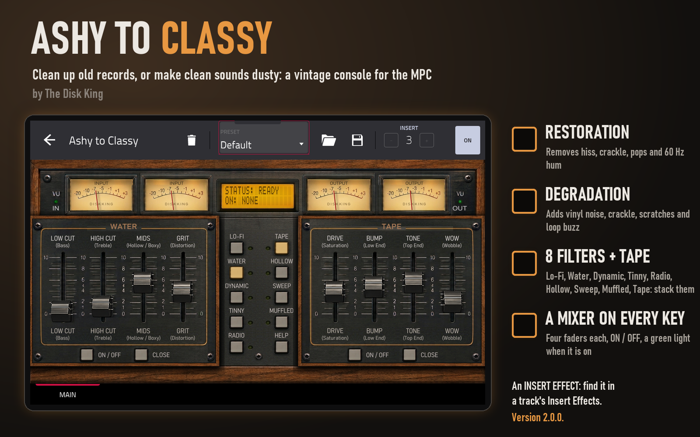

Ashy to Classy 2.0.0 by The Disk King

**Ten new keys, each with its own mixer: eight filters and a real analog TAPE. New INPUT / OUTPUT meters with DISKKING.**

- **Ten keys in the middle:** LO-FI, WATER, DYNAMIC, TINNY, RADIO (left) and TAPE, HOLLOW, SWEEP, MUFFLED, HELP (right). Tap a key and its **mixer** opens over that side of the console: four faders, **ON / OFF** and **CLOSE**. A **green light** beside a key = that sound is on.
- **Eight filters:** LO-FI (telephone), WATER (underwater), DYNAMIC (opens and closes with your playing), TINNY (small speaker), RADIO (AM radio), HOLLOW (scooped, ghostly), SWEEP (sways by itself, smooth or in steps), MUFFLED (through the wall). The still ones share LOW CUT, HIGH CUT, MIDS and GRIT; each keeps its own settings and starts on a sound that already works.
- **Real analog TAPE:** DRIVE (saturation that hits the highs first, like tape), BUMP (the low-end head bump), TONE (top roll-off) and WOW (wow and flutter).
- **Stack them:** turn on as many keys as you like; they run one after another.
- **New meters:** no more IN / OUT plates; the faces say INPUT and OUTPUT, with The Disk King's DISKKING at the bottom.
- **The added vinyl noise only plays while your music plays:** no sound in, no noise out.
- **Presets move the panel:** pick a preset and the knobs, switches and buttons on the panel go to its settings. 16 presets, starting on **Default** (everything off), plus new ones for every key: Old Radio, Long Distance, Water, Dynamic, Tinny, Hollow, Sweep, Muffled, Hot Tape.
- **Gone:** BYPASS (use the MPC's own ON key in the plugin header), PLAY / STOP-EXPORT (resample on the MPC) and RPM (now TAPE's WOW fader). The RESTORATION and DEGRADATION faders are unchanged and your old projects still open.

**It is an EFFECT: find it in Insert Effects** (Mixer or a track's Insert Effects → External Plugins → The Disk King → Ashy to Classy). Tested on an Akai MPC Live III, MPC OS 3.10.1.

Install: copy `The Disk King - VST - Ashy to Classy` into `VST2 Plugins` on your MPC's internal drive (MPC OS 3.10.1+, Enhancements and External Plugin Support on), or install it with MPC Plugins Manager (it also brings you every update). Updating: replace the old folder, then remove the plugin from its insert slot and add it again.

Provided as is, with no warranty. Use at your own risk; The Disk King is not responsible in any way for any loss or damage.
