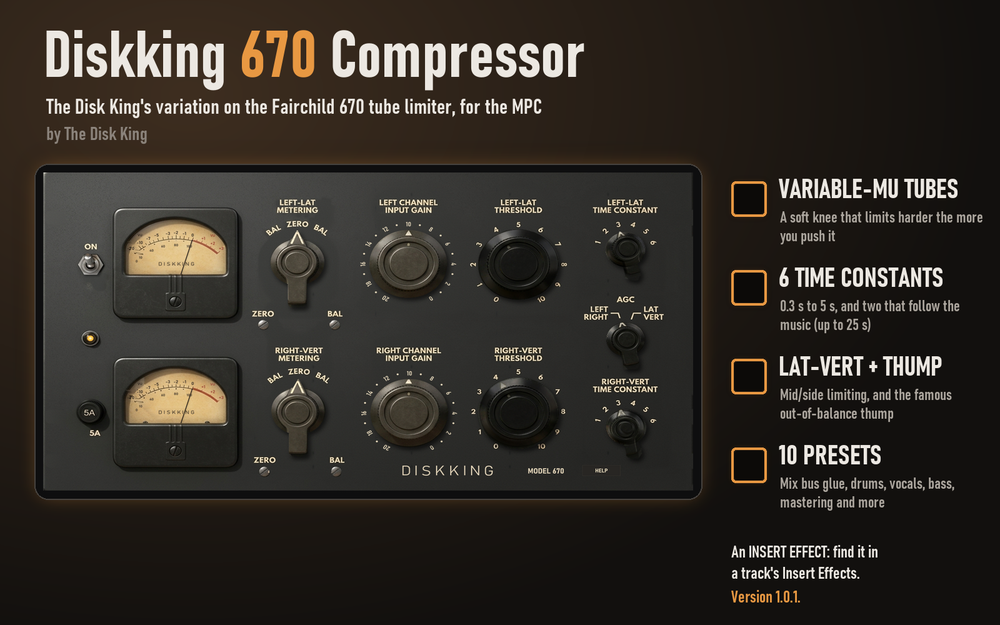

DISKKING 670 Compressor 1.0.0 by The Disk King

**Diskking 670 Compressor by The Disk King: Inspired by the Fairchild 670 two-channel variable-mu tube limiter.**

- **A variable-mu tube limiter:** a very soft knee that limits harder the more you push it (about 2:1 near the threshold, 10:1 and more when pushed), with tube and transformer colour.
- **The real unit's controls:**
  - INPUT GAIN in 1 dB clicks (10 = unity) and THRESHOLD (0 = no limiting);
  - six TIME CONSTANT settings, from 0.3 s to 5 s; settings 5 and 6 follow the music, up to 25 s;
  - METERING BAL / ZERO / BAL;
  - ZERO and BAL screws, where BAL off centre gives the famous thump;
  - AGC LEFT-RIGHT or LAT-VERT (mid/side).
- **The meters rest on 0, unlike most VU meters:** they show gain reduction and swing left as the limiter squeezes.
- **Turning the knobs:** slide up to turn right, slide down to turn left, or tap a label on the few-step knobs.
- **10 presets** (INPUT GAIN / THRESHOLD / TIME CONSTANT):
  - **Mix Bus Glue TC2** (10 / 4 / 2): the whole beat, glue. Loads first.
  - **Lat-Vert Bus TC5** (10 / 4 and 3 / 5, LAT-VERT): glue that keeps the centre steady.
  - **Vocal Leveler TC1** (9 / 6 / 1): keeps vocals even.
  - **Drum Squash TC1** (6 / 8 / 1): hard, fast squash.
  - **Mastering TC3** (10 / 3 / 3): the Master, gently.
  - **Program Auto TC6** (10 / 5 / 6): the release follows the music.
  - **Bass Smooth TC4** (9 / 6 / 4): smooth, steady bass.
  - **Hard Limit TC2** (8 / 9 / 2): a hard limit on the peaks.
  - **Thump (Out of Bal)** (9 / 7 / 1, BAL screws off centre): the famous thump as an effect.
  - **Clean Line Amp** (10 / 0 / 3): no limiting, just the tubes and transformers.
- A HELP card in the machine's own look.

**It is an EFFECT: find it in Insert Effects** (Mixer or a track's Insert Effects → External Plugins → The Disk King → DISKKING 670 Compressor). Tested on an Akai MPC Live III, MPC OS 3.10.1.

Install: copy `The Disk King - VST - DISKKING 670 Compressor` into `VST2 Plugins` on your MPC's internal drive (MPC OS 3.10.1+, Enhancements and External Plugin Support on), or install it with MPC Plugins Manager. New versions are listed at mpcplugins.github.io.

*Fairchild is a trademark of its owner. The Disk King is not affiliated with or endorsed by them; the name is used only to say which classic unit this plugin is inspired by.*

Provided as is, with no warranty. Use at your own risk; The Disk King is not responsible in any way for any loss or damage.
