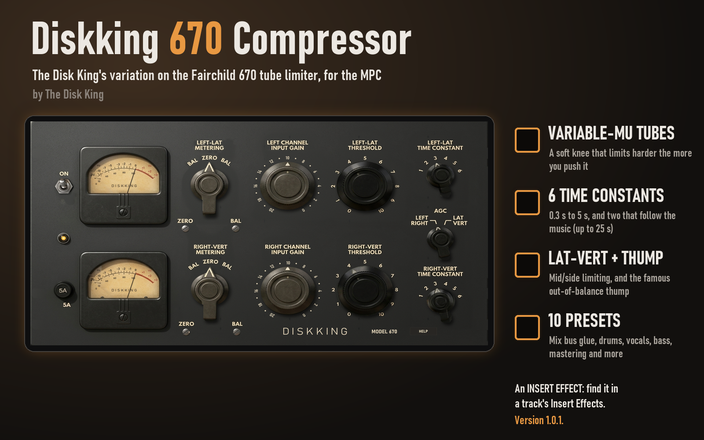

Diskking 670 Compressor 1.0.1 by The Disk King

**New name: Diskking 670 Compressor.** The Disk King's variation on the Fairchild 670 tube limiter, for the MPC.

- **New name on the MPC:** Diskking 670 Compressor (1.0.0 showed it in all capitals). The sound, the panel and the 10 presets are the same as 1.0.0.
- **Updating from 1.0.0:** delete the old folder `The Disk King - VST - DISKKING 670 Compressor` from `VST2 Plugins` (or remove it in MPC Plugins Manager), then install this one. Put it back in your insert slot.
- **Get updates automatically:** install **MPC Plugins Manager** once on your MPC (https://mpcplugins.github.io/p/mpc-plugins-manager/). It shows when a new version is out and installs it in one tap. A zip you download by hand never updates itself.

**It is an EFFECT: find it in Insert Effects** (Mixer or a track's Insert Effects → External Plugins → The Disk King → Diskking 670 Compressor). Tested on an Akai MPC Live III, MPC OS 3.10.1.

*Fairchild is a trademark of its owner. The Disk King is not affiliated with or endorsed by them; the name is used only to say which classic unit this plugin is modelled on.*

Provided as is, with no warranty. Use at your own risk; The Disk King is not responsible in any way for any loss or damage.
