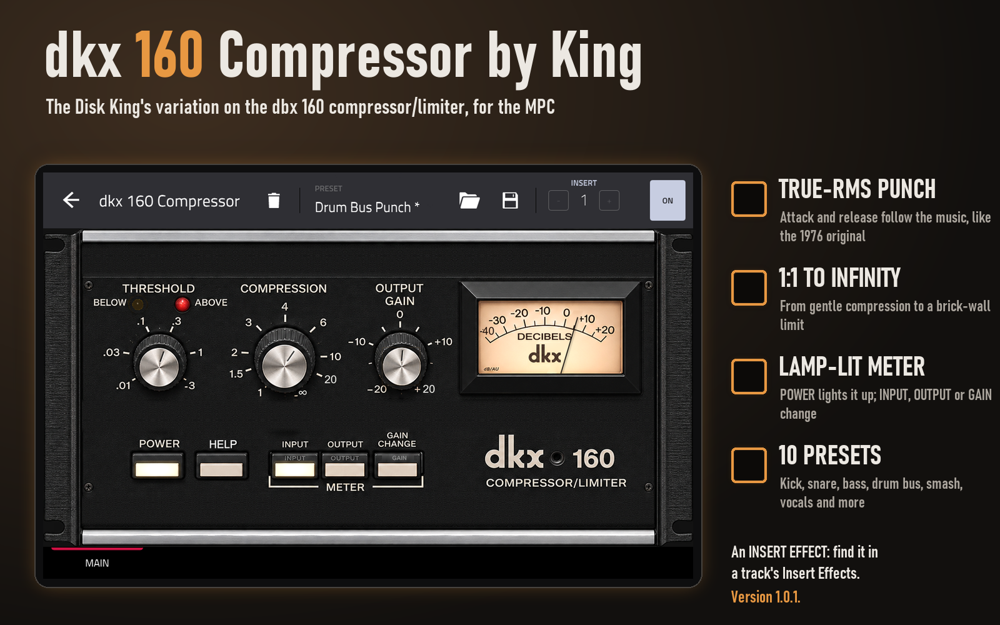

dkx 160 Compressor 1.0.0 by The Disk King

**dkx 160 Compressor by The Disk King: Inspired by the dbx 160 compressor/limiter (1976).**

- **Inspired by the dbx 160:** true-RMS detection with no attack or release knobs, just like the original. It follows the music by itself: about 15 ms for a 10 dB jump, 5 ms for 20 dB and 3 ms for 30 dB, and it lets go at about 120 dB a second. That is the 160's punch on kick, snare and bass.
- **THRESHOLD** in volts (10 mV to 3 V), **COMPRESSION** from 1:1 to infinity, **OUTPUT GAIN** ±20 dB.
- **Amber BELOW / red ABOVE** threshold lights (both glow dimly right at the threshold, as in the original manual).
- **Lamp-lit meter:** POWER lights it up and it reads INPUT, OUTPUT or GAIN change, from -40 to +20. Off = dark, and the sound passes untouched.
- **Lit buttons:** POWER and the selected meter button glow warm white. **HELP** sits right next to POWER.
- **10 presets** (THRESHOLD / COMPRESSION / OUTPUT GAIN):
  - **Drum Bus Punch** (0.77 V / 3:1 / +4 dB): loads first.
  - **Kick Punch** (1 V / 4:1 / +4 dB).
  - **Snare Crack** (0.62 V / 4:1 / +5 dB).
  - **Bass Leveler** (0.49 V / 6:1 / +6 dB).
  - **Vocal Leveler** (0.39 V / 3:1 / +5 dB).
  - **Drum Smash** (0.15 V / 20:1 / +12 dB).
  - **Mix Bus Gentle** (1.2 V / 1.5:1 / +1.5 dB).
  - **Peak Limiter 10:1** (2.5 V / 10:1 / +3 dB).
  - **Hard Limit Inf** (2 V / infinity / +6 dB).
  - **Clean Line Amp** (3 V / 1:1 / 0 dB): the manual's line-amplifier setting.
- **Get updates automatically:** install **MPC Plugins Manager** once on your MPC (https://mpcplugins.github.io/p/mpc-plugins-manager/). It shows when a new version is out and installs it in one tap.

**It is an EFFECT: find it in Insert Effects** (Mixer or a track's Insert Effects → External Plugins → The Disk King → dkx 160 Compressor). Tested on an Akai MPC Live III, MPC OS 3.10.1.

Install: copy `The Disk King - VST - dkx 160 Compressor` into `VST2 Plugins` on your MPC's internal drive (MPC OS 3.10.1+, Enhancements and External Plugin Support on), or install it with MPC Plugins Manager.

*dbx is a trademark of its owner. The Disk King is not affiliated with or endorsed by them; the name is used only to say which classic unit this plugin is inspired by. The dkx logo is The Disk King's own.*

Provided as is, with no warranty. Use at your own risk; The Disk King is not responsible in any way for any loss or damage.
