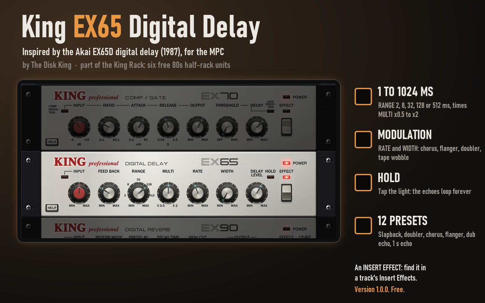

King EX65 1.0.0 by The Disk King

**King EX65 by The Disk King: Inspired by the Akai EX65D digital delay (1987). Delay time RANGE (2, 8, 32, 128, 512 ms) x MULTI (x0.5 to x2) = 1 to 1024 ms, FEED BACK, RATE and WIDTH modulation (chorus, flanger, doubling, tape wobble), DELAY LEVEL, HOLD (loops the echoes forever), INPUT light, EFFECT in/out with the echoes ringing out.**

Part of **The King Rack**: six free 80s half-rack effects inspired by Akai's 1987-88 EX series. Get all six:
https://github.com/mpcplugins/community-plugins/tree/main/king-rack

**It is an EFFECT: find it in Insert Effects** (Mixer or a track's Insert Effects → External Plugins → The Disk King → King EX65). Tested on Gen 1 (Akai MPC X SE) and Gen 2 (Akai MPC Live III), MPC OS 3.10.1.

Downloads: **Gen 1** (32-bit: Live, Live II, One, One+, X, Key 61, Key 37, Force) `*-mpc-armv7.zip`, **Gen 2** (64-bit: Live III, XL) `*-mpc-aarch64.zip`, or `*-mpc-sdk.zip` that works on both.

Install: copy `The Disk King - VST - King EX65` into `VST2 Plugins` on your MPC's internal drive (MPC OS 3.10.1+, Enhancements and External Plugin Support on), or install it with **MPC Plugins Manager** (https://mpcplugins.github.io/p/mpc-plugins-manager/): it also brings you every update.

*Akai and EX65D are trademarks of their owner. The Disk King is not affiliated with or endorsed by them; the name is used only to say which classic unit this plugin is inspired by.*

Provided as is, with no warranty. Use at your own risk; The Disk King is not responsible in any way for any loss or damage.
