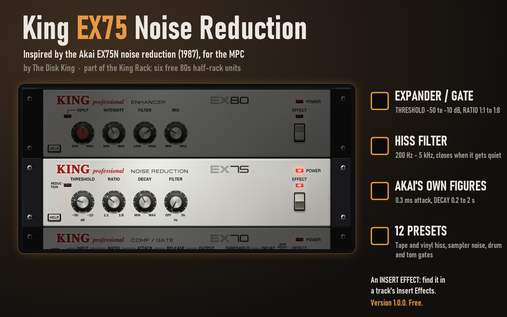

King EX75 1.0.0 by The Disk King

**King EX75 by The Disk King: Inspired by the Akai EX75N noise reduction (1987). THRESHOLD -50 to -10 dB, RATIO 1:1 to 1:8 (gentle expander to hard gate), 0.3 ms attack, DECAY 0.2 to 2 s, a 6 dB/oct FILTER (200 Hz to 5 kHz) that rolls the hiss off when the sound gets quiet, REDUCTION light, EFFECT in/out.**

Part of **The King Rack**: six free 80s half-rack effects inspired by Akai's 1987-88 EX series. Get all six:
https://github.com/mpcplugins/community-plugins/tree/main/king-rack

**It is an EFFECT: find it in Insert Effects** (Mixer or a track's Insert Effects → External Plugins → The Disk King → King EX75). Tested on an Akai MPC Live III, MPC OS 3.10.1.

Install: copy `The Disk King - VST - King EX75` into `VST2 Plugins` on your MPC's internal drive (MPC OS 3.10.1+, Enhancements and External Plugin Support on), or install it with **MPC Plugins Manager** (https://mpcplugins.github.io/p/mpc-plugins-manager/): it also brings you every update.

*Akai and EX75N are trademarks of their owner. The Disk King is not affiliated with or endorsed by them; the name is used only to say which classic unit this plugin is inspired by.*

Provided as is, with no warranty. Use at your own risk; The Disk King is not responsible in any way for any loss or damage.
