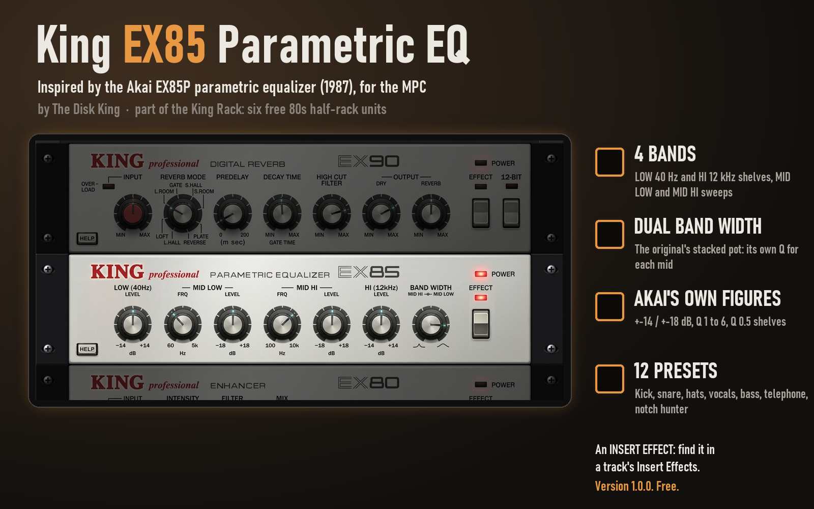

King EX85 1.0.0 by The Disk King

**King EX85 by The Disk King: Inspired by the Akai EX85P parametric equalizer (1987). Four bands with Akai's own figures: LOW shelf at 40 Hz (+-14 dB, Q 0.5), sweepable MID LOW (60 Hz-5 kHz) and MID HI (100 Hz-10 kHz) at +-18 dB, HI shelf at 12 kHz (+-14 dB, Q 0.5), the dual BAND WIDTH knob (its own Q for each mid, 1 to 6), EFFECT in/out switch.**

Part of **The King Rack**: six free 80s half-rack effects inspired by Akai's 1987-88 EX series. Get all six:
https://github.com/mpcplugins/community-plugins/tree/main/king-rack

**It is an EFFECT: find it in Insert Effects** (Mixer or a track's Insert Effects → External Plugins → The Disk King → King EX85). Tested on Gen 1 (Akai MPC X SE) and Gen 2 (Akai MPC Live III), MPC OS 3.10.1.

Downloads: **Gen 1** (32-bit: Live, Live II, One, One+, X, Key 61, Key 37, Force) `*-mpc-armv7.zip`, **Gen 2** (64-bit: Live III, XL) `*-mpc-aarch64.zip`, or `*-mpc-sdk.zip` that works on both.

Install: copy `The Disk King - VST - King EX85` into `VST2 Plugins` on your MPC's internal drive (MPC OS 3.10.1+, Enhancements and External Plugin Support on), or install it with **MPC Plugins Manager** (https://mpcplugins.github.io/p/mpc-plugins-manager/): it also brings you every update.

*Akai and EX85P are trademarks of their owner. The Disk King is not affiliated with or endorsed by them; the name is used only to say which classic unit this plugin is inspired by.*

Provided as is, with no warranty. Use at your own risk; The Disk King is not responsible in any way for any loss or damage.
