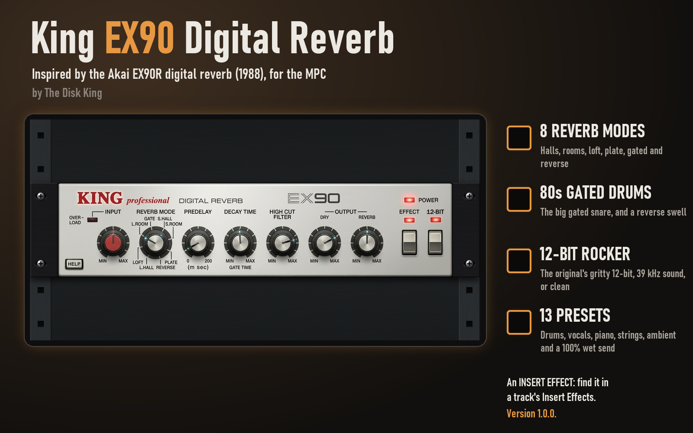

King EX90 1.0.0 by The Disk King

**King EX90 by The Disk King: Inspired by the Akai EX90R digital reverb (1988).**

- **Eight reverb modes:** L.HALL, LOFT, L.ROOM, GATE, S.HALL, S.ROOM, PLATE and REVERSE, on a click-stop dial like the original.
- **The 80s gated drum sound** and a **reverse swell** (GATE TIME 80 ms to 1.5 s).
- **PREDELAY** 0 to 200 ms, **DECAY** 0.3 to 15 s, a steep 24 dB/octave **HIGH CUT** (1 to 16 kHz), separate **DRY** and **REVERB** levels.
- **EFFECT rocker:** switch it out and the tail rings out naturally, like the original.
- **12-BIT rocker:** the original's 12-bit, 39 kHz converter sound, or clean.
- **OVERLOAD** light, **POWER**, **HELP** card, and the unit bolted into its own rack.
- **13 presets:** Big Gated Drums, Snare Plate, Vocal Plate, Drum Machine Room, Large Room Kit, Small Hall Vocal, Concert Hall, Hall Strings, Crisp Piano Loft, Reverse Swell, Ambient Wash, Send 100% Wet and Default.

**It is an EFFECT: find it in Insert Effects** (Mixer or a track's Insert Effects → External Plugins → The Disk King → King EX90). Tested on an Akai MPC Live III, MPC OS 3.10.1.

Install: copy `The Disk King - VST - King EX90` into `VST2 Plugins` on your MPC's internal drive (MPC OS 3.10.1+, Enhancements and External Plugin Support on), or install it with **MPC Plugins Manager** (https://mpcplugins.github.io/p/mpc-plugins-manager/): it also brings you every update.

*Akai and EX90R are trademarks of their owner. The Disk King is not affiliated with or endorsed by them; the name is used only to say which classic unit this plugin is inspired by.*

Provided as is, with no warranty. Use at your own risk; The Disk King is not responsible in any way for any loss or damage.
