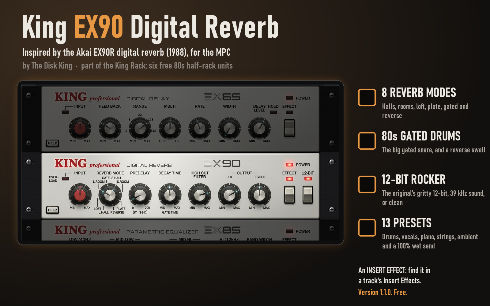

King EX90 1.1.0 by The Disk King

**King EX90 by The Disk King: Inspired by the Akai EX90R digital reverb (1988). Eight modes (L.HALL, LOFT, L.ROOM, GATE, S.HALL, S.ROOM, PLATE, REVERSE), predelay 0-200 ms, decay 0.3-15 s or gate time, high cut 1-16 kHz, separate DRY and REVERB levels, overload light, EFFECT switch with a natural tail, and a 12-BIT switch for the original's 12-bit 39 kHz sound.**

Part of **The King Rack**: six free 80s half-rack effects inspired by Akai's 1987-88 EX series. Get all six:
https://github.com/mpcplugins/community-plugins/tree/main/king-rack

**It is an EFFECT: find it in Insert Effects** (Mixer or a track's Insert Effects → External Plugins → The Disk King → King EX90). Tested on an Akai MPC Live III, MPC OS 3.10.1.

Install: copy `The Disk King - VST - King EX90` into `VST2 Plugins` on your MPC's internal drive (MPC OS 3.10.1+, Enhancements and External Plugin Support on), or install it with **MPC Plugins Manager** (https://mpcplugins.github.io/p/mpc-plugins-manager/): it also brings you every update.

*Akai and EX90R are trademarks of their owner. The Disk King is not affiliated with or endorsed by them; the name is used only to say which classic unit this plugin is inspired by.*

Provided as is, with no warranty. Use at your own risk; The Disk King is not responsible in any way for any loss or damage.
