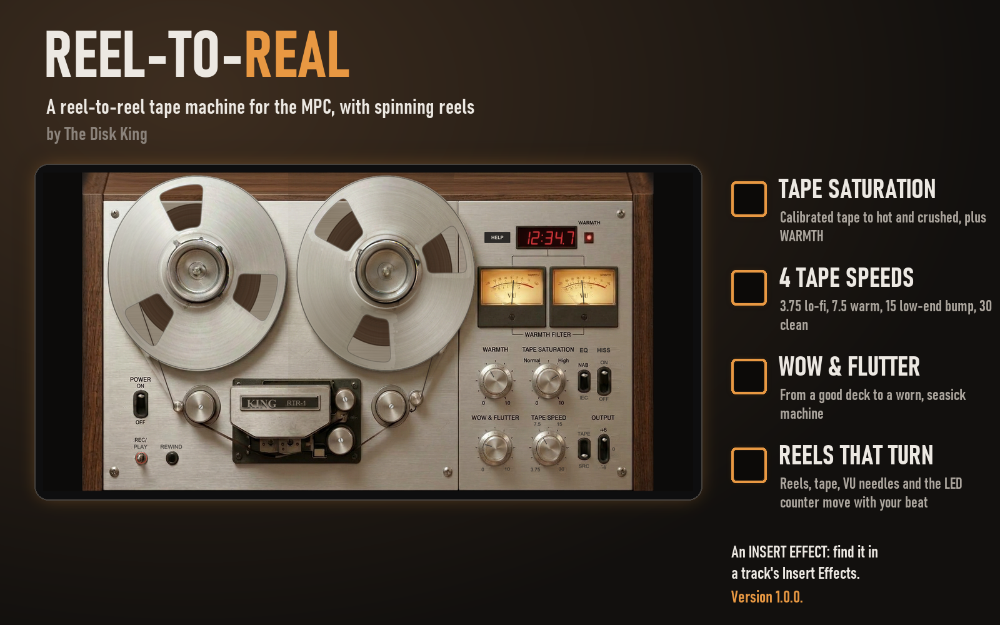

Reel-to-Real 1.0.0 by The Disk King

**First release.** A reel-to-reel tape machine for the MPC, with reels that really turn.

- **Tape sound:** TAPE SATURATION (calibrated tape up to hot and crushed, the highs squashing first like real tape), WARMTH, WOW & FLUTTER (a good deck up to a worn, seasick machine), TAPE SPEED 3.75 / 7.5 / 15 / 30 ips (lo-fi, warm, the classic low-end bump, tight and clean), NAB / IEC tape EQ, and tape HISS.
- **The deck moves:** both reels turn counter-clockwise at the real speed for the tape on them (the full reel slowly, the empty one fast), the tape moves from reel to reel, the rollers turn, the VU needles move and the red LED counter shows tape time.
- **POWER** off = tape stop. **REC** records what you hear to a WAV in `Reel-to-Real Saves`. **REWIND** spins the reels back to 00:00.0. **TAPE / SRC** compares with the dry sound. **OUTPUT** +6 / 0 / -6 dB.
- **11 presets**, from Classic 15 ips and Mix Bus 30 ips to Worn Tape 3.75. Full list in the [README](https://github.com/mpcplugins/community-plugins/tree/main/reel-to-real#presets).
- HELP card on the deck.

**It is an EFFECT: find it in Insert Effects** (Mixer or a track's Insert Effects → External Plugins → The Disk King → Reel-to-Real). On a pad it records that sample to tape, on a track the whole track, on the Master your whole beat. Tested on an Akai MPC Live III, MPC OS 3.10.1.

Install: copy `The Disk King - VST - Reel-to-Real` into `VST2 Plugins` on your MPC's internal drive (MPC OS 3.10.1+, Enhancements and External Plugin Support on), or install it with MPC Plugins Manager.

Provided as is, with no warranty. Use at your own risk; The Disk King is not responsible in any way for any loss or damage.
