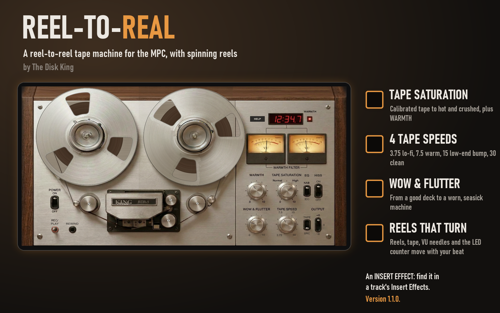

Reel-to-Real 1.1.0 by The Disk King

**The counter follows your loop, full-screen deck, and a new HELP card.**

- **The counter follows your loop:** while the MPC sequence plays, the red counter shows the time from the start of the loop and goes back to 00:00.0 every time the loop starts over (a 4-bar loop at 90 BPM counts to 00:10.6, then resets). With only pads playing it shows tape time, as before.
- **Fills the whole MPC screen:** the deck is stretched evenly sideways, so there are no dark bars and nothing is cut off.
- **New HELP card in the deck's own look:** wood frame, brushed panel, the panel's own lettering and corner screws.
- Everything else as in 1.0.0: tape saturation, warmth, wow & flutter, tape speeds 3.75 to 30 ips, NAB / IEC EQ, hiss, tape stop, WAV recording, spinning reels, VU meters and 11 presets. Your 1.0 projects still open.

**It is an EFFECT: find it in Insert Effects** (Mixer or a track's Insert Effects → External Plugins → The Disk King → Reel-to-Real). Tested on an Akai MPC Live III, MPC OS 3.10.1.

Install: copy `The Disk King - VST - Reel-to-Real` into `VST2 Plugins` on your MPC's internal drive (MPC OS 3.10.1+, Enhancements and External Plugin Support on), or install it with MPC Plugins Manager. Updating: replace the old folder, then remove the plugin from its insert slot and add it again.

Provided as is, with no warranty. Use at your own risk; The Disk King is not responsible in any way for any loss or damage.
