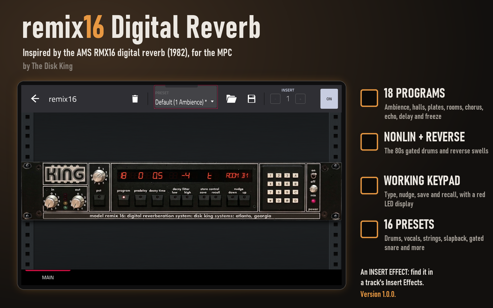

remix16 1.0.0 by The Disk King

**remix16 by The Disk King: Inspired by the AMS RMX16 digital reverb (1982).**

- **18 programs:** AMBIENCE, ROOM A1, HALL C1, PLATE A1, HALL B3, CHORUS, ECHO, NONLIN 2, REVERSE 1, DELAY, FREEZE, HALL A1, NONLIN 1, IMAGE P1, PLATE B1, REVERSE 2, ROOM A0 and ROOM B1.
- **The famous NONLIN gated drums**, **REVERSE** swells, and the **AMBIENCE** freeze (decay 9.9 never dies).
- **A front panel that really works:** a keypad, NUDGE up / down, 9 SAVE / RECALL stores kept in your MPC project, the POT knob on decay, decay filters LOW / HIGH, and a red LED display.
- **Every key acts at once:** program 2 to 9 are instant; a 1 waits 3 seconds for 10 to 18. Keys that would make a wrong number simply do nothing.
- **A closer look:** tap the keypad or the display and they pop up big, with help and close keys.
- **IN / OUT / MIX** knobs, level lights, an OVERFLOW light and POWER.
- **16 presets:** Default (1 Ambience), Ambience Vocal, Ambience Freeze Choir, Room A1 Drums, Hall C1 Vocal, Plate A1 Snare, Plate A1 Vocal, Hall B3 Strings, Chorus Thicken, Echo Slapback, Nonlin 2 Gated Snare, Nonlin 2 Big Room, Reverse 2 Swell, Delay Quarter 120, Image P1 Pan and Room B1 Small.

**It is an EFFECT: find it in Insert Effects** (Mixer or a track's Insert Effects → External Plugins → The Disk King → remix16). Tested on an Akai MPC Live III, MPC OS 3.10.1.

Install: copy `The Disk King - VST - remix16` into `VST2 Plugins` on your MPC's internal drive (MPC OS 3.10.1+, Enhancements and External Plugin Support on), or install it with **MPC Plugins Manager** (https://mpcplugins.github.io/p/mpc-plugins-manager/): it also brings you every update.

*AMS and RMX16 are trademarks of their owner. The Disk King is not affiliated with or endorsed by them; the name is used only to say which classic unit this plugin is inspired by.*

Provided as is, with no warranty. Use at your own risk; The Disk King is not responsible in any way for any loss or damage.
