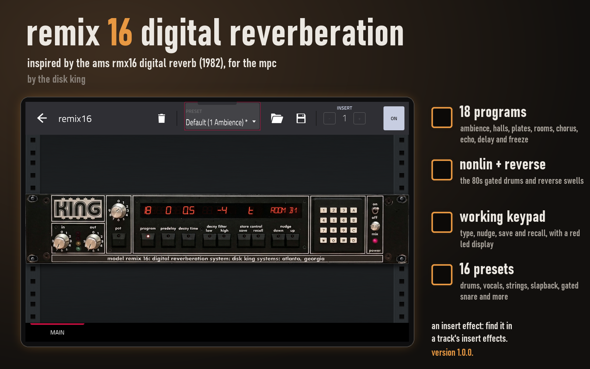
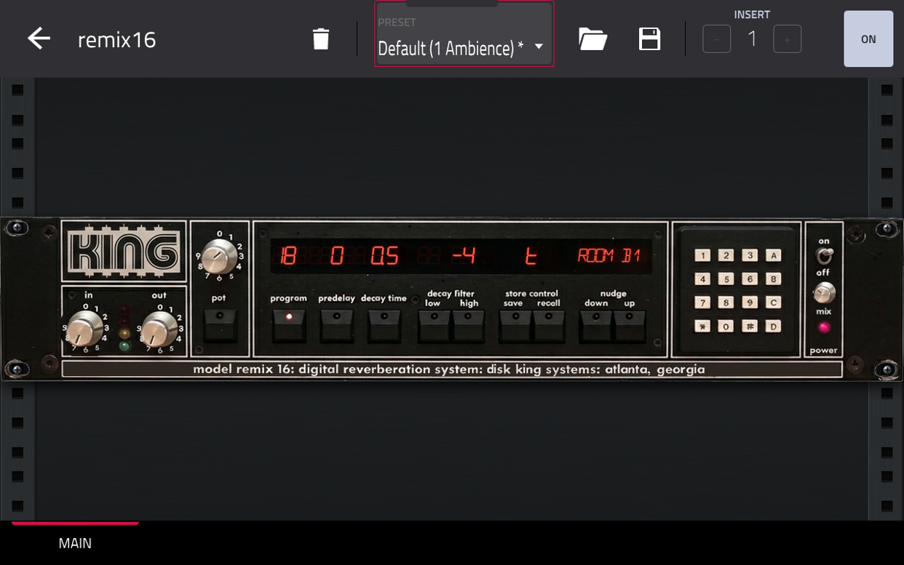
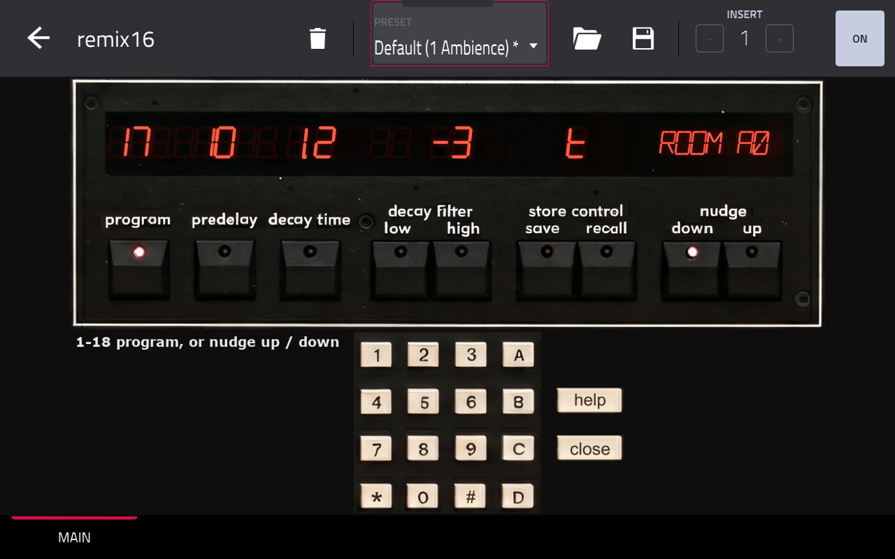
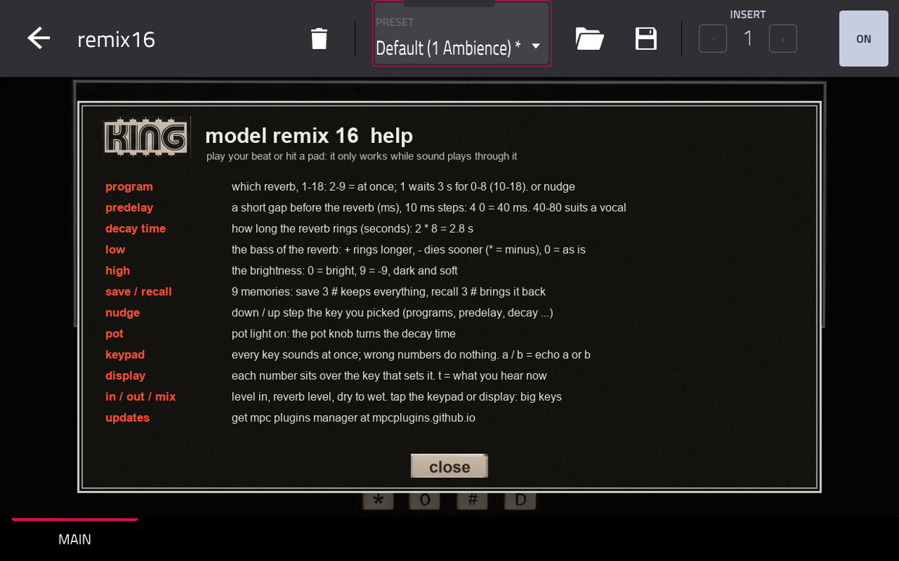

# remix16 (The Disk King)

**remix16 by The Disk King: Inspired by the AMS RMX16 digital reverb (1982).** The classic 2U studio reverb for Akai MPC
standalone hardware, with a front panel that really works: type values on the keypad, nudge them, save and recall
them, and watch the red LED display. It has:
- **18 programs:** AMBIENCE, ROOM A1, HALL C1, PLATE A1, HALL B3, CHORUS, ECHO, NONLIN 2, REVERSE 1, DELAY, FREEZE,
  HALL A1, NONLIN 1, IMAGE P1, PLATE B1, REVERSE 2, ROOM A0, ROOM B1;
- the famous **NONLIN** gated sound, **REVERSE** swells and the **AMBIENCE** freeze (decay 9.9 = it never dies);
- predelay, decay time, and the **decay filters** LOW / HIGH, which shape the reverb tail like the original;
- **9 stores** (SAVE / RECALL), kept in your MPC project;
- a **closer look:** tap the keypad or the display and they pop up big, so the keys are easy to hit; every key acts at once and wrong numbers are simply ignored;
- IN / OUT / MIX knobs, level lights, an OVERFLOW light and POWER.

**Version 1.0.0. Tested on Gen 1 (Akai MPC X SE) and Gen 2 (Akai MPC Live III), MPC OS 3.10.1. Use at your own risk.**

## This is an EFFECT: find it in Insert Effects

remix16 is an **insert effect**, not an instrument. To use it:

1. Open the **Mixer** (or a track's / pad's **Insert Effects**) and tap an empty **Insert** slot.
2. Choose **External Plugins → The Disk King → remix16**. Tap the slot's edit (pencil) icon to see the panel.
3. Play your beat or hit a pad, and set it up with the keys (below) or pick a preset from the **preset name at the top
   of the plugin window**.
4. Press **help** on the closer look (tap the keypad or the display) any time.

**Play while you set it up:** like every MPC insert effect, remix16 only runs while sound plays through it, and its
display and lights update while it runs.

## Download

**Gen 1** (32-bit): MPC Live, Live II, One, One+, X, Key 61, Key 37, Force

**Gen 2** (64-bit): MPC Live III, XL

**Get updates automatically:** a zip you download by hand never updates itself. Install **[MPC Plugins Manager](https://mpcplugins.github.io/p/mpc-plugins-manager/)** once on your MPC: it shows when a new version of remix16 is out and installs it in one tap.

**Easiest:** on your MPC, open **MPC Plugins Manager**, find **remix16** and tap **Install**.

**By hand, step by step:**
1. Click the **DOWNLOAD** button above. A file called `remix16-1.0.0-mpc-sdk.zip` lands in your **Downloads** folder.
2. Unzip it. On Windows: right-click the file, then **Extract All**. On a Mac: double-click it.
3. Connect your MPC to the computer with its USB cable and switch it to **Computer Mode**, so its **internal drive** shows up on the computer.
4. On the MPC's internal drive, open the folder **VST2 Plugins** (make it if it is not there).
5. Copy the folder **The Disk King - VST - remix16** from the unzipped files into **VST2 Plugins**.
6. On the MPC: **Preferences → Enhancements (Beta)** → turn on **Enable Enhancements** and **External Plugin Support** (needs MPC OS 3.10.1 or later). Restart the MPC.
7. Put it in an **Insert Effects** slot (see above) and play.

## Screens

| | | |
|---|---|---|
|  |  |  |

## How to use the panel (just like the original)

Press a key to choose what you change, then type it on the keypad: **every key acts at once, no # needed**, and a key
that would make a wrong number simply does nothing. Or step it with **NUDGE**.
**Tap the keypad or the display to open the closer look** (big keys, **help** and **close**).

| Do this | To |
|---|---|
| **PROGRAM**, type **8** | Program 8, NONLIN 2, at once (2 to 9 are instant; it loads that program's starting settings) |
| **PROGRAM**, type **1**, then **4** | Program 14 at once. A **1** waits 3 seconds for a second digit (0 to 8 = 10 to 18); nothing = program 1 |
| **PROGRAM**, then **NUDGE up / down** | Step through the 18 programs |
| **PREDELAY**, type **4 0** | 40 ms before the reverb starts (10 ms steps, so 1 1 waits for its 0 = 110; CHORUS: 1 ms) |
| **DECAY TIME**, type **2 \* 8** | 2.8 seconds (**\*** = the decimal point; NUDGE: 0.1 s steps) |
| **DECAY FILTER LOW**, type **\* 3** | -3: the lows die away faster (+ = longer, up to 4x; - = shorter, down to 1/4) |
| **DECAY FILTER HIGH**, type **5** | -5: the highs die away faster, from about 5 kHz up (HIGH only cuts: 0 = bright, 9 = -9, dark) |
| **SAVE**, type **3**, **#** | Store everything in store 3 (9 stores, kept in your MPC project) |
| **RECALL**, type **3**, **#** | Bring store 3 back (same program = instant switch, on the beat); an **E** = that store is empty |
| **POT** key (its light on) | The **POT** knob turns the decay time (ride it in a mix) |
| **A** / **B** | ECHO only: which echo you are setting (ECHO A left, ECHO B right) |

The display reads, left to right: **program**, **predelay** (ms), **decay** (s), **low** and **high** filters, **t**
(the settings you are playing; the store number while you save or recall), and the **program name**.

## The knobs and lights

| Control | What it does |
|---|---|
| IN (0..9) | The level going in (7 = 0 dB). Lights: **green** 18 dB below clipping, **yellow** 12, **red** 6; the top **red** = overflow, turn IN down |
| OUT (0..9) | The reverb's level (7 = 0 dB) |
| MIX | Dry (left) to wet (right). The original was 100 % wet; MIX makes it work on an insert |
| POT | The decay time, when the POT key is on |
| POWER | Off = the sound passes untouched |

## The programs

| # | Program | What it is |
|---|---|---|
| 1 | AMBIENCE | Between a hall and a plate, low colouration. Unobtrusive on dry tracks, or to top up existing reverb. **Decay 9.9 with LOW and HIGH at 0 = infinite** (build a choir one voice at a time) |
| 2 | ROOM A1 | A live room with strong colouration. Best short (1-2 s) with a lot of HIGH damping (-7, -8) |
| 3 | HALL C1 | A hall with strong early reflections: clear size, high presence. Vocals |
| 4 | PLATE A1 | A dense plate: smooths drums fast, even decay. Up to 5 s for normal use |
| 5 | HALL B3 | Like HALL C1, softer early reflections |
| 6 | CHORUS | 5 voices across the stereo field. PREDELAY = the voices' spacing (under 6 ms = flanging), DECAY = the depth |
| 7 | ECHO | Two echoes (A left up to 1.2 s, B right up to 400 ms, pick with A / B). PREDELAY = time, DECAY = feedback, filters in the repeats |
| 8 | NONLIN 2 | The sound hardly decays for the set time, then stops dead: the big gated drums. Short = a tight room |
| 9 | REVERSE 1 | Builds up, then stops. Left = smooth, right = discrete reflections |
| 10 | DELAY | A clean delay up to 1.63 s on the right (left = straight). DECAY = feedback (0 = one repeat) |
| 11 | FREEZE | DECAY **0.1** = freeze and add what comes in, **0.2** = hold it and stop adding, **0.0** = clear |
| 12 | HALL A1 | The older hall, loved on vocals |
| 13 | NONLIN 1 | Gated, with a smooth left and a discrete right (hand-clap multiplier) |
| 14 | IMAGE P1 | A gated reverb that pans across the stereo field as it goes (up to 0.6 s) |
| 15 | PLATE B1 | A second plate |
| 16 | REVERSE 2 | Reverse build-up in stereo |
| 17 | ROOM A0 | The first, brighter version of ROOM A1 |
| 18 | ROOM B1 | A small room up to 0.7 s; DECAY changes the size of the room |

## Presets

Pick one from the preset name at the top of the plugin window (every value is on the panel):
Default (1 Ambience), Ambience Vocal, Ambience Freeze Choir, Room A1 Drums, Hall C1 Vocal, Plate A1 Snare,
Plate A1 Vocal, Hall B3 Strings, Chorus Thicken, Echo Slapback, Nonlin 2 Gated Snare, Nonlin 2 Big Room,
Reverse 2 Swell, Delay Quarter 120, Image P1 Pan, Room B1 Small.

## About the RMX16

The AMS RMX16 (1982) was one of the first great digital reverbs, and its AMBIENCE and NONLIN programs are all over the
records of the 1980s. It was a mono-in, stereo-out unit, controlled from a keypad with a red LED display. remix16
follows its user manual: the programs and their limits, the keypad, nudge and store sequences, the decay filter
tables, and the 12-bit converter with gain ranging that gives it its sound.

*AMS and RMX16 are trademarks of their owner. The Disk King is not affiliated with or endorsed by them; the name is
used only to say which classic unit remix16 is inspired by. The KING logo is The Disk King's own.*

## Known limits

- Like every MPC insert effect, it only works (and its display and lights only update) while sound plays through it.
- Changing program mutes the reverb for a moment (like the original, so the old reverb does not spill out).
- AMBIENCE infinite and FREEZE can build up: a gentle limiter protects your ears, and the OVERFLOW light warns you.

## Disclaimer

Provided as is, with no warranty of any kind. Use entirely at your own risk; The Disk King is not responsible in any way
for any loss, damage or problem from using it.

More MPC sounds: https://thediskking.com
