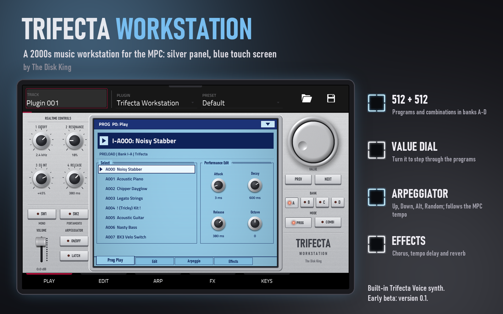
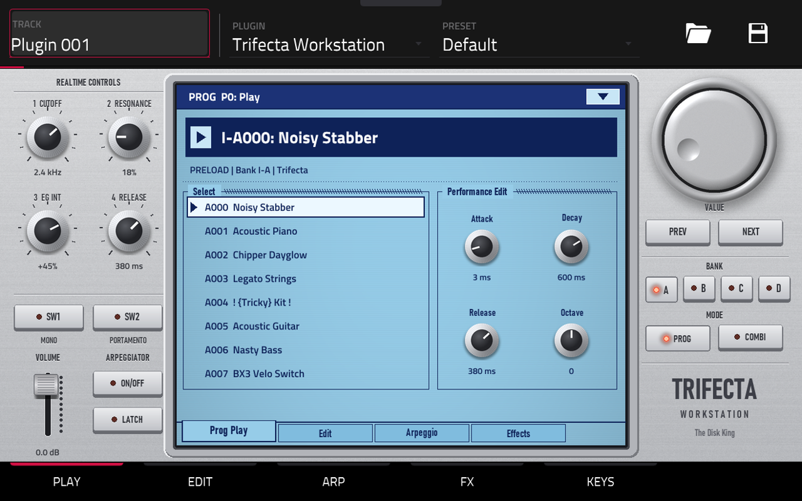
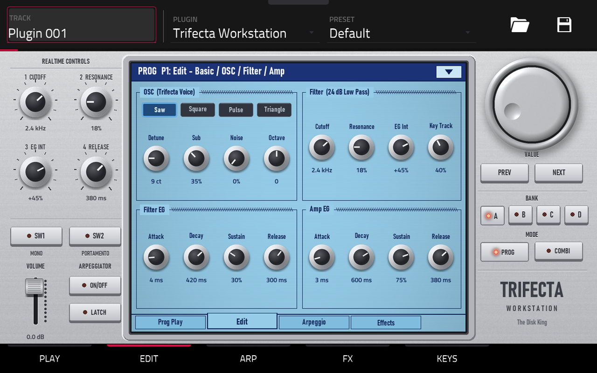
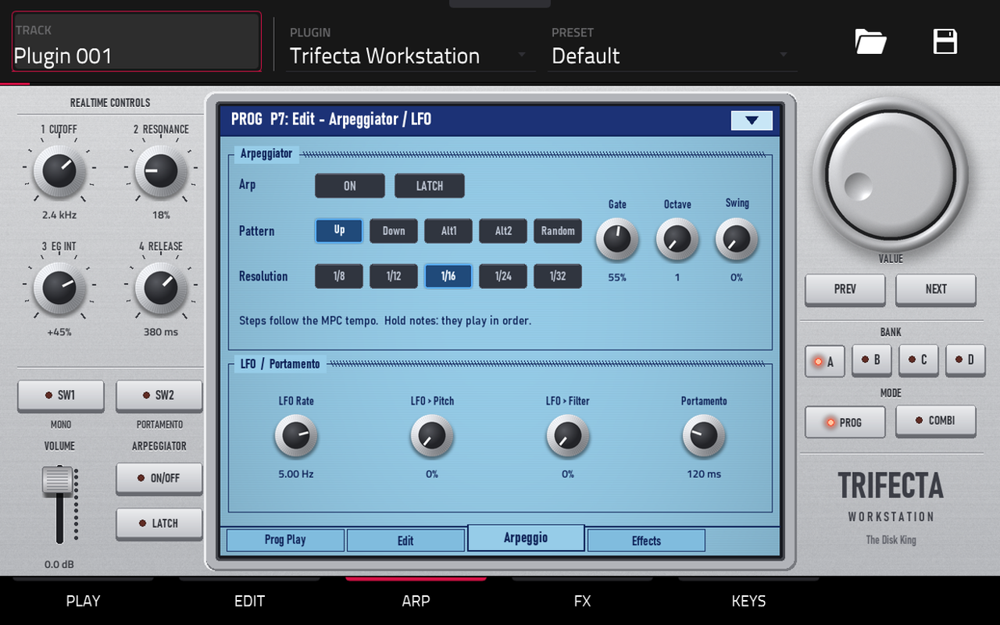
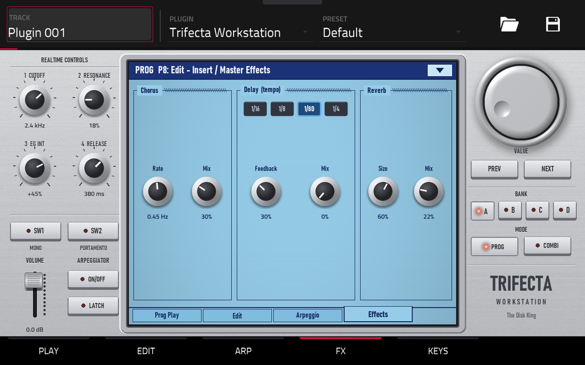
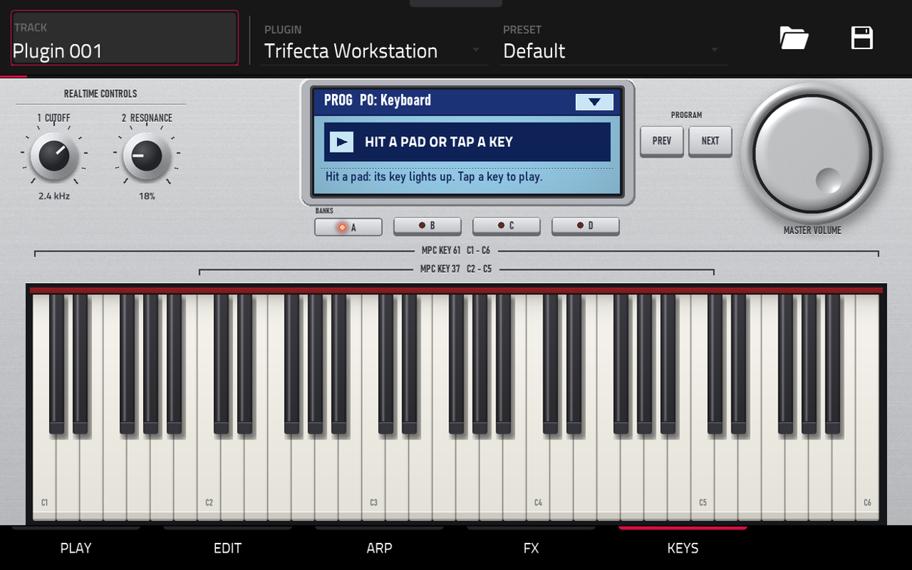

# King Triton Workstation

A 2000s-style music workstation for Akai MPC standalone hardware: a silver panel with realtime knobs, a blue
touch-screen display, a big VALUE dial, program and combination banks, an arpeggiator and effects.

**Version 0.1.1 — early beta. Tested on Gen 1 (Akai MPC X SE) and Gen 2 (Akai MPC Live III), MPC OS 3.10.1. Use at your own risk.**

## Download

**Gen 1** (32-bit): MPC Live, Live II, One, One+, X, Key 61, Key 37, Force

**Gen 2** (64-bit): MPC Live III, XL

**Get updates automatically:** a zip you download by hand never updates itself. Install **[MPC Plugins Manager](https://mpcplugins.github.io/p/mpc-plugins-manager/)** once on your MPC: it shows when a new version of Trifecta Workstation is out and installs it in one tap.

**Easiest:** on your MPC, open **MPC Plugins Manager**, find **Trifecta Workstation** and tap **Install**.

**By hand, step by step:**
1. Click the **DOWNLOAD** button above. A file called `Trifecta-Workstation-0.1.1-mpc-sdk.zip` lands in your **Downloads** folder.
2. Unzip it. On Windows: right-click the file, then **Extract All**. On a Mac: double-click it.
3. Connect your MPC to the computer with its USB cable and switch it to **Computer Mode**, so its **internal drive** shows up on the computer.
4. On the MPC's internal drive, open the folder **VST2 Plugins** (make it if it is not there).
5. Copy the folder **The Disk King - VST - Trifecta Workstation** from the unzipped files into **VST2 Plugins**.
6. On the MPC: **Preferences → Enhancements (Beta)** → turn on **Enable Enhancements** and **External Plugin Support** (needs MPC OS 3.10.1 or later). Restart the MPC.
7. Add a **Plugin track** and pick **Trifecta Workstation**.

## All screens

| | |
|---|---|
|  |  |
|  |  |
|  | |

## Sounds: bring your own

**The original Korg Triton sounds (its built-in PCM ROM and Korg's sample libraries) cannot be included** with this
plugin: they belong to Korg. Trifecta comes with The Disk King's own PRELOAD program set and a built-in synth voice;
for the real sampled sounds you load **your own** sound files.

- **In 0.1:** every program and combi plays the built-in **Trifecta Voice** (an analog-style synth made in code).
- **Next version (0.2): load your own sounds.** Put your own samples in a folder named `Trifecta Sounds` on any MPC
  drive: Korg sample files you made or own (`.KSC` / `.KMP` / `.KSF`, as saved from a Triton) or plain `.WAV` files,
  and Trifecta will play them in its programs.

Trifecta Workstation is an independent plugin by The Disk King. It is not made by, endorsed by or affiliated with Korg.
Korg and Triton are trademarks of their owner.

## What is in 0.1

- **Sound set included:** The Disk King's own PRELOAD set: 4 program banks (A-D, 512 programs) and 4 combination banks
  (512 combis), shown by name. Tap a name in the list, turn the **VALUE dial**, use **PREV / NEXT**, the **A-D bank keys**
  and **PROG / COMBI**.
- **Trifecta Voice:** a built-in analog-style synth (2 detuned oscillators + sub + noise, 24 dB low-pass filter with its own
  envelope, amp envelope, LFO). In 0.1 every program and combi plays this voice.
- **Realtime controls:** Cutoff, Resonance, EG Int, Release. **SW1** = mono, **SW2** = portamento.
- **Arpeggiator:** Up, Down, Alt 1, Alt 2, Random; 1/8 to 1/32; gate, octaves 1-4, swing, latch. Follows the MPC tempo.
- **Effects:** stereo chorus, tempo delay, reverb.
- **KEYS page:** a realistic 61-key keyboard that lights up from the pads; tap a key to play it (handy on an MPC
  without keys). The big dial is the master volume there.
- Q-Links mapped on every page.

## Not yet

- Loading your own sounds (`Trifecta Sounds` folder: KSC / KMP / KSF or WAV) - planned for 0.2.
- The programs' own oscillator, filter and envelope settings.

## Disclaimer

Provided as is, with no warranty of any kind. Use entirely at your own risk; The Disk King is not responsible in any way
for any loss, damage or problem from using it.

More MPC sounds: https://thediskking.com
