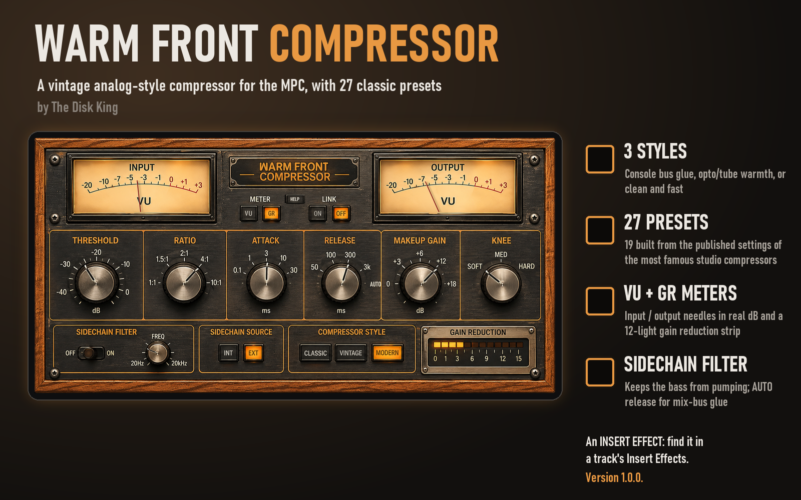
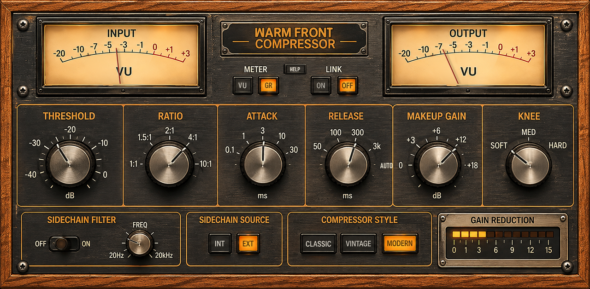
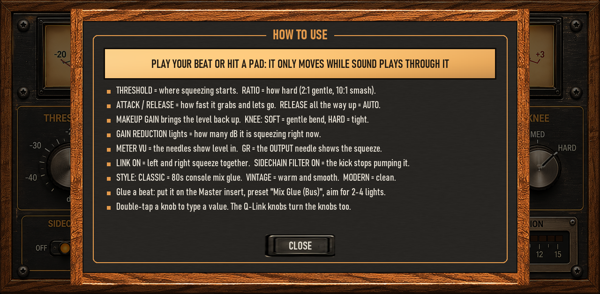

# Warm Front Compressor (The Disk King)

A vintage analog-style stereo compressor for Akai MPC standalone hardware. It has big INPUT / OUTPUT VU
meters, a 12-light GAIN REDUCTION strip, three compressor styles (CLASSIC, VINTAGE, MODERN), a sidechain
filter, and **27 presets**, including 19 built from the published settings of the most famous studio
compressors of all time.

**Version 1.0.1. Tested on Gen 1 (Akai MPC X SE) and Gen 2 (Akai MPC Live III), MPC OS 3.10.1. Use at your own risk.**

## This is an EFFECT: find it in Insert Effects

Warm Front is an **insert effect**, not an instrument. To use it:

1. Open the **Mixer** (or a track's / pad's **Insert Effects**) and tap an empty **Insert** slot.
2. Choose **External Plugins → The Disk King → Warm Front Compressor**. Tap the slot's edit (pencil) icon to see the panel.
3. Pick a preset from the **preset name at the top of the plugin window**, then play.
4. Turn **THRESHOLD** until the GAIN REDUCTION lights show the amount the preset table below suggests.

**Where you put it decides what it squeezes:** on a pad = that sample only, on a track = the whole track
(every pad together: the place for drum-bus glue), on the **Master** insert = your whole beat.

## Download

**Gen 1** (32-bit): MPC Live, Live II, One, One+, X, Key 61, Key 37, Force

**Gen 2** (64-bit): MPC Live III, XL

**Get updates automatically:** a zip you download by hand never updates itself. Install **[MPC Plugins Manager](https://mpcplugins.github.io/p/mpc-plugins-manager/)** once on your MPC: it shows when a new version of Warm Front Compressor is out and installs it in one tap.

**Easiest:** on your MPC, open **MPC Plugins Manager**, find **Warm Front Compressor** and tap **Install**.

**By hand, step by step:**
1. Click the **DOWNLOAD** button above. A file called `Warm-Front-Compressor-1.0.1-mpc-sdk.zip` lands in your **Downloads** folder.
2. Unzip it. On Windows: right-click the file, then **Extract All**. On a Mac: double-click it.
3. Connect your MPC to the computer with its USB cable and switch it to **Computer Mode**, so its **internal drive** shows up on the computer.
4. On the MPC's internal drive, open the folder **VST2 Plugins** (make it if it is not there).
5. Copy the folder **The Disk King - VST - Warm Front Compressor** from the unzipped files into **VST2 Plugins**.
6. On the MPC: **Preferences → Enhancements (Beta)** → turn on **Enable Enhancements** and **External Plugin Support** (needs MPC OS 3.10.1 or later). Restart the MPC.
7. Put it in an **Insert Effects** slot (see above) and play.

## Screens

| | |
|---|---|
|  |  |

## The controls

| Control | Range | What it does |
|---|---|---|
| THRESHOLD | -40 to 0 dB | Level where squeezing starts. Lower = more compression. |
| RATIO | 1:1 to 10:1 | How hard it squeezes above the threshold. |
| ATTACK | 0.1 to 30 ms | How fast it grabs. Slow attack lets the punch of drums through. |
| RELEASE | 50 ms to 3 s, then **AUTO** | How fast it lets go. AUTO (turn fully right) is a two-speed release: quick after short hits, slow after long loud parts, like the classic console bus compressor. |
| MAKEUP GAIN | 0 to +18 dB | Turns the level back up after compression. |
| KNEE | soft to hard | Soft = gentle, gradual start; hard = squeezes right at the threshold. |
| METER VU / GR | | VU: the needles show input and output level. GR: the OUTPUT needle shows gain reduction. |
| LINK ON / OFF | | ON: left and right compress together (keeps the stereo picture steady). OFF: each side on its own. |
| SIDECHAIN FILTER + FREQ | 20 Hz to 20 kHz | Stops low bass from making the compressor pump. 60 to 120 Hz is typical. |
| SIDECHAIN SOURCE INT / EXT | | INT only in 1.0 (EXT is planned). |
| COMPRESSOR STYLE | CLASSIC / VINTAGE / MODERN | CLASSIC: 1980s console bus VCA, punchy glue. VINTAGE: smooth, program-dependent, opto/tube-style warmth. MODERN: clean and fast, with look-ahead. |
| GAIN REDUCTION lights | 0 to 15 dB | How much it is squeezing right now. |
| HELP | | Shows a help card on the panel. |

## All 27 presets

How to read the tables:
- **Threshold is only a starting point.** It depends on how loud your sound is: turn THRESHOLD until the
  GAIN REDUCTION lights show the **Aim for** amount.
- **"Unspecified = 0/off" rule:** where the famous setting does not say anything about a control, it is left
  at zero or off (makeup 0 dB, sidechain filter off, METER on VU, SIDECHAIN SOURCE INT, LINK off on units that
  are mono). Add makeup gain to taste after you set the threshold.
- AUTO = RELEASE turned fully right.

### The classic-compressor presets (19)

Each one copies the published settings of a famous hardware compressor. The hardware names are only here so
you know what each preset is based on (see the note at the bottom).

| Preset | Based on (hardware) | Style | Thresh | Ratio | Attack | Release | Knee | Link | SC filter | Makeup | Aim for | Known for / who used it |
|---|---|---|---|---|---|---|---|---|---|---|---|---|
| Bus 2:1 30ms Auto | SSL G-Series bus compressor: the classic "slowest attack, auto release" glue | CLASSIC | -20 | 2:1 | 30 ms | AUTO | Hard | On | Off | 0 | 2–4 dB | The console mix-bus "glue" heard on countless rock, pop and hip-hop hits since the 1980s. Engineers Bob Clearmountain and Mick Guzauski are known users. |
| Bus 2:1 30ms 100ms | SSL G-Series bus compressor, Waves' starting point | CLASSIC | -20 | 2:1 | 30 ms | 100 ms | Hard | On | Off | 0 | up to 4 dB | The same mix-bus unit with a fast release, for more movement and punch. |
| Bus 4:1 1ms Auto | SSL G-Series bus compressor: Andy Wallace's mix-bus setting | CLASSIC | -20 | 4:1 | 1 ms | AUTO | Hard | On | Off | 0 | about 4 dB | Andy Wallace (mix engineer of Nirvana, Jeff Buckley, Linkin Park, Slayer) is known for this aggressive setting. |
| Drum Bus 4:1 10/300 | SSL G-Series bus compressor on a drum bus | CLASSIC | -22 | 4:1 | 10 ms | 300 ms | Hard | On | Off | 0 | 3–6 dB | The standard rock and metal drum-bus setting taught in mixing courses. |
| Drum Bus 2:1 1ms Auto | SSL G-Series bus compressor: Fab Dupont's drum setting | CLASSIC | -22 | 2:1 | 1 ms | AUTO | Hard | On | Off | 0 | 2–4 dB | Fab Dupont (producer/engineer, Puremix) shows this on drums. |
| FET Vocal 4:1 | UREI / Universal Audio 1176 FET limiter: 4:1, attack 3, release 7 (dial numbers) | MODERN | -24 | 4:1 | 0.2 ms | 50 ms | Hard | Off | Off | 0 | 3–7 dB | The classic rock and pop vocal setting. Bruce Swedien used his 1176 on Michael Jackson's vocals; Chris Lord-Alge and Michael Brauer still use them on hit mixes. |
| FET Pepper 4:1 | 1176 "Dr. Pepper" setting (attack at 10 o'clock, release at 2 o'clock) | MODERN | -24 | 4:1 | 0.25 ms | 140 ms | Hard | Off | Off | 0 | 3–7 dB | The well-known "10 and 2" all-round 1176 setting for vocals, bass and guitars. |
| FET All-Buttons Drums | 1176 "all buttons in" (British mode), slowest attack, fastest release | MODERN | -30 | 10:1 | 0.8 ms | 50 ms | Hard | Off | Off | 0 | lots: smash it | Andy Johns crushed the room mics with all buttons in on Led Zeppelin's "When the Levee Breaks". The trick is used on drum rooms everywhere. |
| Opto Leveler 3:1 | Teletronix LA-2A tube opto leveling amplifier | VINTAGE | -24 | 3:1 | 10 ms | 60 ms, then a slow tail | Soft | Off | Off | 0 | 2–3 dB, up to 5 | The smooth vocal and bass leveler. Reported on Kurt Cobain's vocals on *Nevermind* and Alanis Morissette's *Jagged Little Pill*; Joe Chiccarelli used it on Jack White's vocals (*Icky Thump*); Just Blaze uses it on hip-hop vocals. |
| Vari-Mu TC1 .2ms/.3s | Fairchild 660 / 670 tube limiter, time constant 1 | VINTAGE | -20 | 2:1 | 0.2 ms | 0.3 s | Soft | On | Off | 0 | 1–3 dB | Fairchild 660s were used on virtually every Beatles record at Abbey Road (drums and vocals). Rudy Van Gelder used Fairchild when cutting Blue Note jazz records. |
| Vari-Mu TC2 .2ms/.8s | Fairchild 660 / 670, time constant 2 | VINTAGE | -20 | 2:1 | 0.2 ms | 0.8 s | Soft | On | Off | 0 | 1–3 dB | Same unit, slower release: smoother on vocals and full mixes. |
| Vari-Mu TC3 .4ms/2s | Fairchild 660 / 670, time constant 3 | VINTAGE | -20 | 2:1 | 0.4 ms | 2 s | Soft | On | Off | 0 | 1–3 dB | Slow, gentle leveling for whole mixes and masters. |
| Vari-Mu TC5 Auto | Fairchild 660 / 670, time constant 5 (2 s / 10 s program-dependent) | VINTAGE | -20 | 2:1 | 0.4 ms | AUTO | Soft | On | Off | 0 | 1–3 dB | The program-dependent setting: quick on short peaks, slow on long ones. |
| Vari-Mu TC6 Auto | Fairchild 660 / 670, time constant 6 (0.3 s to 25 s program-dependent) | VINTAGE | -20 | 2:1 | 0.2 ms | AUTO | Soft | On | Off | 0 | 1–3 dB | The widest auto setting, the classic choice on a full mix. |
| Mastering Mu 1.5:1 | Manley Stereo Variable Mu, compress mode | VINTAGE | -16 | 1.5:1 | 30 ms | 0.6 s | Soft | On | Off | 0 | 1–2 dB | A mastering-room favourite. Pete Lyman (mastered Grammy-winning albums by Jason Isbell and Chris Stapleton) and mixer Tom Elmhirst are known users. |
| Hard Knee 4:1 Punch | dbx 160 / 160A VCA compressor (its own fixed attack and release) | CLASSIC | -20 | 4:1 | 15 ms | 80 ms | Hard | Off | Off | 0 | 4–6 dB | The punchy kick, snare and bass box. Reported on Boston's first album and early Tame Impala; Jerry Finn (Green Day, blink-182) used it on kick and snare; drummer Matt Sorum calls it his workhorse. |
| Thrust Bus 4:1 1ms | API 2500 bus compressor, default settings with THRUST | CLASSIC | -20 | 4:1 | 1 ms | 200 ms | Hard | On | On, 100 Hz | 0 | 2–4 dB | A top drum-bus and mix-bus box. Vance Powell (Jack White, The Raconteurs, The Dead Weather) calls it his favourite drum-bus compressor. |
| Diode Bus 2:1 Auto | Neve 33609 diode-bridge compressor, slow attack, AUTO 1 release | VINTAGE | -20 | 2:1 | 6 ms | AUTO | Soft | On | Off | 0 | 2–3 dB | Warm, coloured mix-bus and vocal glue. Reported on Whitney Houston's vocals on "I Wanna Dance with Somebody" and on Daft Punk's *Random Access Memories*. |
| Diode Drums 4:1 3/100 | Neve 33609, fast attack | VINTAGE | -22 | 4:1 | 3 ms | 100 ms | Soft | On | Off | 0 | 3–5 dB | The same unit pushed harder on a drum bus (also used for parallel drum compression). |

Notes:
- **1176 presets:** the 1176 attack and release dials run backwards (7 = fastest). The times above are the
  real milliseconds those dial positions give.
- **FET All-Buttons Drums:** the real all-buttons ratio is about 12–20:1, but Warm Front 1.0 stops at 10:1, so this
  is as close as 1.0 can go.
- **Opto Leveler 3:1:** the LA-2A has no ratio or time controls; 3:1 and 10 ms / 60 ms are its measured average
  behaviour, and VINTAGE style adds the slow opto release tail.
- **Hard Knee 4:1 Punch:** the dbx 160 ratio is a continuous knob; 4:1 is the common choice.
- **Thrust Bus 4:1 1ms:** the API manual gives no release; 200 ms is one of its stepped values. THRUST
  (less bass in the detector) is matched with the sidechain filter at 100 Hz.

### The Warm Front originals (8)

House presets made for the MPC, with makeup gain already set.

| Preset | In the spirit of | Style | Thresh | Ratio | Attack | Release | Knee | Link | SC filter | Makeup | Use it on |
|---|---|---|---|---|---|---|---|---|---|---|---|
| Mix Glue (Bus) | SSL G-Series mix bus (the headline preset) | CLASSIC | -20 | 2:1 | 10 ms | AUTO | Hard | On | On, 60 Hz | +2 | The whole beat (Master insert) or a drum track: 2–4 dB of glue. |
| Master Polish | SSL G-Series on a master, gentle | CLASSIC | -16 | 2:1 | 30 ms | AUTO | Hard | On | On, 60 Hz | +1 | The Master: 1–2 dB, just holds it together. |
| Drum Bus Smash | Console bus pushed hard | CLASSIC | -24 | 10:1 | 3 ms | 100 ms | Hard | On | Off | +4 | A drum track, for big squashed drums. |
| Gentle Glue | Soft-knee bus compression | CLASSIC | -18 | 1.5:1 | 30 ms | AUTO | Soft | On | On, 80 Hz | +1.5 | Full mixes, keys, pads: barely there. |
| Vocal Leveler | Opto-style vocal leveling | VINTAGE | -24 | 4:1 | 3 ms | 300 ms | Medium | On | On, 120 Hz | +4 | Vocals and samples with uneven level. |
| Punchy Kick | Fast clean compression | MODERN | -18 | 4:1 | 10 ms | 100 ms | Hard | On | Off | +3 | Kicks and snares: lets the click through, then grabs. |
| Vintage Warm | Tube / opto colour | VINTAGE | -20 | 3:1 | 10 ms | 300 ms | Soft | On | Off | +3 | Samples, bass, Rhodes: warm and round. |
| Smash | Limiter-style squash | MODERN | -32 | 10:1 | 0.1 ms | 50 ms | Hard | On | Off | +8 | Parallel drums, effects, anything you want crushed. |

## Coming in a later version

The classic units have a few things this 1.0 panel cannot copy yet. They are planned for **Warm Front
Compressor II**: faster attack (down to 0.02 ms), ratios up to 20:1 and LIMIT, release up to 10 s, a DRIVE
(saturation) knob, a MIX (parallel / New York compression) knob, and six COMPRESSOR MODEL keys (VCA BUS, FET,
OPTO, VARI-MU, DIODE, MODERN). External sidechain (EXT) is also planned.

## Where the settings come from

- [Waves: How to use an SSL bus compressor](https://www.waves.com/how-to-use-ssl-bus-compressor-classic-mix-glue)
- [Nail The Mix: SSL bus settings](https://www.nailthemix.com/?p=9125)
- [Puremix: Fab Dupont SSL bus compressor](https://www.puremix.com/blog/fab-dupont-ssl-bus-compressor)
- [Vintage King: exploring the SSL bus compressor](https://vintageking.com/blog/exploring-the-ssl-the-bus-stereo-bus-compressor/)
- [SSL 500 G Comp user guide](https://www.solidstatelogic.com/assets/uploads/downloads/SSL_500_Series_G_Comp_Module_User_Guide.pdf)
- [Sweetwater: SSL bus compressor users](https://www.sweetwater.com/insync/?p=231003)
- [UA 1176 Classic FET manual](https://help.uaudio.com/hc/en-us/articles/34530260482324-1176-Classic-FET-Compressor-Manual)
- [UA: 1176 history](https://www.uaudio.com/blog/analog-obsession-1176-history)
- [UA: 1176 & LA-2A in your mix](https://www.uaudio.com/blogs/ua/how-to-use-the-la-2a-and-1176-in-your-mix)
- [Sage Audio: SSL and 1176](https://www.sageaudio.com/articles/what-you-need-to-know-about-the-ssl-and-1176-compressors)
- [Sweetwater: all-button mode](https://www.sweetwater.com/insync/all-button-mode/)
- [MusicRadar: why everyone loves the 1176](https://www.musicradar.com/music-tech/gear-gadgets/there-are-few-producers-who-havent-employed-or-lusted-after-it-at-some-point-or-another-such-is-its-legendary-status-why-does-everyone-love-the-urei-ua-1176-compressor)
- [UA: why the LA-2A is the most famous compressor](https://www.uaudio.com/blogs/ua/why-is-the-teletronix-la-2a-the-worlds-most-famous-audio-compressor)
- [MusicRadar: producer's guide to the LA-2A](https://musicradar.com/news/producers-guide-la-2a)
- [Wikipedia: LA-2A](https://en.wikipedia.org/wiki/LA-2A_Leveling_Amplifier)
- [UA: Fairchild Tube Limiter manual](https://help.uaudio.com/hc/en-us/articles/13293388042900-Fairchild-Tube-Limiter-Collection-Manual)
- [Abbey Road: Fairchild 660 #GearThatMadeUs](https://www.abbeyroad.com/news/fairchild-660-gearthatmadeus-3188)
- [Wikipedia: Fairchild 660](https://en.wikipedia.org/wiki/Fairchild_660)
- [Sound On Sound: Fairchild 660/670](https://www.soundonsound.com/reviews/fairchild-660-670)
- [Sweetwater: Manley Variable Mu](https://www.sweetwater.com/store/detail/VariMu)
- [dbx 160A cut sheet](https://dbxpro.com/en/product_documents/dbx160acutsheeta2pdf)
- [Mixdown: Gear icons, dbx 160](https://mixdownmag.com.au/features/gear-icons-dbx-160)
- [Equipboard: dbx 160](https://equipboard.com/items/dbx-160?src=feed)
- [UA: API 2500 manual](https://help.uaudio.com/hc/en-us/articles/4419505673620-API-2500-Bus-Compressor-Manual)
- [UA: API 2500 (Vance Powell quote)](https://www.uaudio.com/uad-plugins/compressors-limiters/api-2500-bus-compressor.html)
- [Attack Magazine: API 2500](https://www.attackmagazine.com/technique/hardware-focus/api-2500-stereo-bus-compressor/)
- [AMS Neve 33609 manual](https://www.ams-neve.com/wp-content/uploads/2022/01/33609N1.0usermanual.pdf)
- [Vintage King: Neve 33609/N shootout](https://vintageking.com/blog/neve-33609n-shootout/)

"Who used it" credits come from the sources above (interviews, manufacturer pages and gear histories). Where a
credit is only "reported", the original session notes were not found.

## Trademarks

SSL, G-Series, UREI, Universal Audio, 1176, Teletronix, LA-2A, Fairchild, Manley, Variable Mu, dbx, API, Neve and
all other product names are trademarks of their owners. They are used here only to describe which published
settings a preset is based on. Warm Front Compressor is an original plugin; it is not an emulation of, and is not
affiliated with or endorsed by, any of these companies. Artist and engineer names are given only as history of the
hardware, not as endorsements of this plugin.

## What is new in 1.0.1

- **Presets move the panel:** pick a preset and the knobs, switches and buttons on the panel go to its settings.
- **Starts on Default:** a new "Default" preset (nothing set) is first, and the plugin loads on it until you pick a preset.
- **DISKKING on the meters:** the meter faces now carry The Disk King's DISKKING brand, in the Diskking 670 meter's lettering. INPUT and OUTPUT stay as they were.
- Everything else as in 1.0.0. Your projects still open.

## Older versions

- [1.0.0](https://github.com/mpcplugins/community-plugins/releases/tag/warm-front-compressor-v1.0.0): first release.

## Known limits

- SIDECHAIN SOURCE **EXT** acts like INT in 1.0 (MPC plugins have no sidechain input; a key-send method is planned).
- The plugin only runs while sound plays through it (that is how the MPC runs insert effects), so with no sound
  the needles and lights stand still.

## Disclaimer

Provided as is, with no warranty of any kind. Use entirely at your own risk; The Disk King is not responsible in any way
for any loss, damage or problem from using it.

More MPC sounds: https://thediskking.com
